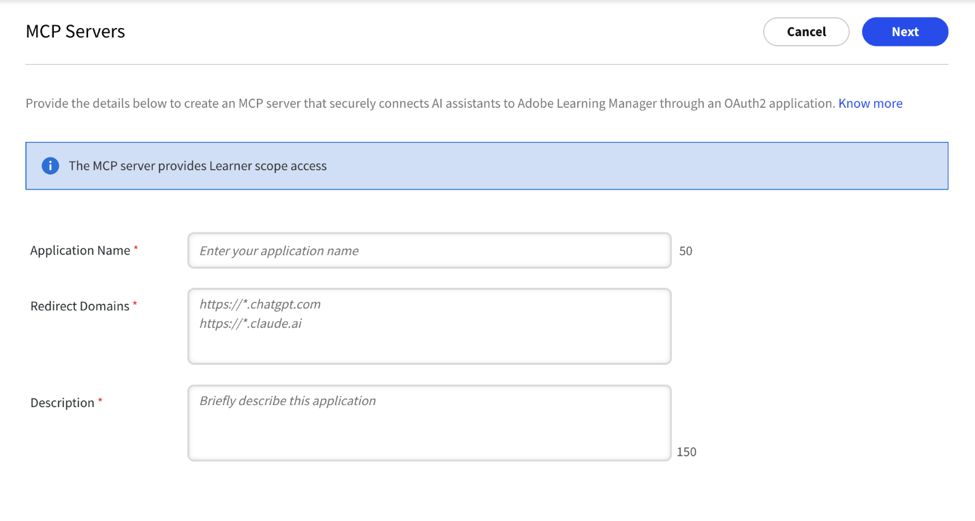

# Konfigurieren eines Model Context Protocol-Servers

## Übersicht

Jeder MCP-Server registriert eine OAuth 2.0-Clientanwendung, die AI-Clients autorisiert, im Namen Ihrer Teilnehmer zu handeln. Als Administrator erstellen Sie den Server und kopieren seine Anmeldeinformationen, die Sie dann dem AI-Client-Administrator übergeben, der die Verbindung abschließt. Sie können einen Server jederzeit erneut aufrufen, um ihn zu bearbeiten, seine Toolbeschreibungen zu verfeinern, seine Anmeldeinformationen zu kopieren oder ihn zu löschen.

>[!NOTE]
>
>Der Server bietet schreibgeschützten Zugriff auf Benutzer mit der Teilnehmerrolle.

## Erstellen des MCP-Servers

1. Melden Sie sich bei Adobe Learning Manager als Administrator an.
2. Navigieren Sie zu **AI in Learning** > **MCP Servers**.
3. Wählen Sie **Neuer MCP-Server** aus.
4. Geben Sie die Serverdetails einschließlich einer Beschreibung ein.

   * **Servername:** Geben Sie einen Namen mit bis zu 50 Zeichen ein.
   * **Beschreibung:** Geben Sie eine kurze Beschreibung mit bis zu 150 Zeichen ein.
   * **URL:** Geben Sie die URL Ihres Unternehmens oder Ihrer Anwendung ein.
   * **Domänen umleiten:** Geben Sie die Domäne jedes AI-Clients ein, der eine Verbindung herstellen wird, z. B. [http://\*.chatgpt.com](https://encoded-592c9deb-987b-4562-aa3c-9fa3d37d83e9.uri/http%3a%2f%2f*.chatgpt.com) oder [http://\*.claude.ai](https://encoded-592c9deb-987b-4562-aa3c-9fa3d37d83e9.uri/http%3a%2f%2f*.claude.ai). Dieses Feld ist erforderlich.

   

5. Wählen Sie **Weiter**.
6. Überprüfen Sie auf der Seite **Verfügbare Tools** die vom Server gelegt Teilnehmertools. Bereitstellen detaillierter, kontextbezogener und zweckorientierter Beschreibungen für MCP-ToolsGeben Sie detaillierte, kontextbezogene Beschreibungen für jedes Tool an. Eine präzise Beschreibung hilft MCP-kompatiblen Clients dabei, das entsprechende Tool auszuwählen und aufzurufen. Geben Sie den Zweck des Tools, unterstützte Aufgaben, erwartete Eingaben und typische Anwendungsfälle an.

   

   Wählen Sie **Ansicht** für jedes Tool aus, um die Anweisungen anzuzeigen, um zu bestimmen, wann das Tool ausgewählt ist und wie das Tool reagiert.

   

7. Wählen Sie im linken Navigationsbereich **Client-Anmeldeinformationen** aus.
8. Kopieren Sie die **MCP-Endpunkt-URL**, **Client-ID** und den **geheimen Schlüssel**. Wählen Sie **Kopieren** neben jedem Wert.

   

9. Wählen Sie **Schließen**.

>[!NOTE]
>
>Der Server bietet schreibgeschützten Zugriff auf Benutzer mit der Teilnehmerrolle.

Geben Sie die Endpunkt-URL, die Client-ID und den geheimen Schlüssel an Ihren AI-Client-Administrator weiter.

## Bearbeiten einer Werkzeugbeschreibung

Eine Toolbeschreibung weist den AI-Client an, wann das Tool ausgewählt werden soll und wie das Tool reagiert. Sie können auch Beispielaufforderungen hinzufügen. Gut geschriebene Toolbeschreibungen helfen MCP-kompatiblen Clients dabei, die entsprechenden Tools genauer zu erkennen und aufzurufen. Hierzu zählen der Zweck des Tools, unterstützte Aufgaben, erwartete Eingaben und typische Anwendungsfälle.

1. Wählen Sie auf der Seite **Verfügbare Tools** das Menü **Aktionen** für ein Tool aus.
2. Wählen Sie **MCP-Tool-Konfiguration** \> **Bearbeiten** aus.

   

3. Aktualisieren Sie im Dialogfeld **Edit tool** **Instructions/Description**.

   

4. Bearbeiten Sie unter **Beispielaufforderungen** die Aufforderungen. Um eine Eingabeaufforderung hinzuzufügen, wählen Sie **Ein weiteres Beispiel hinzufügen**.
5. Wählen Sie **Speichern**.

Um ein Tool auf seinen ursprünglichen Wortlaut zurückzusetzen, wählen Sie das Menü **Aktionen** für das Tool aus und wählen dann **MCP-Tool-Konfiguration** \> **Zurücksetzen**.

## MCP-Server bearbeiten

1. Wählen Sie **AI in Learning** > **MCP-Server** aus.
2. Wählen Sie den Servernamen aus.
3. Wählen Sie **Bearbeiten**.
4. Aktualisieren Sie die Felder auf der Seite **Anwendungsdetails** und speichern Sie dann Ihre Änderungen.

## MCP-Server löschen

1. Wählen Sie **AI in Learning** > **MCP-Server** aus.
2. Wählen Sie in der Zeile für den Server das Menü **Aktionen** aus.
3. Wählen Sie **Löschen** aus.
4. Wählen Sie im Bestätigungsdialogfeld **Löschen** aus.

>[!WARNING]
>
>Durch das Löschen eines Servers wird der Zugriff auf alle zugehörigen Tools für verbundene KI-Anwendungen entfernt. Aktive Sitzungen funktionieren möglicherweise nicht mehr sofort und Sie können den Löschvorgang nicht mehr rückgängig machen.

## Fehlerbehebung

**Werkzeugänderungen werden nicht sofort angezeigt.**
Änderungen an Werkzeugbeschreibungen werden erst nach einer Weile wirksam. Warten Sie und versuchen Sie es erneut.

**Ein AI-Client funktioniert nicht mehr, nachdem ein Server gelöscht wurde.**
Erstellen Sie einen neuen Server und geben Sie die neuen Anmeldeinformationen an Ihren AI-Client-Administrator weiter.

**Der AI-Client verwendet das falsche Tool.**
Prüfen Sie alle von Ihnen geänderten Werkzeugbeschreibungen. Wählen Sie **Zurücksetzen**, um den ursprünglichen Wortlaut wiederherzustellen.

## Best Practices

* Behalten Sie die ursprünglichen Toolbeschreibungen bei, es sei denn, Sie haben einen bestimmten Grund, sie zu ändern.
* Schreiben Sie spezifische, eindeutige Werkzeugbeschreibungen und Beispielaufforderungen, wenn Sie sie bearbeiten.
* Speichern Sie den geheimen Schlüssel sicher und geben Sie ihn nur an Ihren AI-Client-Administrator weiter.
* Erstellen Sie für jede AI-Anwendung einen separaten Server, damit Sie einen widerrufen können, ohne die anderen zu beeinträchtigen.
* Vergewissern Sie sich, dass keine AI-Anwendung von einem Server abhängig ist, bevor Sie ihn löschen.
