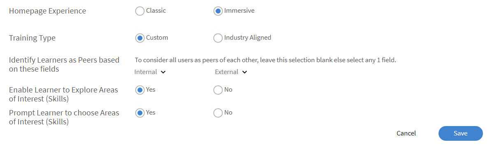
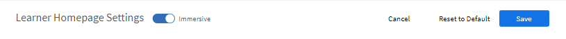
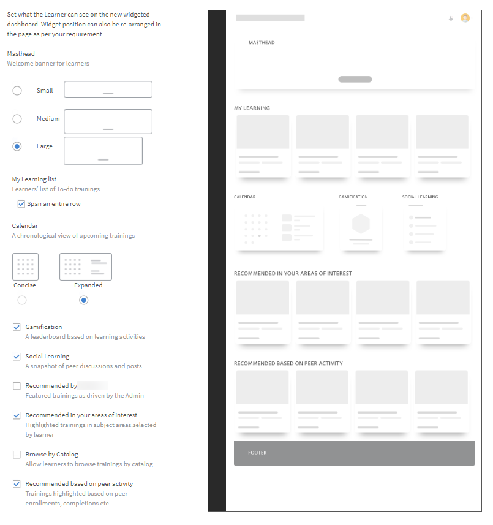
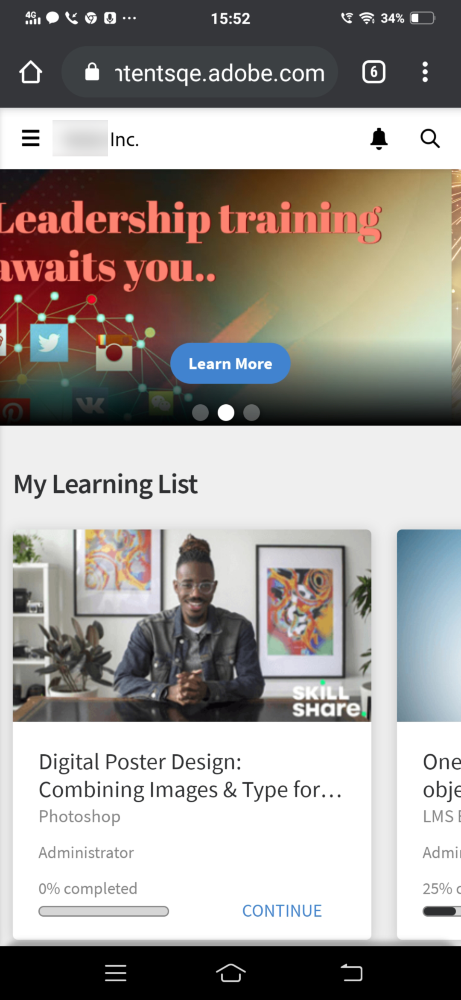
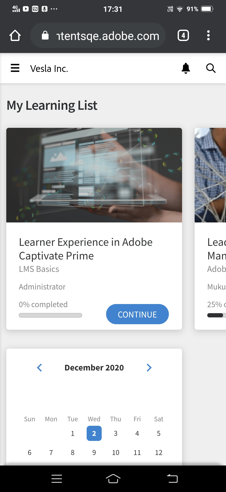
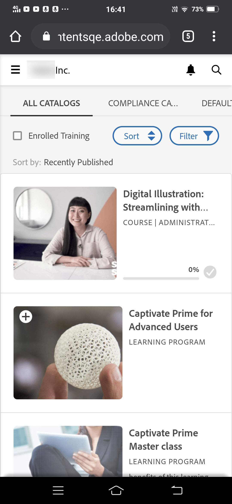
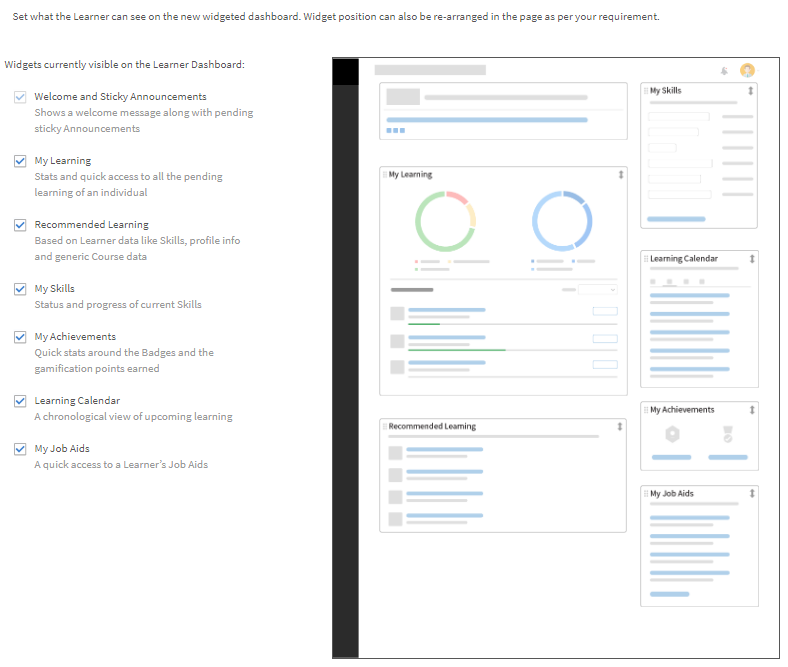

# Anpassen der Teilnehmer-Startseite

## Übersicht {#overview}

Ein Administrator kann die Startseite des Teilnehmers anpassen und sie moderner, inhaltsorientierter und für einen Teilnehmer personalisiert gestalten.

Der personalisierte Ansatz bietet eine Widget-basierte Möglichkeit, eine Teilnehmer-Startseite zu erstellen, die der Administrator des Unternehmens in der Admin-Benutzeroberfläche WYSIWYG konfigurieren kann.

Die Erfahrung basiert auf personalisierten Schulungsempfehlungen eines AI-basierten Algorithmus, der Inhalte von Drittanbietern für Branchenkenntnisse analysiert, Peer-Aktivitäten einbezieht und Interessensbereiche von Teilnehmern mithilfe expliziter und impliziter Daten berücksichtigt.

### Anpassen der Teilnehmer-Startseite

In dieser Schulung lernen Sie, wie Sie die Teilnehmerseite anpassen können.

Wenn Sie die Schulung nicht starten können, schreiben Sie an <almacademy@adobe.com>.

## Konfigurieren der Startseite des Teilnehmers {#configurethelearnerhomepage}

Auf der Seite **Branding** > **Teilnehmerseite** kann ein Administrator das Startseitenerlebnis eines Teilnehmers anpassen, sodass der Teilnehmer bei der Anmeldung bei der Teilnehmer-App ein völlig neues Erscheinungsbild erlebt.

Administratoren können die Benutzeroberfläche (Erscheinungsbild) in der Admin-App festlegen (**Branding** > **Registerkarte Teilnehmer-Startseite**).

Administratoren können zur Ansicht „Widget für immersive Benutzeroberfläche“ wechseln, Widgets/Funktionen entsprechend anpassen und dann die immersive Benutzeroberfläche aktivieren.

Der Bildschirm **Teilnehmerseite** enthält folgende Abschnitte:

## Option für immersives Layout {#immersivelayoutoption}

Um das Layout einer immersiven Seite anzuzeigen, aktivieren Sie die Option **Immersiv**. Sie können diese Option unter **Branding > Allgemein** umschalten.

In früheren Versionen wurden die Optionen für die Teilnehmer-Startseite in den Einstellungen angezeigt.

Diese Optionen können Sie festlegen:

**Startseitenerlebnis:** Aktivieren Sie entweder **Classic** oder **Immersive**. Wenn Sie „Immersiv“ wählen, werden folgende Optionen angezeigt:

* **Schulungstyp:** Wählen Sie entweder **Industrie** oder **Benutzerdefiniert ausgerichtet**. Benutzerdefinierte Schulungen werden intern erstellt. Branchenspezifische Schulungen beinhalten Standardinhalte von Drittanbietern.

*Legen Sie das Erlebnis auf der Startseite fest, indem Sie &quot;Branchenspezifisch&quot; oder &quot;Benutzerdefiniert&quot; auswählen*

Die Option **Teilnehmern das Erkunden von Interessensbereichen ermöglichen** ist sowohl für die klassische als auch immersive Benutzeroberfläche verfügbar.

<table>
 <tbody>
  <tr>
   <td>
    
<b>Wenn Sie „Benutzerdefiniert“ auswählen...</b>
</td>
   <td>
    
<b>Wenn Sie Branchenspezifisch auswählen...</b> 
</td>
  </tr>
  <tr>
   <td>
    
Sie können maximal ein internes und ein externes aktives Feld auswählen.
</td>
   <td>
    
Sie können höchstens fünf Felder und müssen mindestens ein Feld auswählen. Standardmäßig ist die Option <b>Profil </b>ausgewählt.
</td>
  </tr>
 </tbody>
</table>

Bei weniger als 1.000 Teilnehmern wird das gesamte Konto als ein einziger Bereich betrachtet. Dies gilt speziell für den benutzerdefinierten Schulungstyp. Wenn das Konto weniger als 1000 Benutzer hat, wird das gesamte Konto als sein Bereich betrachtet.

>[!NOTE]
>
>Das Kontrollkästchen **Neue Fähigkeiten erschließen** wurde zu &quot;Einstellungen&quot; > &quot;Allgemein&quot; verschoben.

Diese Option wird aktiviert und abgeblendet, wenn die immersive Benutzeroberfläche ausgewählt wird. Dieses Kontrollkästchen wird nur für die klassische Benutzeroberfläche aktiviert.

*Einstellungen für die Teilnehmer-Startseite*

Das immersive Layout ist die Standardeinstellung für alle neuen Konten. Das Layout wird von Widgets gesteuert, die ein Administrator aktivieren oder deaktivieren kann. Die Positionierung der Widgets wird auf der Teilnehmer-Startseite widergespiegelt.

Hier sind die Widgets, die Sie aktivieren/deaktivieren können.

Damit können Sie eine Vorschau der Teilnehmer-Benutzeroberfläche anzeigen, bevor die Teilnehmer-Benutzeroberfläche live geschaltet wird.

Für vorhandene Konten ist die Option **Immersiv** **AUS**. Es wird für ein neues Konto mit aktivierter Sozial- und Gamification-Funktion aktiviert.

*Teilnehmer-UI in der Vorschau anzeigen*

<table>
 <tbody>
  <tr>
   <td>
    
<b>Widget</b>
</td>
   <td>
    
<b>Beschreibung</b>
</td>
  </tr>
  <tr>
   <td>
    
Mastertitel
</td>
   <td>
    
<b>Was ist ein Mastertitel und wie kann ich den Mastertitel für Teilnehmer anpassen? </b> 

    
Es ist ein Willkommensbanner für Teilnehmer. Das Banner kann ein Bild oder Video sein. Sie können den Mastertitel auf bestimmte Benutzergruppen ausrichten, und ein Teilnehmer sieht den Mastertitel, sobald er auf die Startseite gelangt. Eine Benutzergruppe kann mehrere Hero Images oder Videos dem vom Administrator festgelegten Zielplan entsprechend anzeigen. 

    
So lädt ein Administrator ein Banner hoch:

    <ol>
     <li>Klicken Sie im linken Bereich auf <b>Ankündigungen</b>. </li>
     <li>Klicken Sie in der rechten oberen Ecke der Seite auf <b>Hinzufügen</b>.</li>
     <li>Wählen Sie in der Dropdownliste <b>Typ </b>die Option <b>Als Mastertitel</b>.</li>
     <li>Schreiben Sie eine Nachricht, die im Mastertitel angezeigt wird.</li>
     <li>Laden Sie ein Bild oder Video hoch.</li>
     <li>Wählen Sie die Zielgruppe. Wählen Sie eine Benutzergruppe oder Schulung aus, in der der Mastertitel angezeigt werden soll.</li>
     <li>Speichern Sie die Ankündigung für den Mastertitel.</li>
    </ol></td>
  </tr>
  <tr>
   <td>
    
Eigenes Lernen
</td>
   <td>
    
Zeigt die Lernobjekte an, die kürzlich vom Teilnehmer besucht wurden. 
</td>
  </tr>
  <tr>
   <td>
    
Kalender
</td>
   <td>
    
Zeigt den Teilnehmern verschiedene bevorstehende Schulungen im Schulungsraum und virtuellen Schulungsraum nach Monaten sortiert an. Es werden die Schulungen angezeigt, bei denen sich der Teilnehmer anmelden kann oder bereits angemeldet hat, einschließlich von Managern genehmigter Schulungen. 
</td>
  </tr>
  <tr>
   <td>
    
Registrierungen mit Frist
</td>
   <td>
    
Zeigt Anmeldungen an, die überfällig sind, anstehende Fristen haben oder planmäßig verlaufen. 
</td>
  </tr>
  <tr>
   <td>
    
Gamification
</td>
   <td>
    
Zeigt das Leaderboard auf Lernaktivitäten basierend an.
</td>
  </tr>
  <tr>
   <td>
    
Soziales Lernen
</td>
   <td>
    
Listet Aktivitäten und Beiträge von Benutzern auf, die sich als Teilnehmer im gleichen Benutzerbereich befinden. 
</td>
  </tr>
  <tr>
   <td>
    
Empfohlen von der Organisation
</td>
   <td>
    
Wenn diese Option aktiviert ist, empfiehlt dieses Widget Schulungen für bestimmte Benutzergruppen. Jede Benutzergruppe kann auf eine oder mehrere Schulungen ausgerichtet werden, und der Zielplan würde auf einem zeitlichen Rahmen basieren.  

    <ul>
     <li>
      
Erstens erstellt der Administrator <a href="announcements.md#recommendation">eine Ankündigung</a> des Typs <b>Als Empfehlung</b>, wählt dann die erforderliche Schulung aus und verwendet Gruppen. Einem Teilnehmer, der zu einer Benutzergruppe gehört, wird die empfohlene Schulung angezeigt.
</li>
     <li>
      
Zweitens kann der Administrator auch entscheiden, ob die Empfehlungen sofort oder zu einem bestimmten Zeitpunkt eintreffen.
</li>
    </ul></td>
  </tr>
  <!--
  <tr>
   <td>
    
Recommendation based on area of interest
</td>
   <td>
    
Displays Learning Objects based on the learner's chosen area of interest. The recommendation is driven by a Machine Learning algorithm.
</td>
  </tr>
  -->
  <tr>
   <td>
    
Nach Katalog durchsuchen 
</td>
   <td>
    
Zeigt Kataloge als Kacheln auf der Startseite an. 
</td>
  </tr>
  <!--
  <tr>
   <td>
    
Recommendation based on peer activity 
</td>
   <td>
    
Displays training based on what a learner's peers are taking. This is again driven by a Machine Learning algorithm.
</td>
  </tr>
  -->
 </tbody>
</table>

Nachdem Sie die Änderungen gespeichert haben, spiegelt die Teilnehmer-Startseite alle Änderungen wider.

Wenn sich der Teilnehmer über einen Browser bei der Teilnehmer-App anmeldet, kann er das folgende immersive Layout sehen:

<table>
 <tbody>
  <tr>
   <td>
    
<strong>Startseite</strong>
</td>
   <td>
    
<strong>Meine Lernliste</strong>
</td>
   <td>
    
<strong>Katalog anzeigen</strong>
</td>
  </tr>
 </tbody>
</table>

*Immersives Layout für verschiedene Abschnitte auf der Startseite anzeigen*

## Option „Klassisches Layout“ {#classiclayoutoption}

Das bisher immer vorhandene Layout der Benutzeroberfläche wird jetzt als klassisches Layout bezeichnet. Wenn Sie diese Option auswählen, wird die Teilnehmer-Startseitenansicht auf das klassische Layout zurückgesetzt.

*Vorschau des klassischen Layouts anzeigen*

## Konfigurieren der Empfehlungseinstellungen {#configurerecommendationsettings}

Auf **Branding** > **Allgemein** können Sie Empfehlungsbereiche für interne und externe Teilnehmer konfigurieren und den Teilnehmern die Auswahl von Kenntnissen auf der Teilnehmer-Startseite ermöglichen.

Auf der Seite **Allgemein** stehen Ihnen die folgenden Optionen zur Verfügung:

<table>
 <tbody>
  <tr>
   <td>
    
Unternehmensname
</td>
   <td>
    
Der Name des Unternehmens, zu dem der Teilnehmer gehört.
</td>
  </tr>
  <tr>
   <td>
    
Unterdomäne
</td>
   <td>
    
Die Unterdomäne des Unternehmens.
</td>
  </tr>
  <tr>
   <td>
    
Logo-Gestaltung
</td>
   <td>
    
So werden Ihr Logo und Ihr Firmenname auf Learning Manager angezeigt. 
</td>
  </tr>
  <tr>
   <td>
    
Designs
</td>
   <td>
    
Das auf Learning Manager angewendete Design.
</td>
  </tr>
  <tr>
   <td>
    
Anpassen
</td>
   <td>
    
Mit Adobe Learning Manager können Sie Ihr Konto anpassen, um Ihren Benutzern ein besseres Lernerlebnis zu bieten. 
</td>
  </tr>
  <tr>
   <td>
    
Startseite für Teilnehmer
</td>
   <td>
    
Wählen Sie entweder <b>Klassisch </b>oder <b>Immersiv</b>. Wenn Sie „Immersiv“ wählen, werden andere Optionen angezeigt.
</td>
  </tr>
  <tr>
   <td>
    
Schulungstyp 
</td>
   <td>
    
Wählen Sie entweder <b>Benutzerdefiniert </b>oder <b>Branchenspezifisch</b>. Bei weniger als 1.000 Teilnehmern wird das gesamte Konto als ein einziger Bereich betrachtet. Die Empfehlung basiert auf allen Teilnehmern. 
</td>
  </tr>
  <tr>
   <td>
    
Einstellung des Empfehlungsumfangs 
</td>
   <td>
    
Wählen Sie mindestens ein aktives Feld aus. Für <b>Benutzerdefiniert</b> können Sie maximal ein aktives Feld auswählen. Für <b>Branchenspezifisch</b> können Sie maximal fünf aktive Felder auswählen. 
</td>
  </tr>
  <tr>
   <td>
    
Teilnehmern das Erkunden von Interessensbereichen ermöglichen
</td>
   <td>
    
Nur für klassisches Benutzeroberfläche. Wählen Sie <b>Ja </b>oder <b>Nein</b> aus. 
</td>
  </tr>
  <tr>
   <td>
    
Benutzer auffordern, Interessensbereiche (Kenntnisse) auszuwählen  
</td>
   <td>
    
Nur für immersive Benutzeroberfläche. Wählen Sie <b>Ja</b> oder <b>Nein</b> aus.  
</td>
  </tr>
 </tbody>
</table>

>[!NOTE]
>
>Für das neue Konto sind die Einstellungen Teilnehmer-Startseite, Schulungstyp und Empfehlungsumfang nicht sichtbar.

## Hinzufügen und Neuanordnen von Homepagestreifen in Adobe Learning Manager {#add-reorder-homepage-strips}

Fügen Sie der Teilnehmer-Startseite personalisierte Lernpfade und virtuelle Coach-Streifen hinzu und ziehen Sie Streifen per Drag &amp; Drop, um die Reihenfolge festzulegen, in der die Teilnehmer sehen.

Als Administrator können Sie der Teilnehmer-Startseite in Adobe Learning Manager personalisierte Lernpfade (PLP) und virtuelle Coach-Streifen hinzufügen. Sie können auch jeden Homepage-Streifen mit Drag-and-Drop-Steuerelementen in **Admin-Branding** neu anordnen. Sie können jetzt entscheiden, welche Streifen die Teilnehmer zuerst sehen.

Sie können auch ein Widget für einen personalisierten Lernpfad zu einer benutzerdefinierten Seite hinzufügen.

### Allgemeines zu Homepagestreifen

Startseitenstreifen sind die Widgets (Karten), die auf der Teilnehmer-Startseite angezeigt werden. Beim Admin-Branding legen Sie fest, welche Streifen angezeigt werden und in welcher Reihenfolge sie angezeigt werden. In der ALM-Version vom Dezember 2026 sind zwei KI-gestützte Streifen verfügbar:

* **Personalisierter Lernpfadstreifen:** Hebt KI-generierte Lernpfade für jeden Teilnehmer hervor.
* **Virtueller Coach-Streifen:** Hilft Teilnehmern, Coaching-Erlebnisse über die Startseite zu finden und zu öffnen.

### Personalisierter Lernpfadstreifen

Die Teilnehmer können den Streifen für Folgendes verwenden:

* Nutzen Sie KI-generierte Lernpfade.
* Setzen Sie zuvor generierte Lernpfade fort.
* Entdecken Sie empfohlene Customer Journeys.

### Virtueller Coachstreifen

Die Teilnehmer können den Streifen für Folgendes verwenden:

* Virtuelles Coach.
* Coaching-Aktivitäten fortsetzen.
* Starten Sie das KI-Coaching aus der Homepage heraus.

### Homepage-Streifen neu anordnen

Sie können jeden Streifen an einer beliebigen Position platzieren. Sie können beispielsweise zuerst den virtuellen Coachstreifen anzeigen, dann die personalisierten Lernpfade, **Empfohlen** und **Katalog** und anschließend **Zuletzt angesehen**.

1. Wählen Sie in der Administrator-App im linken Navigationsbereich **Branding**.
2. Wählen Sie **Teilnehmerseite** aus.
3. Suchen Sie in der Liste der Streifen den Streifen, den Sie verschieben möchten.
4. Ziehen Sie den Streifen an die neue Position.

   

5. Speichern Sie Ihre Änderungen.

Nach der Veröffentlichung wird die neue Reihenfolge auf der Teilnehmer-Startseite angezeigt.

>[!NOTE]
>
>Wenn der personalisierte Lernpfad oder der virtuelle Trainerstreifen nicht in der Liste enthalten ist, stellen Sie sicher, dass er der Homepage-Konfiguration hinzugefügt wurde, bevor Sie ihn neu anordnen.

## Hinzufügen eines Widgets für einen personalisierten Lernpfad zu einer benutzerdefinierten Seite

Sie können das Widget &quot;Personalisierter Lernpfad&quot; außerhalb der Startseite verwenden. Fügen Sie sie einer benutzerdefinierten Seite hinzu, um den Teilnehmern einen Ort zu bieten, an dem sie nach personalisierten Lernempfehlungen suchen können.

1. Wählen Sie **Benutzerdefinierte Seiten** aus.
2. Erstellen Sie eine Seite oder bearbeiten Sie eine vorhandene Seite.
3. Fügen Sie ein **Widget für einen personalisierten Lernpfad** hinzu.

   

   Überprüfen Sie das Widget.

   

4. **Fortfahren** auswählen.
5. Fügen Sie den Widget-Titel und die Beschreibung hinzu.

   

6. Wählen Sie **Widget hinzufügen**.
7. Speichern Sie die Seite.
8. Publish zu öffnen.
