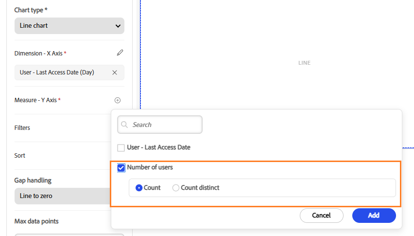
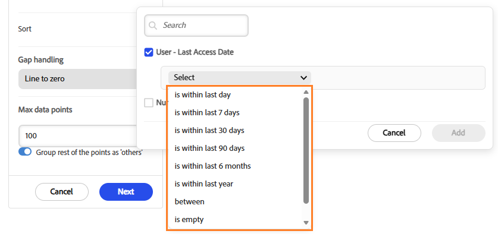
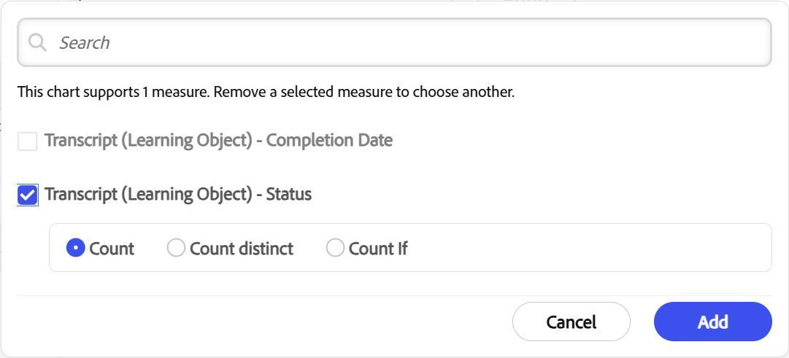

# Visualisierungen im Report Builder

Visualisierungen in Adobe Learning Manager Report Builder verwandeln einen gespeicherten Bericht in Diagramme und Dashboards. Ihr könnt Gruppen vergleichen, Trends ermitteln und Ergebnisse teilen, ohne die Daten in einem Tabellenkalkulations-Tool neu gestalten zu müssen.

>[!IMPORTANT]
>
>Visualisierungen (Diagramme und Dashboards) in der Report Builder stehen nur Adobe Learning Manager Ultimate-Kunden zur Verfügung. Sie sind nicht in der Prime-Edition verfügbar.

## Visualisierungen in Report Builder {#about-visualizations}

Eine Visualisierung ist ein Diagramm oder ein Dashboard aus Diagrammen, das auf der Grundlage eines Berichts erstellt wird, den Sie im Report Builder gespeichert haben. Sie wählen, welche Berichtsspalten gezeichnet werden sollen, und Report Builder zeichnet das Diagramm aus den Berichtsdaten. Sie können Spalten direkt zeichnen oder zusammengefasste Daten aus einem Bericht zeichnen.

* **Diagramme für einen Bericht erstellen:** Öffnen Sie den Bericht, wählen Sie **Visualisierung** aus, und erstellen Sie Diagramme. Siehe [Erstellen eines Diagramms aus einem Bericht](#create-chart-from-report).
* **Gruppendiagramme in einem Dashboard:** Wählen Sie Berichte als Datenquelle aus und fügen Sie dann Diagramme aus ihnen hinzu. Siehe [Dashboard erstellen](#build-dashboard).
* **Freigeben und Anzeigen:** Geben Sie ein Dashboard für Administratoren frei, die es im schreibgeschützten Modus anzeigen und filtern.

Diagramme funktionieren in zwei Modi:

* **Konfigurationsmodus:** Sie erstellen oder bearbeiten das Diagramm.
* **Ansichtsmodus:** Sie filtern, was das Diagramm anzeigt, ohne zu ändern, wie es erstellt wird.

## Diagrammtypen und wann sie verwendet werden {#chart-types}

Wählen Sie den Diagrammtyp anhand der Frage aus, die Sie beantworten möchten.

| Diagrammtyp | Damit kannst du | Beispiel |
|---|---|---|
| Zeile | Zeigt, wie sich ein Wert im Zeitverlauf ändert. | Registrierungen nach Erstellungsmonat |
| Leiste oder Spalte | Vergleichen Sie Werte über Kategorien hinweg. Es sind gruppierte, gestapelte und zu 100 % gestapelte Layouts verfügbar. | Teilnehmer nach Registrierungsstatus |
| Kreis | Zeigen Sie die Freigabe jeder Kategorie für ein Ganzes an. Segmente unter 1 % werden in ein **anderes**-Segment gruppiert. | Registrierungen nach Katalog |
| Große Zahl | Eine Schlüsselmetrik markieren. | Gesamtabschlüsse in diesem Quartal |
| Tabelle | Zeigen Sie exakte Werte an. Sie können eine Teilmenge der Spalten auswählen und eine Datumsspalte als Zeilen statt Spalten anzeigen (Spalten-zu-Zeilen-Ansicht). | Aufgewandte Lernzeit pro Benutzer und Monat |

>[!NOTE]
>
>Liniendiagramme, die anhand von Trendberichten erstellt wurden, z. B. Registrierungen nach Monaten, zeigen den aktuellen Snapshot Ihrer Daten gruppiert nach Datum an. Sie zeigen nicht, wie die Daten jedes vergangene Datum betrachtet haben. Weitere Informationen finden Sie unter Report Builder und Terminologie.

## Visualisierungsbegriffe {#visualization-terms}

| Begriff | Bedeutung |
|---|---|
| Bericht | Eine gespeicherte Spaltenkonfiguration mit Report Buildern, Filtern und Gruppierungen. Diagramme basieren auf Berichten. |
| Filter auf Diagrammebene | Ein Filter, den Sie beim Erstellen oder Bearbeiten eines Diagramms festlegen. Es begrenzt die Daten der Diagrammdiagramme. |
| Seitenebenenfilter | Ein Filter, den ein Viewer auf alle Diagramme auf einer Seite oder in einem Dashboard anwendet. Sie kann die Filter des Berichts einschränken, aber nicht erweitern. |
| Report Builder-Dashboard | Eine Diagrammseite, die Sie in Report Builder erstellen. |

## Diagramm aus einem Bericht erstellen {#create-chart-from-report}

Erstellen Sie ein Diagramm aus einem gespeicherten Bericht, um die Daten zu Registrierung, Abschluss oder Zeitaufwand auf einen Blick zu sehen. Sie konfigurieren das Diagramm einmal und es wird bei jedem Öffnen aus Ihren Berichtsdaten erstellt.

### Bevor Sie ein Diagramm erstellen {#before-you-create-chart}

Bestätigen Sie Folgendes:

* **Bericht speichern.** Die Option zum Hinzufügen eines Report Builders wird auf der Diagrammseite angezeigt, nachdem Sie den Bericht gespeichert haben.
* **Verwenden Sie Ihren eigenen Bericht.** Duplizieren Sie einen freigegebenen Bericht, um eine eigene Kopie zu erstellen, und verwenden Sie ihn dann zum Erstellen von Diagrammen.
* **Überprüfen Sie die Größe.** Ein Bericht mit mehr als 10 Millionen Zeilen kann nicht gezeichnet werden. Ein zusammenfassender Bericht mit mehr als 10.000 Datenpunkten ist nicht gezeichnet. Siehe Diagramm- und Dashboard-Einschränkungen.
* **Optimieren Sie die Daten für die Visualisierung.** Wenden Sie geeignete Filter auf Bericht- oder Diagrammebene an, um die aufgezeichneten Daten zu begrenzen. Die zum Laden eines Diagramms erforderliche Zeit hängt von Faktoren wie dem Volumen der Berichtsdaten, dem ausgewählten Datumsbereich und der Kombination der im Bericht verwendeten Datensätze und Tabellen ab. Berichte, die große Datenmengen oder komplexe Dataset-Kombinationen verarbeiten, können länger geladen werden oder überlastet sein. Schränken Sie in diesem Fall die Filter oder den Datumsbereich ein und versuchen Sie es erneut.
* **Kenne deine Spalten.** Die X-Achse (Dimension) und die Y-Achse (Maß) des Diagramms stammen aus den Berichtsspalten. Um den Bericht selbst zusammenzufassen, verwenden Sie **Gruppe nach** und aggregieren Sie. Weitere Informationen finden Sie unter Anwenden von Gruppen nach und Aggregationen.

### Diagramm konfigurieren {#configure-chart}

1. Melden Sie sich bei Adobe Learning Manager als Administrator an.
1. Wählen Sie **Berichte** und anschließend **Report Builder** aus.
1. Wählen Sie die Registerkarte **Berichte** aus, und öffnen Sie dann einen gespeicherten Bericht. Wählen Sie zum Beispiel einen Trend-Bericht für die Benutzeranmeldung aus, der die Anzahl der Benutzer anzeigt, die sich an jedem Datum bei der Lernplattform angemeldet haben.
1. Wählen Sie in der linken Navigation **Visualisierung** aus. Ein Bereich mit den Registerkarten **Setup** und **Style** wird geöffnet.

   

   >[!NOTE]
   >
   >Nachdem ein Diagramm vorhanden ist, wählen Sie **Bearbeiten** und anschließend **+** aus, um ein weiteres Diagramm hinzuzufügen.

1. Wählen Sie in **Diagrammtyp** einen Typ aus, z. B. **Liniendiagramm**. Dieses Feld ist erforderlich.
1. Wählen Sie neben **Dimension - X Achse** das Symbol zum Hinzufügen aus, und wählen Sie dann die Berichtsspalte aus. Wählen Sie für eine Datumsspalte auch eine **Datumgranularität**, z. B. Tag oder Monat.

   {width="650"}

1. Wählen Sie **Hinzufügen** aus, um die Datumsdimension hinzuzufügen.
1. Wählen Sie neben **Measure - Y Achse** das Symbol zum Hinzufügen aus, und wählen Sie dann die Berichtsspalte aus, und wie Sie sie aggregieren, z. B. **Anzahl**.

   {width="650"}

1. Wählen Sie **Hinzufügen** aus, um die Kennzahl hinzuzufügen.
1. (Optional) Wählen Sie **Filter hinzufügen** aus, um die gezeichneten Daten auf einen Bereich zu beschränken, z. B. auf die letzten 30 Tage. Wählen Sie **Hinzufügen** aus.

   {width="650"}

1. (Optional) Fügen Sie eine **Sortieren**-Spalte hinzu, und wählen Sie dann **Aufsteigend** oder **Absteigend** aus. Wählen Sie **Hinzufügen** aus.

   {width="650"}

1. (Optional) Legen Sie für ein Liniendiagramm die **Lückenbehandlung** für fehlende Daten fest. Siehe [Lückenbehandlung für fehlende Daten](#gap-handling).
1. Geben Sie in **Max. Datenpunkte** die Anzahl der Datenpunkte ein, die im Diagramm gezeichnet werden sollen. Der Standardwert ist 100 Punkt und der Grenzwert ist 10.000 Punkt.
1. Aktivieren Sie **Restliche Punkte als &#39;Andere&#39; gruppieren**. Der Report Builder zeigt einzelne Datenpunkte bis zum Wert **Max. Datenpunkte** an und fasst alle über diesen Grenzwert hinausgehenden Datenpunkte in einer zusätzlichen Kategorie mit dem Namen **Andere** zusammen.

   Wenn beispielsweise **Max. Datenpunkte** 150 ist und Ihre Abfrage 200 Punkte zurückgibt:

   * Report Builder zeigt 150 Punkte einzeln an.
   * Der Report Builder fasst die verbleibenden 50 Punkte in **Andere** zusammen.
   * Das Diagramm zeigt 151 Punkte: 150 plus **Andere**.

1. Wählen Sie **Weiter**. Sie können jetzt Ihr Diagramm anpassen.

   {width="650"}

#### Lückenbehandlung für fehlende Daten {#gap-handling}

Die Lückenbehandlung definiert, was das Diagramm macht, wenn eine oder mehrere Beobachtungen in einer Serie keinen numerischen Wert haben, z. B. NULL, NA, NaN oder eine leere Zelle.

Angenommen, die Daten sind:

| X | Wert |
|---|---|
| Jan | 10 |
| Februar | 15 |
| März | N/A |
| Apr | N/A |
| Mai | 25 |

Die folgende Tabelle zeigt die drei Verhaltensweisen.

| Umgang mit Lücken | Konzeptuelles Ergebnis | Darstellung |
|---|---|---|
| Linie bis Null | `10 -> 15 -> 0 -> 0 -> 25` | Behandelt fehlende Werte als 0. |
| Überspringen | `10 -> 15   25` | Zeichnet die fehlenden Punkte nicht auf und bricht die Linie. |
| Verbinden | `10 -> 15 ----> 25` | Zeichnet die fehlenden Punkte nicht auf, sondern verbindet die gültigen Beobachtungen auf beiden Seiten. |

>[!NOTE]
>
>Verbinden ist keine Interpolation. Wenn März und April fehlen, wird durch die direkte Verbindung von Februar mit Mai nur eine visuelle Linie zwischen den beiden bekannten Werten gezogen. Es werden keine tatsächlichen Werte für März und April erstellt.

### Diagramm anpassen. {#customize-chart}

Das Diagramm übersichtlich und leicht lesbar gestalten. Auf der Registerkarte **Stil** können Sie einen Titel hinzufügen, Titel und Legenden der Achse ein- bzw. ausblenden, die Legende positionieren und ausrichten sowie eine Farbe für jede Serie festlegen. Formatänderungen wirken sich nur auf das Aussehen des Diagramms aus. Sie verändern nicht die Daten, die es zeichnet.

1. Um einen Titel über dem Diagramm anzuzeigen, wählen Sie **Titel für Diagramm anzeigen**. Um sie auszublenden, deaktivieren Sie die Option.
1. Geben Sie in **Diagrammtitel** einen Titel für das Diagramm ein.
1. Wählen Sie **Titel für X-Achse anzeigen** und **Titel für Y-Achse anzeigen** aus, um die Achsen zu beschriften.
1. Um einen Schlüssel anzuzeigen, der jede Zeile identifiziert, wählen Sie **Legenden anzeigen**.
1. Wählen Sie in **Legendenposition** das linke, mittlere oder rechte Symbol aus, um die Legende auszurichten.
1. Wählen Sie unter **Linienfarbe** das Farbfeld neben einer Reihe aus, z. B. **Anzahl der Benutzer**.
1. Wählen Sie im Farbwähler eine Farbe aus der Palette oder definieren Sie eine eigene Farbe auf der Registerkarte &quot;Benutzerdefiniert&quot;.
1. Wiederhole die letzten beiden Schritte für jede Linie, die neu eingefärbt werden soll.
1. Wählen Sie **Erstellen** aus, um das Diagramm hinzuzufügen. Wenn Sie ein vorhandenes Diagramm bearbeiten, wählen Sie **Speichern**.

   {width="650"}

Das Diagramm wird mit Ihren Titeln, der Legende und den Linienfarben angezeigt.

>[!TIP]
>
>* Wähle Farben, die sich gut miteinander und mit dem Hintergrund abheben. Wenn du die Titel und die Legende aktiviert hältst, werden nicht nur die Linien durch Farbe voneinander abgegrenzt.
>* Die Optionen **Legendenposition**, **Legendenausrichtung** und **Linienfarbe** gelten nur, wenn **Legenden anzeigen** aktiviert ist.
>* Jede Linie im Diagramm hat ein eigenes Farbfeld, eine pro Kennzahl, die Sie auf der Registerkarte **Einrichtung** hinzugefügt haben.

Informationen zum Anordnen von Diagrammen auf einer einzelnen Seite finden Sie unter [Dashboard erstellen](#build-dashboard).

## Kreisdiagramm erstellen {#create-pie-chart}

Mit einem Kreisdiagramm können Sie zeigen, wie sich ein Ganzes in Teile aufteilt, z. B. den Anteil der Mitarbeiter, die die Pflichtschulung abgeschlossen haben, oder die Mischung aus Kursformaten. Jedes Slice zeigt den Anteil einer Kategorie an der Gesamtsumme an.

### Kreisdiagramme {#about-pie-charts}

Ein Kreisdiagramm zeichnet ein Segment pro Kategorie. Die Slice-Größe zeigt den Anteil dieser Kategorie an der Gesamtgröße an. Jedes Slice wird durch eine Legende identifiziert und der entsprechende Wert wird angezeigt.

Mit einem Tortendiagramm kannst du Teile eines Ganzen in mehreren Kategorien darstellen, wenn Betrachter Proportionen benötigen, die über den exakten Wert hinausgehen. Um viele Kategorien zu vergleichen, verwenden Sie ein Balkendiagramm. Um Änderungen im Zeitverlauf anzuzeigen, verwenden Sie ein Liniendiagramm.

### Schritte zum Erstellen eines Kreisdiagramms {#pie-chart-steps}

Bevor Sie beginnen, speichern Sie einen Bericht, dessen Eigentümer Sie sind. Geben Sie eine Spalte für die Kategorien und eine Spalte für die Messung an.

1. Wählen Sie **Berichte** und anschließend **Report Builder** aus. Öffnen Sie auf der Registerkarte **Berichte** den gespeicherten Bericht.
1. Wählen Sie in der linken Navigation **Visualisierung** aus.
1. Wählen Sie in **Diagrammtyp** **Kreisdiagramm** aus.
1. Wählen Sie neben **Dimension - Segment** das Symbol zum Hinzufügen aus, und wählen Sie dann die Spalte aus, die die Slices definiert. Wählen Sie beispielsweise **Transkript (Lernobjekt) - Status** aus.
1. Wählen Sie neben **Measure - Value** das Symbol zum Hinzufügen aus, und wählen Sie dann die Spalte aus, und aggregieren Sie die Größe der Slices, z. B. **Count**.
1. (Optional) Geben Sie in **Max. Datenpunkte** die maximale Anzahl der zu zeichnenden Slices ein. Der Standardwert ist 100.
1. (Optional) Um untergeordnete Kategorien zusammenzufassen, aktivieren Sie **Rest der Punkte als &quot;andere&quot; gruppieren**.
1. Wählen Sie **Weiter**, um das Kreisdiagramm anzupassen.

### Kreisdiagramm anpassen {#customize-pie-chart}

1. Um einen Titel anzuzeigen, aktivieren Sie **Titel für Diagramm anzeigen**. Deaktivieren Sie sie, um den Titel auszublenden.
1. Geben Sie in **Diagrammtitel** einen Titel ein, z. B. `Mandatory Compliance Completion`.
1. Wählen Sie in **Diagrammstil** **Kreis** für einen durchgehenden Kreis oder **Kreis** für einen Ring aus.
1. Wählen Sie **Legenden anzeigen**, um die Legende im Diagramm anzuzeigen.
1. Wählen Sie in **Legendenposition** aus, wo die Legende angezeigt werden soll.
1. Wählen Sie in **Legendenausrichtung** links, zentriert oder rechts aus.
1. Wählen Sie **Erstellen** für ein neues Diagramm aus. Wenn Sie ein vorhandenes Diagramm bearbeiten, wählen Sie **Speichern** und anschließend **Speichern** auf der Seite **Visualisierung** aus.

   {width="650"}

Report Builder erstellt das Kreis- oder Donut-Diagramm.

## Erstellen eines Balkendiagramms {#create-bar-chart}

Mithilfe eines Balkendiagramms können Sie eine Kennzahl kategorienübergreifend vergleichen, z. B. den Schulungsstatus nach Team oder die Lernzeit nach Kunde. Balken lassen sich leicht vergleichen und ordnen. Du kannst sie gruppieren oder in Stapeln einordnen, um eine zweite Aufschlüsselung hinzuzufügen.

### Balkendiagramme {#about-bar-charts}

Ein Balkendiagramm zeichnet einen Balken für jede Kategorie auf der X-Achse. Die Länge der Leiste zeigt das Maß für die Y-Achse an, z. B. die Anzahl der Teilnehmer. Sie können Balken vertikal (Spalten) oder horizontal zeichnen.

Verwenden Sie ein Balkendiagramm für Folgendes:

* Vergleichen Sie die Werte über verschiedene Kategorien hinweg, z. B. Teams, Partner oder Kunden.
* Rangkategorien vom höchsten zum niedrigsten Wert.
* Zeigt eine zweite Aufschlüsselung innerhalb jeder Leiste an, z. B. den Status innerhalb jedes Partners.

### Bevor Sie ein Balkendiagramm erstellen {#before-you-create-bar-chart}

* Speichern Sie den Bericht und verwenden Sie einen Bericht, dessen Eigentümer Sie sind.
* Geben Sie eine Spalte für die Kategorien und eine Spalte für die Messung an.
* Halten Sie den Bericht innerhalb der Beschränkungen in Diagramm und Dashboard.

### Schritte zum Erstellen eines Balkendiagramms {#bar-chart-steps}

1. Wählen Sie **Berichte** und anschließend **Report Builder** aus. Öffnen Sie auf der Registerkarte **Berichte** den gespeicherten Bericht.
1. Wählen Sie in der linken Navigation **Visualisierung** aus.
1. Wählen Sie in **Diagrammtyp** **Balkendiagramm** aus.
1. Wählen Sie neben **Dimension - X Achse** das Symbol &quot;Hinzufügen&quot; aus und wählen Sie dann die Spalte aus, in der die Kategorien definiert sind. Wählen Sie **Fertig**.

   {width="650"}

1. Wählen Sie neben **Measure - Y Achse** das Symbol zum Hinzufügen aus, und wählen Sie dann die Spalte aus, und legen Sie fest, wie diese aggregiert werden soll, z. B. **Anzahl**. Wählen Sie **Fertig**.

   {width="650"}

1. (Optional) Fügen Sie **Filter** hinzu, um die Daten einzuschränken, und legen Sie **Sortieren** fest, um die Balken nach einer Spalte zu sortieren.
1. Geben Sie in **Max. Datenpunkte** die maximale Anzahl der zu zeichnenden Datenpunkte ein. Wenn Sie 150 eingeben, zeigt der Report Builder bis zu 150 individuelle Datenpunkte an und fasst alle darüber hinausgehenden Werte in einer zusätzlichen Kategorie zusammen, die **Andere** genannt wird.
1. Wählen Sie **Weiter**, um das Balkendiagramm anzupassen.

### Anpassen des Balkendiagramms {#customize-bar-chart}

Verwenden Sie die Registerkarte **Stil**, um Titel, Ausrichtung, Gruppierung, Legende und Farben festzulegen. Formateinstellungen ändern das Aussehen des Diagramms, nicht die Daten, die gezeichnet werden.

1. Wählen Sie die Registerkarte **Stil** aus.
1. Um einen Titel anzuzeigen, aktivieren Sie **Titel für Diagramm anzeigen**. Geben Sie in **Diagrammtitel** einen Titel ein, z. B. `Most Popular Courses`.
1. Um die Achsen zu beschriften, aktivieren Sie **Titel für X-Achse anzeigen** und **Titel für Y-Achse anzeigen**. Deaktivieren Sie eine Option, um den Titel auszublenden.
1. Wählen Sie in **Diagrammstil** **Vertikal** für Spalten oder **Horizontal** für seitliche Leisten aus. Horizontale Balken lassen mehr Platz für lange Kategorienamen.
1. Wählen Sie in der **Balkengruppierung** eines der drei Symbole aus, um festzulegen, wie mehrere Serien eine Kategorie gemeinsam nutzen: gruppiert, gestapelt oder zu 100 % gestapelt.
1. Aktivieren Sie **Legenden anzeigen**, um jede Serie zu identifizieren.
1. Wählen Sie in **Legendenposition** aus, wo die Legende angezeigt werden soll. Wählen Sie in **Legendenausrichtung** links, zentriert oder rechts aus.
1. Wählen Sie unter **Balkenfarbe** das Farbfeld neben einer Serie aus, und wählen Sie dann eine Farbe aus.
1. Wählen Sie **Erstellen** für ein neues Diagramm aus. Wenn Sie ein vorhandenes Diagramm bearbeiten, wählen Sie **Speichern**.

>[!NOTE]
>
>**Die Balkengruppierung** ist nur relevant, wenn eine Leiste mehr als eine Serie aufweist, z. B. zwei Kennzahlen. Lege die Legende fest, und zeige Datenbeschriftungen an. Farbe ist also nicht die einzige Möglichkeit, Serien voneinander zu unterscheiden.

## Eine große Zahl erstellen. {#create-big-number}

Verwenden Sie eine große Zahl, um eine Schlüsselmetrik als eine große, leicht lesbare Zahl anzuzeigen, z. B. die Gesamtzahl der Teilnehmer, überfällige Registrierungen oder aktive Benutzer. Oben auf einem Dashboard, auf dem die Betrachter die wichtigsten Zahlen zuerst überprüfen, sehen sich große Zahlen gut an.

### Große Zahlen {#about-big-numbers}

Eine große Zahl ist eine Kachel mit zwei Teilen: einen Wert und eine Beschriftung. Der Wert ist eine einzelne Zahl, die aus Ihrem Bericht berechnet wird, z. B. eine Anzahl oder eine Summe. Das Etikett verrät den Betrachtern, was die Zahl bedeutet. Eine große Zahl hat keine Achsen, Legenden oder Kategorien.

Verwenden Sie eine große Zahl für Folgendes:

* Zeigt eine Überschrift, die regelmäßig überprüft wird.
* Geben Sie einem Dashboard vor den detaillierten Diagrammen darunter einen Kontext.

### Schritte zum Erstellen einer großen Zahl {#big-number-steps}

Bevor Sie beginnen, speichern Sie einen Bericht, dessen Eigentümer Sie sind. Entscheiden Sie, welche Nummer Sie möchten und welche Spalte und welches Aggregat sie erzeugen.

Beispielsweise berichten Schulungsadministratoren jeden Monat darüber, wie viel Schulung das Unternehmen absolviert hat. Führungskräfte wünschen sich eine Überschrift, keine Liste von Registrierungen, und Administratoren möchten sie aktualisieren, ohne den Bericht neu zu erstellen.

1. Wählen Sie **Berichte** und anschließend **Report Builder** aus. Öffnen Sie auf der Registerkarte **Berichte** den gespeicherten Bericht.
1. Wählen Sie in der linken Navigation **Visualisierung** aus.
1. Wählen Sie in **Diagrammtyp** **Große Zahl** aus.
1. Wählen Sie in **Measure - Value** die Option **Transkript (Lernobjekt) - Status** aus, und wenden Sie dann das Aggregat **Anzahl** an. Wählen Sie **Fertig**.

   {width="650"}

1. Wählen Sie die Anzahl der Ziffern, die nach dem Dezimaltrennzeichen angezeigt werden sollen. Sie können höchstens zwei Ziffern auswählen.
1. Wählen Sie in **Anzeigeeinheit** aus, wie große Zahlen gekürzt werden sollen. Wählen Sie **K** für Tausende, **M** für Millionen, **B** für Milliarden oder **Keine**, um den vollen Wert anzuzeigen. **Auto** wählt die entsprechende Einheit automatisch aus. Wählen Sie **Weiter**.

   {width="650"}

### Anpassen der großen Zahl {#customize-big-number}

Verwenden Sie die Registerkarte **Stil**, um die Legendeneigenschaften der großen Zahl anzupassen.

1. Geben Sie in **Legendentitel** den Text ein, der die Nummer benennt. Geben Sie beispielsweise `Total Course Completions` ein.
1. Wählen Sie in **Legendenposition** eines der beiden Symbole aus, um festzulegen, wo der Titel angezeigt wird.
1. Wählen Sie in **Legendenausrichtung** links, zentriert oder rechts aus.
1. Wählen Sie **Erstellen** für ein neues Diagramm aus. Wenn Sie ein vorhandenes Diagramm bearbeiten, wählen Sie **Speichern**.

   {width="650"}

## Erstellen von Tabellen oder Pivot-Diagrammen {#create-table-pivot-chart}

Verwenden Sie eine Pivot-Tabelle, um eine Zahl in zwei Kategorien zusammenzufassen, z. B. wie viele Teilnehmer im Team jedes Managers die erforderliche Schulung abgeschlossen, gestartet oder nicht gestartet haben. Sie können auch zu einer Pivot-Ansicht wechseln, in der Daten oder Kategorien über den oberen Rand der Tabelle laufen, sodass jeder Teilnehmer oder Kurs in eine Zeile passt.

### Tabellen- und Pivot-Diagramme {#about-table-pivot}

Eine Pivot-Tabelle ist ein Raster mit einer Kategorie an der Seite nach unten, einer Kategorie an der Oberseite und einer Zahl in jeder Zelle. Jede Zelle zeigt das Maß für einen Zeilenwert und einen Spaltenwert an. Sie erstellen es mit drei Einstellungen auf der Registerkarte **Setup**.

| Einstellung | Zweck | Im Beispiel |
|---|---|---|
| **Dimension - Spalten** | Die Werte dieses Felds werden zu den Spaltenüberschriften am oberen Rand. | **Transkript (Lernobjekt) - Status**: Abgeschlossen, Bearbeitung läuft, nicht gestartet |
| **Dimension - Zeilen** | Die Werte dieses Felds werden zu den Zeilenbeschriftungen auf der linken Seite, eine Zeile für jeden Wert. | **Benutzer - Managername** |
| **Maß - Wert** | Die Zahl in jeder Zelle. Sie wählen eine Spalte und ein Aggregat aus, z. B. **Anzahl**. Es wird als Spaltenname gefolgt von **Aggregiert von: Anzahl**. | Anzahl der Teilnehmer |

Eine Dimension ist ein Feld, nach dem Sie gruppieren. Eine Kennzahl ist eine Zahl, die Sie berechnen.

### Vor dem Erstellen eines Tabellendiagramms {#before-you-create-table-chart}

* Um die Spalten-in-Zeilen-Ansicht zu verwenden, gruppieren Sie den Bericht nach der gewünschten Spalte als Überschriften, z. B. nach einem Datum.
* Wenn Sie nach mehr als einer Datumsspalte gruppieren, wählen Sie eine für die Überschriften aus.

### Schritte zum Erstellen eines Tabellendiagramms {#table-chart-steps}

1. Wählen Sie **Berichte** und anschließend **Report Builder** aus. Öffnen Sie auf der Registerkarte **Berichte** den gespeicherten Bericht.
1. Wählen Sie in der linken Navigation **Visualisierung** aus.
1. Wählen Sie in **Diagrammtyp** **Tabelle / Pivot** aus.
1. Wählen Sie neben **Dimension - Zeilen** das Symbol zum Hinzufügen aus, und wählen Sie dann **Benutzer - Managername** aus.
1. Wählen Sie neben **Dimension - Spalten** das Symbol zum Hinzufügen aus und wählen Sie dann **Transkript (Lernobjekt) - Status** aus.
1. Wählen Sie neben **Messen - Wert** das Symbol &quot;Hinzufügen&quot; aus. Wählen Sie die Kennzahl **Transkript (Lernobjekt) - Status** aus, und wählen Sie dann **Hinzufügen** aus.

   {width="650"}

1. Aktivieren Sie eine oder beide der folgenden Optionen gemäß Ihren Berichtsanforderungen:

   * **Gesamtsumme für Spalten anzeigen:** Zeigt die Gesamtsumme für jede Spalte an. Wenn die Tabelle beispielsweise Verkaufsdaten für verschiedene Regionen anzeigt, zeigt die Gesamtsumme die Gesamtverkäufe für jede Spalte an.
   * **Gesamtsumme für Zeilen anzeigen:** Zeigt die Gesamtsumme für jede Zeile an. Wenn die Tabelle beispielsweise den monatlichen Umsatz für verschiedene Produkte anzeigt, zeigt die Gesamtsumme den Gesamtumsatz für jede Zeile an.

1. Geben Sie in **Anzahl der anzuzeigenden Zeilen (max. 20)** ein, wie viele Zeilen gleichzeitig in der Tabelle angezeigt werden sollen. Der Standardwert ist 10 und der Höchstwert ist 20. Beispielsweise zeigt 15 15 Zeilen pro Seite an.
1. Wählen Sie **Weiter**.

### Tabelle anpassen {#customize-table}

Verwenden Sie die Registerkarte **Stil**, um den Diagrammtitel hinzuzufügen, den Tabellenkopf einzufärben und die Tabellenzeilen einzufärben.

1. Geben Sie in **Diagrammtitel** den Titel ein, den Sie anzeigen möchten, z. B. `Status of Learning`.
1. Wählen Sie **Kopfzeilenfarbe**, um eine Hintergrundfarbe auf die Kopfzeile anzuwenden.
1. Aktivieren Sie **Alternative Zeilen markieren**, um Zeilen zum leichteren Lesen mit abwechselnden Farben zu versehen.
1. Wählen Sie **Color 1** und anschließend die erste Farbe für die abwechselnden Zeilen aus.
1. Wählen Sie **Farbe 2** und anschließend die zweite Farbe für die abwechselnden Zeilen aus.
1. Wählen Sie **Speichern** aus, um die Stileinstellungen auf das Diagramm anzuwenden.

## Dashboard erstellen {#build-dashboard}

Ein Dashboard platziert Diagramme aus einem oder mehreren Berichten auf einer einzigen Seite. Erstelle eine neue, wenn du wiederholt dieselben Fragen beantwortest, z. B. wie viele Personen diesen Monat eine Schulung abgeschlossen haben oder welche Teams zurückliegen.

### Dashboards für Report Builder {#about-dashboards}

Ein Dashboard ist eine Seite mit Diagrammen. Sie wählen die Berichte aus, aus denen sie erstellt wird, die als Datenquelle bezeichnet werden, und fügen dann Diagramme aus diesen Berichten hinzu. Diagramme stammen immer aus Berichten. Erstellen Sie sie daher zuerst auf der **Visualization**-Seite jedes Berichts. Sie können nur Berichte verwenden, deren Eigentümer Sie sind. Der Umfang gilt für jedes Diagramm im Dashboard.

### Dashboard erstellen {#create-dashboard}

1. Wählen Sie **Berichte** > **Dashboards**. Auf der Seite werden alle von Ihnen erstellten Dashboards aufgelistet.
1. Wählen Sie **Dashboard erstellen**.
1. Geben Sie den Namen und die Beschreibung des Dashboards ein.

   {width="650"}

1. Wählen Sie in **Datenquelle** die Option **Bericht hinzufügen** aus, um die vorab erstellten Diagramme aus den verfügbaren Berichten hinzuzufügen.
1. Wählen Sie einen oder mehrere Berichte aus der Liste aus und wählen Sie dann **Hinzufügen**.

   {width="650"}

Report Builder fügt die Berichte zum Dashboard hinzu.

{width="650"}

### Diagramme im Dashboard anzeigen {#view-charts}

Wählen Sie im linken Navigationsbereich des Dashboards **Diagramme** aus.

{width="650"}

Alle Diagramme der verfügbaren Berichte werden im Dashboard angezeigt.

{width="650"}

### Diagramme im Dashboard verschieben {#move-charts}

1. Wählen Sie **Bearbeiten** in der oberen rechten Ecke des Dashboards aus. Sie können die Spalten in jedem Bericht anzeigen, die zum Erstellen der Diagramme verwendet wurden. Sie können auch ein weiteres Diagramm erstellen, um es dem Dashboard hinzuzufügen.

   {width="650"}

1. Wählen Sie im linken Bereich die Diagramme aus, die Sie dem Dashboard hinzufügen möchten.
1. Ziehe jedes Diagramm an die gewünschte Position. Lasse die Maustaste los, um das Diagramm zu platzieren.
1. Wiederholen Sie den vorherigen Schritt, um die Diagramme Ihren Berichtspflichten entsprechend anzuordnen.
1. Wählen Sie **Speichern** aus, um alle Änderungen im Dashboard zu speichern.

### Dashboard freigeben {#share-dashboard}

Geben Sie ein Report Builder-Dashboard für andere Administratoren frei, damit diese dieselben Diagramme und Daten anzeigen können.

Diagramme, die Sie aus einem Bericht erstellen, werden mit diesem Bericht gespeichert. Wenn Sie den Bericht freigeben, erhalten auch andere Administratoren die Diagramme. Geben Sie ein Dashboard nur einmal frei, anstatt jeden Administrator aufzufordern, es neu zu erstellen.

#### Dashboard für andere Administratoren freigeben {#share-with-administrators}

1. Melden Sie sich bei Adobe Learning Manager als Administrator an.
1. Wählen Sie **Berichte** und anschließend **Report Builder** aus.
1. Wählen Sie die Registerkarte **Berichte** aus, und öffnen Sie dann den Bericht, der das Dashboard enthält.
1. Wählen Sie **Aktionen** > **Freigeben**.
1. Wählen Sie unter **Freigeben** die Option **Bearbeiten** aus.
1. Wählen Sie das Feld **Benutzer/Benutzergruppen auswählen** aus.
1. Suchen Sie nach den Administratoren oder Benutzergruppen, für die Sie die Freigabe durchführen möchten, und wählen Sie sie aus.

   {width="650"}

1. Wählen Sie **Speichern**.

Die ausgewählten Administratoren können jetzt den Bericht und die Diagramme in ihrer Report Builder-Ansicht anzeigen.

>[!NOTE]
>
>Administratoren mit freigegebenem Zugriff können den Bericht anzeigen, duplizieren und bearbeiten.

#### Freigegebenen Zugriff entfernen {#remove-shared-access}

1. Öffnen Sie den Bericht und wählen Sie dann **Aktionen** > **Freigeben**.
1. Wählen Sie unter **Freigeben** die Option **Bearbeiten** aus.
1. Deaktivieren Sie den Administrator oder die Benutzergruppe.
1. Wählen Sie **Speichern**.

#### Bewährte Verfahren für die Freigabe {#sharing-best-practices}

* Geben Sie einen gut konfigurierten Bericht frei, anstatt jedem Administrator eine Variation erstellen zu lassen. Dadurch bleibt eine maßgebliche Version der Daten erhalten.
* Erstellen Sie den Bericht mit Filtern, die für alle gelten, für die Sie ihn freigeben, damit alle Betrachter konsistente Diagramme sehen.

### Dashboard löschen {#delete-dashboard}

Löschen Sie ein Report Builder-Dashboard, wenn Sie es nicht mehr benötigen. Durch das Löschen eines Dashboards werden es und die zugehörigen Freigabeeinstellungen dauerhaft entfernt. Sie können diese Aktion nicht rückgängig machen.

1. Melden Sie sich bei Adobe Learning Manager als Administrator an.
1. Wählen Sie **Berichte** und anschließend **Report Builder** aus.
1. Wählen Sie die Registerkarte **Berichte** aus, und öffnen Sie dann das Dashboard, das Sie löschen möchten.
1. Wählen Sie **Aktionen** > **Löschen**. Das Dialogfeld **Erforderliche Bestätigung** wird angezeigt. Hier werden der Dashboard-Name und die Benutzer angezeigt, für die das Dashboard freigegeben ist.

   {width="650"}

1. Wählen Sie eine der folgenden Optionen aus:

   * **Freigabe bearbeiten:** Überprüfen oder ändern Sie die Benutzer, für die das Dashboard freigegeben ist.
   * **Abbrechen:** Schließen Sie das Dialogfeld, ohne das Dashboard zu löschen.
   * **Dashboard löschen:** Löschen Sie das Dashboard endgültig und entfernen Sie die Freigabeeinstellungen.