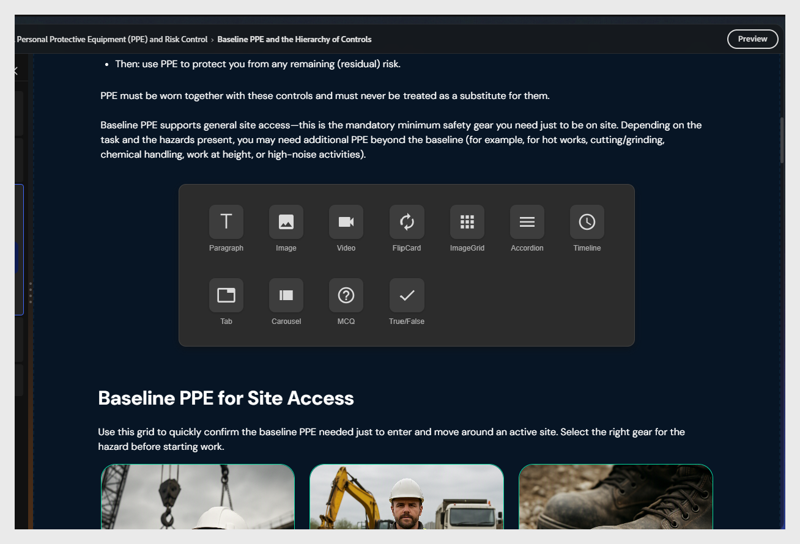
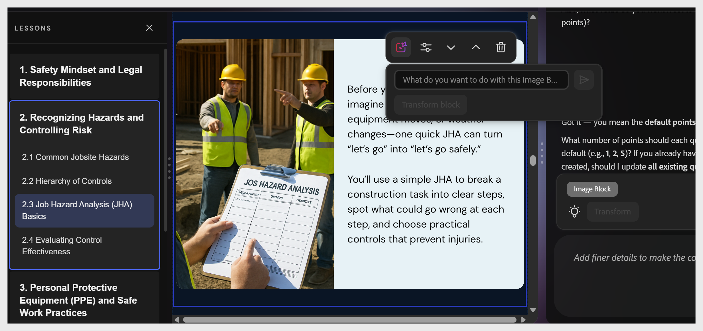

# Inhaltskomponente hinzufügen

Wählen Sie zwischen zwei vorhandenen Elementen aus. Die Schaltfläche &quot;+&quot; wird angezeigt. Wählen Sie diese Option aus, um die Komponentenauswahl zu öffnen.

Verfügbare Komponenten:

<table>
  <thead>
    <tr>
      <th>Komponente</th>
      <th>Verwenden für</th>
    </tr>
  </thead>
  <tbody>
    <tr>
      <td><strong>Absatz</strong></td>
      <td>Textkörper und Erläuterungen</td>
    </tr>
    <tr>
      <td><strong>Bild</strong></td>
      <td>Illustrationen, Screenshots, Diagramme</td>
    </tr>
    <tr>
      <td><strong>Video</strong></td>
      <td>Eingebettetes MP4- oder verknüpftes Video</td>
    </tr>
    <tr>
      <td><strong>Flip-Card</strong></td>
      <td>Term- oder Definitionspaare, Anzeigen von Interaktionen</td>
    </tr>
    <tr>
      <td><strong>Bild-Raster</strong></td>
      <td>Mehrere Bilder in einem Raster-Layout</td>
    </tr>
    <tr>
      <td><strong>Akkordeon</strong></td>
      <td>Erweiterbare Abschnitte, schrittweise Verfahren</td>
    </tr>
    <tr>
      <td><strong>Timeline</strong></td>
      <td>Sequenzielle Ereignisse oder Prozessschritte</td>
    </tr>
    <tr>
      <td><strong>Web-Objekt</strong></td>
      <td>Einbetten von externem Webinhalt, einer Webseite, einem interaktiven Tool, einer Umfrage oder einer Webanwendung direkt in eine Themenfolie</td>
    </tr>
    <tr>
      <td><strong>Tabulator</strong></td>
      <td>Parallele Inhalte - Vergleiche, regionale Varianten</td>
    </tr>
    <tr>
      <td><strong>Karussell</strong></td>
      <td>Wischbare Serie von Bildern oder Inhaltskarten</td>
    </tr>
    <tr>
      <td><strong>MCQ</strong></td>
      <td>Inline-Wissensüberprüfung ohne Bewertung</td>
    </tr>
    <tr>
      <td><strong>True/False</strong></td>
      <td>Inline-Prüfung auf Richtigkeit oder Richtigkeit</td>
    </tr>
  </tbody>
</table>

>[!NOTE]
>
>Verwenden Sie **Akkordeon** für Schritt-für-Schritt-Verfahren, bei denen die Teilnehmer von der Kontrolle ihres Tempos profitieren. Verwenden Sie **Flip Card** als Ausdruck oder Definitionsinhalt.

## Hinzufügen eines Web-Objekts zu einem Kurs zum Erstellen von Inhalten

Ein Web-Objekt zeigt externen Inhalt in einem eingebundenen Rahmen innerhalb des Kurses an. Teilnehmer interagieren mit dem Inhalt, ohne den Kurs zu verlassen. Verwenden Sie es für interaktive Tools, eingebettete Formulare, Umfragen oder jede webbasierte Ressource, die die iframe-Einbettung unterstützt.

### Webobjekt hinzufügen

1. Öffnen Sie Ihren Kurs in &quot;Inhaltsgestaltung&quot; und navigieren Sie zu dem Thema, zu dem Sie das Webobjekt hinzufügen möchten.
2. Wählen Sie zwischen zwei vorhandenen Elementen auf der Themenfolie. Die Schaltfläche **+** wird angezeigt.
3. Wählen Sie **+** aus, um die Komponentenauswahl zu öffnen.
4. Wählen Sie **Webobjekt** aus. Der Block wird auf der Arbeitsfläche angezeigt.

### Konfigurieren des Webobjekts

Wählen Sie das Symbol **Einstellungen** auf der Symbolleiste des Webobjektblocks aus, um das Konfigurationsfeld zu öffnen.

### Festlegen der Inhaltsquelle

Wählen Sie unter **Inhalt** aus, wie der externe Inhalt geladen wird:

- **URL** — Geben Sie die Webadresse der Seite oder des Tools ein, die bzw. das Sie einbetten möchten. Der Inhalt wird in einem Inline-Rahmen innerhalb des Kurses geladen.
- **Einbettungscode** — Fügen Sie ein Einbettungsausschnitt aus einem Drittanbieterdienst ein. Verwenden Sie diese Option für Tools, die ihren eigenen Einbettungscode bereitstellen, z. B. interaktive Formulare, Umfragen oder Media Player.
- **System** — Wählen Sie Inhalte aus einem verbundenen System oder einer Integration aus.

### Height &quot;Rahmen&quot; festlegen

Legen Sie im Feld **Rahmen Height** das Height des eingebetteten Rahmens in Pixel fest. Verwenden Sie die Steuerelemente **+** und **-**, um den Wert anzupassen. Der Standardwert ist 498 px.

Passen Sie das Height des Rahmens an das natürliche Height des eingebetteten Inhalts an. Wenn Sie ihn zu niedrig einstellen, wird eine Bildlaufleiste im Rahmen hinzugefügt. zu hoch eingestellt ist, wird ein leerer Bereich unter dem Inhalt hinzugefügt.

### Lade- und Anzeigeoptionen konfigurieren

- **Automatisches Laden** - Wenn diese Option ausgewählt ist, wird der Webinhalt automatisch geladen, wenn ein Teilnehmer die Folie erreicht. Deaktivieren Sie diese Option für Seiten mit hohem Inhalt, um den Kurs nicht zu verlangsamen. Wenn das automatische Laden deaktiviert ist, wählen die Teilnehmer den Rahmen aus, der das Laden auslösen soll.
- **Titel blockieren** — schaltet ein, um eine Überschrift über dem Webobjektblock anzuzeigen. Verwenden Sie diese Option, um Teilnehmern Kontext zu eingebetteten Inhalten zu geben, bevor sie damit interagieren.

## Inhaltsblöcke innerhalb eines Themas verschieben

Sie können Inhaltsblöcke innerhalb eines Themas entweder mit den Bearbeitungsoptionen in der Symbolleiste oder mit der KI neu anordnen.

