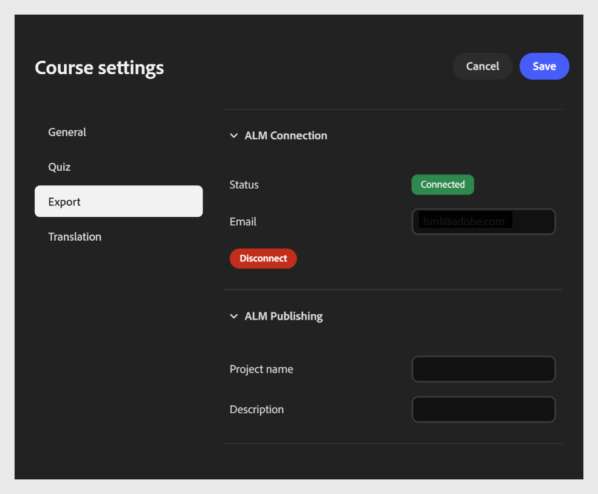
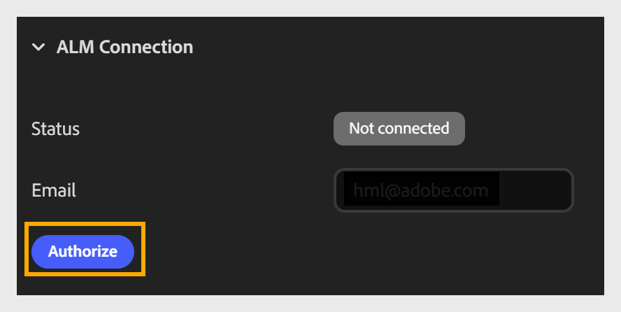
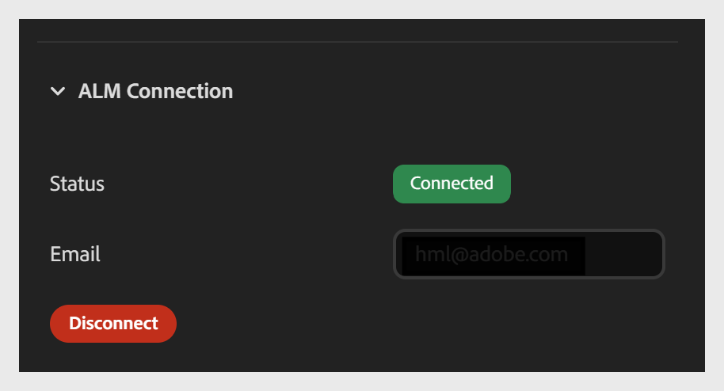

# Publish einen Kurs von Content Composer zu Adobe Learning Manager

Auf der Registerkarte **Exportieren** können Sie Ihren Kurs mit Adobe Learning Manager (ALM) verbinden und direkt in der ALM-Inhaltsbibliothek veröffentlichen. Um die Verbindung einzurichten, geben Sie Ihre E-Mail-Adresse in das Feld **E-Mail** ein. Stellen Sie sicher, dass Sie ein ALM-Konto mit derselben E-Mail-Anmelde-ID haben. Sobald die Verbindung hergestellt ist, können Sie den Kurs in ALM als Modul veröffentlichen.

Diese Verbindung wird einmal pro Kurs eingerichtet. Nach der Einrichtung müssen Sie nicht jedes Mal eine erneute Verbindung herstellen, wenn Sie veröffentlichen oder exportieren.

Es umfasst zwei Abschnitte:

- ALM-Verbindungsabschnitt

- ALM-Veröffentlichungsabschnitt

**So konfigurieren Sie die Exporteinstellungen**

1. Öffnen Sie **Kurseinstellungen** und wählen Sie links die Registerkarte **Export** aus.

2. Erweitern Sie den Abschnitt **ALM-Verbindung** (falls er nicht bereits erweitert wurde).

   - Geben Sie Ihre **E-Mail**-Adresse ein, die mit Ihrem Adobe Learning Manager-Konto verknüpft ist.

   - Wählen Sie **Autorisieren** aus, um sich anzumelden und den Kurs mit Ihrem ALM-Konto zu verbinden.
     

   - Bestätigen Sie nach der Autorisierung die Aktualisierung des Felds **Status** von **Verbindung trennen** auf **Verbindung hergestellt**.
     

## Adobe Learning Manager-Veröffentlichungsdetails

Nachdem Sie Ihr Konto verbunden haben, konfigurieren Sie die Veröffentlichungsdetails im Abschnitt ALM-Veröffentlichung .

- Geben Sie einen Namen für **Projekt** ein, um den Kurs zu identifizieren. Dieser Name wird als Kurstitel in der ALM-Inhaltsbibliothek angezeigt.

- Geben Sie eine **Beschreibung** ein - eine kurze Zusammenfassung des Kurses, die in der ALM-Inhaltsbibliothek daneben angezeigt wird, damit Teilnehmer und Administratoren seinen Zweck verstehen können.

- Wählen Sie **Publish** aus, um den Kurs als Modul an die ALM-Inhaltsbibliothek zu senden.

## Teilnehmernavigation in veröffentlichten Kursen zur Inhaltserstellung

Erfahren Sie, wie Teilnehmer durch in Adobe Learning Manager veröffentlichte oder als SCORM-Pakete exportierte Content Composer-Kurse navigieren, einschließlich des reduzierbaren Inhaltsverzeichnisses und der mobilen Navigation.

## Reduzierbares Inhaltsverzeichnis

Kurse, die in Adobe Learning Manager veröffentlicht oder als SCORM-Pakete exportiert werden, enthalten eine reduzierbare Lektion und ein Navigationsfenster für Themen.

Teilnehmer können:

- **Erweitern** Sie das Navigationsfenster, um Lektionen und Themen zu durchsuchen und zu einem beliebigen Abschnitt zu springen.
- **Das Navigationsfenster reduzieren**, um sich auf den Kursinhalt zu konzentrieren, ohne dass das Fenster Platz auf dem Bildschirm beansprucht.
Der Status des Bedienfelds bleibt erhalten, wenn die Teilnehmer den Kurs durchlaufen.

## Mobile Navigation

Auf Mobilgeräten wird die Lektions- und Themennavigation als Vollbildüberlagerung und nicht als Seitenbereich geöffnet. Die Teilnehmer wählen das Navigationssymbol aus, um die Überlagerung zu öffnen, navigieren zu der Lektion oder dem Thema, zu dem sie möchten, und wählen sie aus, um dorthin zu navigieren.

Die Überlagerung wird automatisch geschlossen, nachdem der Teilnehmer ein Ziel ausgewählt hat, und sie wird an den Kursinhalt zurückgesendet.
