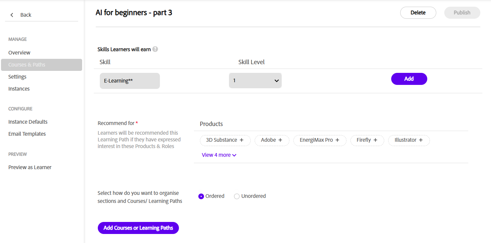

# Erstellen eines Lernpfads

Ein Autor kann einen Lernpfad erstellen, den Teilnehmer nutzen können. So erstellen Sie einen Lernpfad in der Autoren-App:

1. Melden Sie sich als **Autor** an.
1. Wählen Sie **Lernpfade** > **Lernpfade**.
1. Wählen Sie **Hinzufügen** aus.

   

1. **Name des Lernpfads**: Geben Sie einen Namen für den Lernpfad ein.
1. **Übersicht über den Lernpfad**: Geben Sie eine kurze Übersicht über den Lernpfad ein.
1. **Vorteile dieses Lernpfads**: Beschreiben Sie einige Vorteile des Lernpfads.
1. **Tags**: Wählen Sie die entsprechenden Tags aus der vordefinierten Liste aus.
1. **Eindeutige Lernobjekt-ID**: Geben Sie eine eindeutige ID für das Lernobjekt ein.
1. **Registrierungstyp**: Wählen Sie den Registrierungstyp aus dem Dropdown-Menü aus.
1. **Preisplan**: Wählen Sie entweder **Paid** oder **Free** aus. Wenn Sie **Kostenlos** auswählen, wird das Feld **Preis für Lernpfad** deaktiviert.
1. **Registrierung aufheben**: Wählen Sie diese Option, um Teilnehmern zu ermöglichen, sich selbst zu registrieren.
1. **Titelbild**: Wählen Sie ein Titelbild für den Lernpfad aus.
1. **Bannerbild**: Wählen Sie ein Bannerbild für den Lernpfad aus.
1. **Kataloge auswählen**: Wählen Sie die entsprechenden Kataloge aus der Liste aus.
1. **Konformitätsbezeichnung**: Wählen Sie das entsprechende Konformitätslabel aus der Liste aus.
1. **Beschriftungen**: Wählen Sie die entsprechende Beschriftung aus der Liste.
1. **Credly Badge ID**: Wählen Sie die entsprechende Beschriftung aus der Liste.
1. **Schwierigkeitsgrad**: Wählen Sie den entsprechenden Schwierigkeitsgrad aus der Liste aus.
1. **Kompatibilität**: Wählen Sie die entsprechende Compliance-Ebene aus der Liste aus.

   >[!NOTE]
   >
   > Sie können jederzeit vor dem Speichern eine neue Sprache hinzufügen, indem Sie die Registerkarte **Neue Sprache hinzufügen**, eine Sprache aus der Liste und anschließend **Speichern** auswählen. Die Standardsprache ist Englisch.

   

1. Wählen Sie **Speichern**. Eine neue Seite mit dem Namen des Lernpfads wird angezeigt. Sie können jetzt Kenntnisse und Produkte hinzufügen, Abschnitte organisieren und Kurse oder Lernpfade hinzufügen.

   

1. Wählen Sie **Qualifizierte Teilnehmer verdienen**. Wählen Sie im daraufhin geöffneten Abschnitt die Kenntnisse, die die Teilnehmer erwerben sollen, sowie deren Stufen aus.

   

1. Wählen Sie **Hinzufügen** aus.
1. Wählen Sie aus, wie Abschnitte, Kurse oder Lernpfade organisiert werden sollen. Wählen Sie entweder **Ordered** oder **Unordered**.
1. Wählen Sie als Nächstes **Kurse oder Lernpfade hinzufügen**. Ein Fenster mit vorhandenen Kursen und Lernpfaden wird angezeigt. Jede Kachel zeigt den Namen, den Typ (Kurs oder Lernpfad), den Veröffentlichungsstatus und das Kursformat an. Wenn es sich um einen Kurs handelt, wird der Typ angezeigt, z. B. &quot;Selbststudium&quot;, &quot;Virtuell&quot;, &quot;Klassenzimmer&quot; oder &quot;Gemischt&quot;. Wenn es sich um einen Lernpfad handelt, wird die Anzahl der Kurse angezeigt.

   

1. Wählen Sie die Kurse oder Lernpfade aus, die Sie dem Lernpfad hinzufügen möchten.

   

1. Wählen Sie **Hinzufügen** aus. Die Kurse und Lernpfade werden auf der Seite &quot;Lernpfad&quot; angezeigt.

   

1. Wählen Sie **Qualifizierte Teilnehmer verdienen**. Wählen Sie die Kenntnisse und Stufen aus. Wählen Sie **Hinzufügen** aus.
1. Ordnen Sie den Lernpfad den Produkten zu, indem Sie Produkte aus der Liste und dann ihre Ebenen auswählen.

   >[!NOTE]
   >
   > Wenn Sie nicht mindestens ein Produkt auswählen, können Sie den Lernpfad nicht veröffentlichen.

   

1. Wählen Sie aus, wie Abschnitte, Kurse oder Lernpfade organisiert werden sollen. Wählen Sie entweder **Ordered** oder **Unordered**.
1. Wählen Sie **Abschnittstitel hinzufügen** aus, und geben Sie dann einen Abschnittstitel ein.

   

1. Wählen Sie **Senden**.
1. Wählen Sie **Erforderlich**, um den Lernpfad als obligatorisch festzulegen. Wenn Sie ihn nicht auswählen, wird der Lernpfad optional.
1. Wenn Sie einen weiteren Abschnitt mit einem anderen Lernpfad hinzufügen möchten, wiederholen Sie die Schritte 24 bis 30.
1. **Voraussetzungen für die Fertigstellung**: Wählen Sie **Alle** oder eine Zahl aus der Liste aus, um die Schulung abzuschließen.
1. Verschieben Sie die Kurse nach oben oder unten, um ihre Reihenfolge zu ändern.
1. Um einen Kurs aus dem Lernpfad zu entfernen, wählen Sie **X** auf der Kurskarte aus.
1. Wählen Sie **Publish** aus. Um den neu veröffentlichten Lernpfad anzuzeigen, kehren Sie zur Seite **Lernpfade** zurück.
