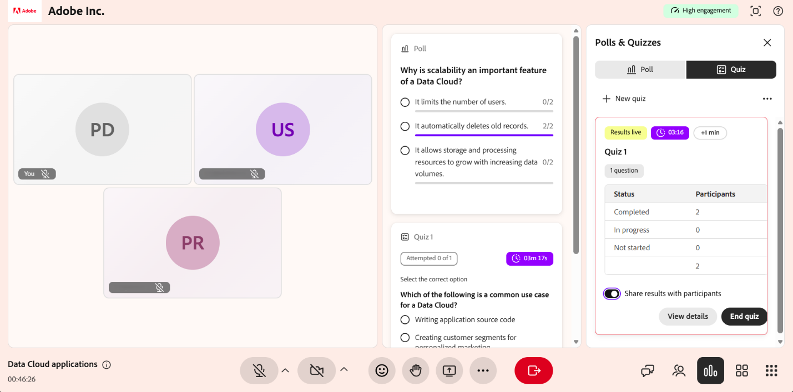

# Teilnehmer-Interaktionen nachverfolgen

Die Interaktion des Teilnehmers im Live-Hub gibt den Kursleitern eine Echtzeit-Ansicht der Interaktion der Teilnehmer während einer Live-Sitzung. Sie kombiniert den Browserfokus, die Chat-Aktivität und die Teilnahme an Umfragen in einer einzigen Interaktionsstufe, die als grüne, gelbe oder rote Anzeige angezeigt wird. Nutze die Funktion, um Flecken in der Aufmerksamkeit zu erkennen und deine Zustellung in Echtzeit anzupassen.

Die Teilnehmer-Interaktion zeigt die durchschnittliche Interaktionsstufe aller Teilnehmer im Hauptraum zu einem bestimmten Zeitpunkt an. Die Stufe wird aktualisiert, sobald ein Teilnehmer an der Sitzung teilnimmt.

Die Interaktion mit den Teilnehmern wird nur während einer Live-Sitzung berechnet und angezeigt.

>[!NOTE]
>
> Nur Kursleiter können die Interaktionsanzeige sehen. Teilnehmer haben keinen Zugriff darauf.

## Berechnungen zur Interaktionsstufe verstehen

Die Interaktionsstufe wird rechts oben in der Live-Hub-Sitzungsoberfläche angezeigt. Er wird als Echtzeitindikator für die Teilnehmerbeteiligung angezeigt.

*Live-Hub-Oberfläche, auf der die Teilnehmerinteraktion in der oberen rechten Ecke angezeigt wird.*

Das System berechnet die Interaktionsstufe anhand der drei folgenden Faktoren:

* **Browserfokus**: Ob die Registerkarte oder das Fenster &quot;Virtuelles Klassenzimmer&quot; auf dem Bildschirm des Teilnehmers aktiv ist.

* **Chat-Aktivität**: Teilnehmerbeteiligung durch Nachrichten im Sitzungs-Chat.

* **Teilnahme an Umfragen**: Antworten, die während der Sitzung an Umfragen gesendet wurden.

## Identifizieren von Interaktionsstufen und Indikatoren

Die Interaktion der Teilnehmer basiert auf farbcodierten Indikatoren, die auf der Interaktion der Teilnehmer basieren. Jede Stufe hat folgende Bedeutung:

| **Engagement** | **Farbindikator** | **Beschreibung** |
|----|----|----|
| Hoch | Grün | Teilnehmer nehmen aktiv an der Sitzung teil. |
| Mittel | Gelb | Teilnehmer zeigen gelegentliche Interaktion mit mäßiger Teilnahme. |
| Niedrig | Rot | Die Teilnehmer zeigen während der Sitzung nur minimale oder keine Interaktion oder einen reduzierten Fokus. |
