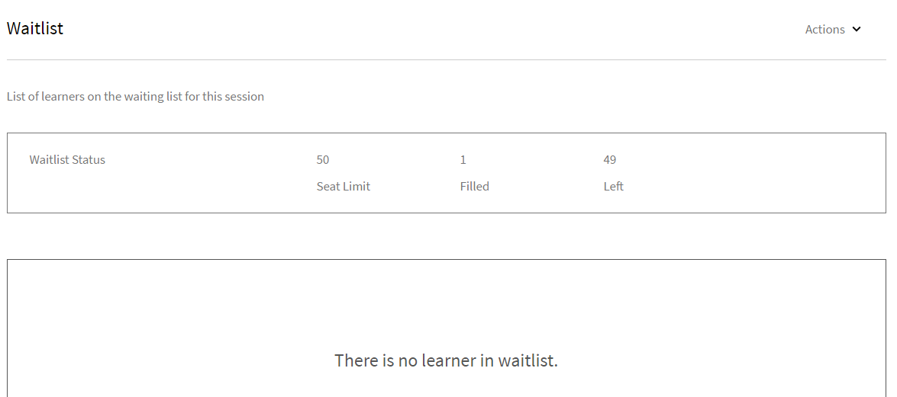
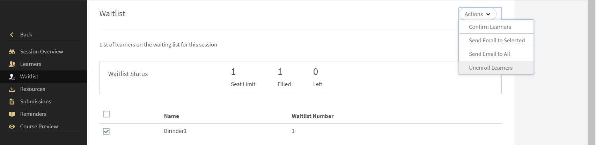
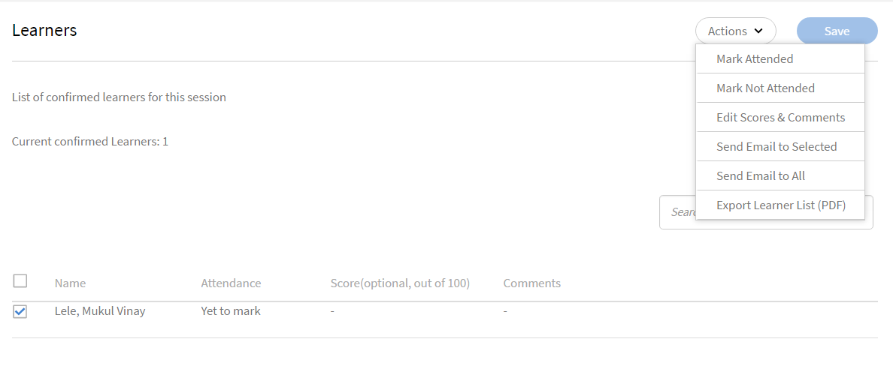
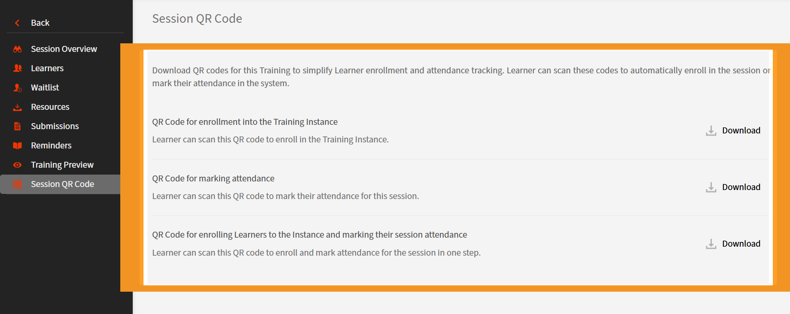
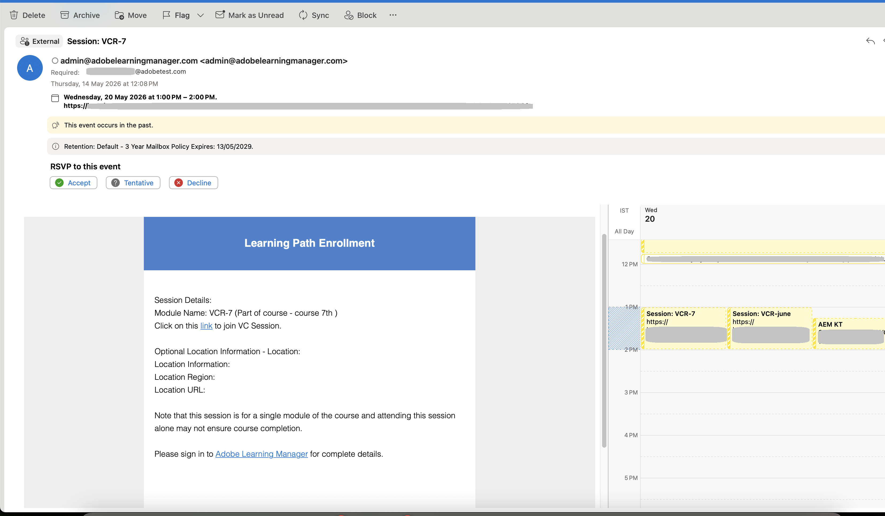
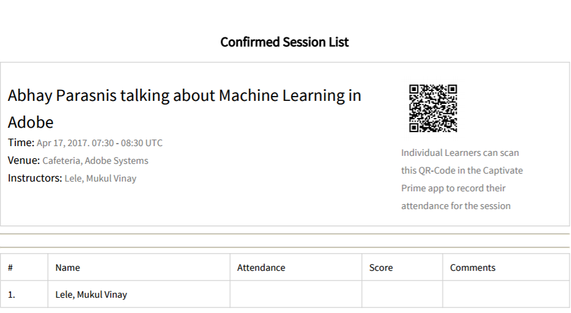
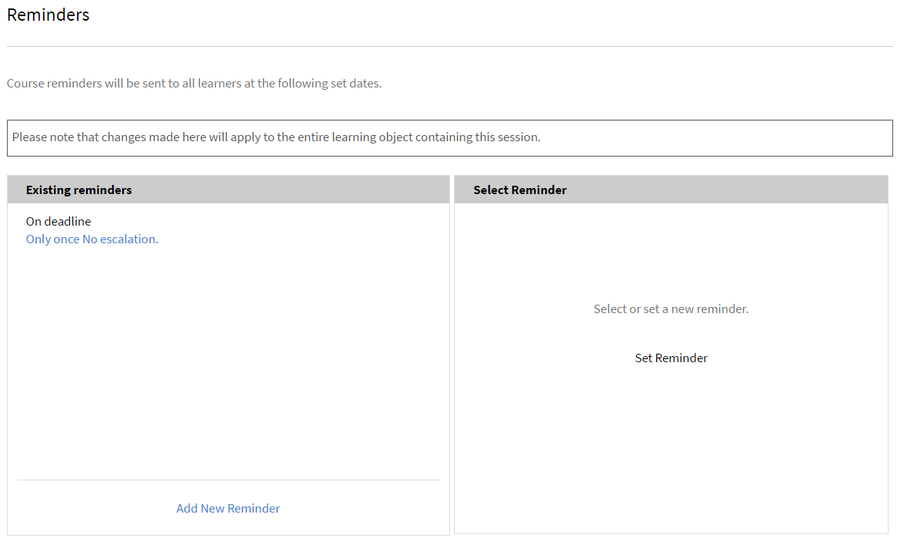
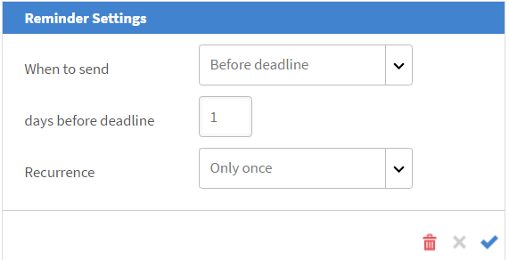
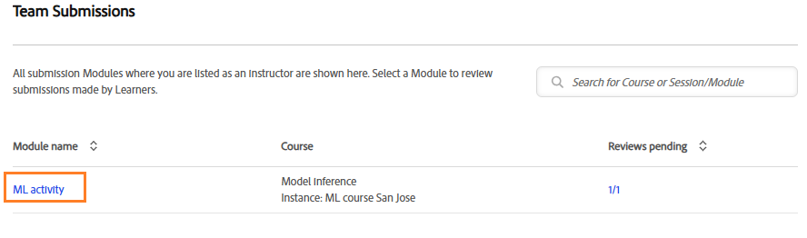

# Verwalten der Teilnehmer für Ihre Sitzung

Lesen Sie den folgenden Artikel, um zu erfahren, wie Sie die Teilnehmer verwalten, kursbezogene E-Mail senden und Erinnerungen für Sitzungen senden können.

## Siehe Sitzungen oder Module mit ausstehenden Überprüfungen {#pending}

Als Kursleiter können Sie die Sitzungen oder Module mit ausstehenden Überprüfungen anzeigen.

Auf der Seite &quot;Sitzungen/Module&quot; wird eine Spalte **Überprüfungen ausstehend** mit der Anzahl der ausstehenden Überprüfungen für die entsprechende Sitzung/Aktivität anzeigt.

## Verwalten der Warteliste für die Sitzung {#managewaitlistforyoursession}

Wenn sich die Teilnehmer für Ihr Modul anmelden, können Sie den aktuellen Status der Einschreibung und die Warteliste auf der Seite „Warteliste“ sehen.

1. Wählen Sie in der Kursleiter-App im linken Navigationsbereich „Geplante Sitzungen“ > „Warteliste“.

   Sie können die maximale Anzahl von Lizenzen, die Anzahl der Lizenzen, die gerade verwendet werden und die freien Lizenzen sehen. In der Tabelle werden außerdem Teilnehmer aufgeführt, die sich auf der Warteliste befinden. Sie ist leer, wenn es keine Warteschlangen auf der Warteliste gibt.

   
   *Teilnehmer auf Warteliste anzeigen*

1. Wählen Sie in der Warteliste-Tabelle den/die Teilnehmer, den/die Sie bestätigten möchten.
1. Wählen Sie „Aktionen“ > „Teilnehmer bestätigen“.

   Die Teilnehmer, die Sie bestätigt haben, werden der Liste „Bestätigte Teilnehmer“ hinzugefügt.

Kursleiter haben die Möglichkeit, die Registrierung von Teilnehmern für Sitzungen aufzuheben. Dadurch wird auch die Registrierung bei den dazugehörigen Lernprogrammen aufgehoben. Wählen Sie die Registerkarte **[!UICONTROL Warteliste]**. Wählen Sie mithilfe der Kontrollkästchen die Teilnehmer aus, deren Registrierung aufgehoben werden soll. Um die Registrierung aufzuheben, wählen Sie **[!UICONTROL Aktionen]** > **[!UICONTROL Registrierung von Teilnehmern aufheben]**.

*Registrierung der Teilnehmer aufheben*

### Wartelistenbericht

Mit dem neuen **[!UICONTROL Wartelistenbericht]** von Adobe Learning Manager können Kursleiter die Liste der auf die Warteliste gesetzten Teilnehmer für alle Instanzen eines Kurses herunterladen. Kursleiter können über den Abschnitt **[!UICONTROL Warteliste]** auf der Seite **[!UICONTROL Sitzungsübersicht]** auf diesen Bericht zugreifen.

Die folgenden Spalten sind im Bericht &quot;Warteliste&quot; verfügbar:

* Kursname
* Instanzname
* Instanzen-ID
* Instanzenstatus
* Benutzername
* E-Mail
* Eindeutige ID des Benutzers
* Registriert am (UTC-Zeitzone)
* Status
* Warteliste Nummer
* Limit für Warteliste
* Maximale Anzahl Lizenzen

So laden Sie den Bericht im Abschnitt &quot;Kursleiter&quot; herunter:

1. Melden Sie sich als **[!UICONTROL Kursleiter]** an.
2. Wählen Sie eine beliebige Sitzung auf der Startseite aus.
3. Wählen Sie die Option **[!UICONTROL Warteliste]** auf der Seite **[!UICONTROL Sitzungsübersicht]** aus.
4. Wählen Sie **[!UICONTROL Aktionen]** > **[!UICONTROL Bericht exportieren]**, um den Bericht **[!UICONTROL Warteliste]** herunterzuladen.

## Vermerken der Teilnahme an Ihrer Sitzung {#markattendanceforyoursession}

Sie können die Anzahl der bestätigten Teilnehmer, die an der Sitzung teilnehmen, deren Namen, deren Teilnahmestatus sowie andere Details auf der Seite „Teilnehmer“ sehen.

1. Klicken Sie im linken Navigationsbereich auf „Geplante Sitzungen“ > „Teilnehmer“.
1. Wählen Sie den/die Teilnehmer aus der Teilnehmerliste aus und führen Sie einen der folgenden Schritte aus:

   * Um die Teilnahme zu vermerken, klicken Sie auf „Aktionen“ > „Teilnahme vermerken“. Sobald der Status als „Teilgenommen“ vermerkt wurde, können Sie den Status nicht mehr ändern.
   * Um den Status als „Nicht-teilgenommen“ zu vermerken, klicken Sie auf „Aktionen“ > „Nicht-teilgenommen“.
   * Um einen Teilnehmer aufgrund einer Absage oder aus anderen Gründen zu löschen, klicken Sie auf &quot;Aktionen&quot; > &quot;Teilnehmer löschen&quot;.

   Ein Teilnehmer kann ein Modul erst abschließen, wenn der Teilnahmestatus „Teilgenommen“ lautet.

   
   *Anwesenheit der Teilnehmer markieren*

### QR-Codes für Teilnehmerregistrierung und Teilnahme herunterladen

Kursleiter können QR-Codes für ihre zugewiesenen Sitzungen herunterladen, damit sich Teilnehmer für eine Kursinstanz anmelden und die Teilnahme oder den Abschluss durch Scannen des QR-Codes markieren können.

Dadurch können Kursleiter die Teilnahme an Sitzungen unabhängig verwalten, ohne dass Administratorunterstützung erforderlich ist.

Die folgenden Schritte sind für beide geeignet:

* Sitzungen im Klassenzimmer
* Online-Lernumgebungen

Für eine Sitzung im physischen Klassenzimmer müssen Sie als Kursleiter den richtigen QR-Code generieren und ihn in den Klassenzimmer einfügen (oder ihn umgehen), in dem die Teilnehmer an der Sitzung teilnehmen, damit sie den QR-Code scannen und ihre Registrierung, Teilnahme oder beides abhängig vom QR-Code markieren können.

Bei einer Online-Klassenzimmersitzung können Sie als Kursleiter den generierten QR-Code per E-Mail, über ein Messaging-System oder auf andere Weise senden, sodass die Teilnehmer den QR-Code scannen und ihre Registrierung, Teilnahme oder beides je nach QR-Code markieren können.

#### QR-Codes für eine Sitzung herunterladen

1. Melden Sie sich mit der Rolle **Kursleiter** bei Adobe Learning Manager an.
2. Wechseln Sie zum **Kursleiter-Dashboard**.
3. Öffnen Sie die relevante **Kursinstanz**.
4. Wählen Sie die Registerkarte **Sitzungen** aus.
5. Wählen Sie eine Sitzung aus, die Ihnen zugewiesen wurde.
6. Wählen Sie **Session QR Code**.
   

Sie können die folgenden QR-Codes herunterladen:

* **QR-Registrierungscode** - ermöglicht Teilnehmern die Registrierung in der Kursinstanz
* **QR-Code für Anwesenheit** - markiert die Anwesenheit für die Sitzung
* **Registrierung + Teilnahme-QR-Code** - registriert Teilnehmer und markiert die Teilnahme in einem einzigen Scan.

Der QR-Code wird als PDF heruntergeladen und kann digital freigegeben oder während der Sitzung angezeigt werden.

#### Was passiert, wenn Teilnehmer den QR-Code scannen?

* Teilnehmer scannen den QR-Code mit einem Mobilgerät.
* Adobe Learning Manager validiert den Teilnehmer und die Sitzung.
* Basierend auf dem QR-Codetyp:
  * Teilnehmer sind für die Kursinstanz registriert oder
  * Anwesenheit und Abschluss werden für die Sitzung aufgezeichnet.

Alle Aktualisierungen werden automatisch in den Teilnehmerdatensätzen, Transkripten und Berichten widergespiegelt.

#### Anmerkungen

* QR-Codes sind nur für Kursleiter verfügbar, die der Sitzung zugewiesen sind.
* Die für den Kurs und die Sitzung konfigurierten Regeln für Registrierung, Teilnahme und Abschluss gelten weiterhin.
* Bestehender Teilnehmerfortschritt und Berichterstellungs-Workflows bleiben unverändert.

#### Anwendungsszenarien

* Unternehmen, die große Mengen an Vor-Ort-Sitzungen durchführen (z. B. Produktschulungen für Fachkräfte), können es den Kursleitern ermöglichen, sitzungsspezifische QR-Codes zu drucken, die die Teilnahme mit einem Scan registrieren und markieren.

* Bei Schulungen für Einzelhandel, Fertigung und Gesundheitswesen, bei denen Teilnehmer oft direkt vom Boden aus oder ohne vorherige Anmeldung an Sitzungen teilnehmen, kann ein QR-Code &quot;Anmeldung + Teilnahme&quot; an der Tür platziert werden. Dies ermöglicht es Teilnehmern, ihre Anmeldung und Anwesenheit über ihre Telefone selbst zu bearbeiten.

* Schulungen für Partner oder Kunden ermöglichen es dem Trainer vor Ort, sich einfach an Änderungen im Raum, zusätzliche Sitzungen oder zusätzliche Teilnehmer anzupassen, ohne den Administrator um neue QR-Codes bitten zu müssen.

### Kalendereinladungen {#calendarinvites}

* Wenn sich ein Teilnehmer oder ein Kursleiter in einem Klassenzimmer oder einer virtuellen Klassenzimmersitzung registriert hat, sendet der Lern-Manager eine Kalendereinladung (ICS-Datei).
* Die Kalendereinladung umfasst:

  * Datum und Uhrzeit der Sitzung
  * Sitzungsdetails
  * **Link zur direkten Sitzung** in der Kalenderbeschreibung

  

Die Teilnehmer können die Kalenderveranstaltung öffnen und direkt aus ihrem Kalender an der Sitzung teilnehmen.

#### An einer Sitzung von Gmail teilnehmen

1. Öffnen Sie **Google-Kalender**.
2. Wählen Sie das Sitzungsereignis aus.
3. Klicken Sie in den Ereignisdetails auf den Link **Sitzung beitreten**.
4. Die Sitzung wird direkt in Adobe Learning Manager oder dem konfigurierten Tool für virtuelle Klassenzimmer geöffnet.

Sie müssen nicht die ursprüngliche E-Mail öffnen, um auf den Sitzungslink zuzugreifen.

#### Teilnahme an einer Sitzung von anderen Kalender-Clients

Der Sitzungslink ist im Kalenderereigniskörper enthalten und kann abgerufen werden über:

* Microsoft Outlook
* Apple Calendar
* Andere Kalenderanwendungen, die ICS-Dateien unterstützen

#### Anmerkungen

* Kalendereinladungen werden automatisch vom Learning Manager generiert.
* Die Zeitzoneninformationen in der Kalendereinladung werden basierend auf der ausgewählten Zeitzone des Teilnehmers angepasst.
* Diese Verbesserung gilt für neu generierte Kalendereinladungen.
* Administratoren oder Kursleiter müssen keine zusätzliche Konfiguration vornehmen.

## Als erfolgreich markieren

Kursleiter können den Erfolgsstatus jedes Teilnehmers direkt auf der Teilnehmerseite als bestanden oder abgelehnt markieren. Mit dieser Funktion können Kursleiter das Ergebnis von Sitzungen im Klassenzimmer oder virtuellen Klassenzimmer basierend auf der Leistung der Teilnehmer genau aufzeichnen.

So markieren Sie den Erfolg für Teilnehmer:

1. Melden Sie sich bei Adobe Learning Manager als Kursleiter an.
2. Wählen Sie im linken Navigationsbereich **[!UICONTROL Bevorstehende Sitzungen]** aus.
3. Wählen Sie **[!UICONTROL Teilnehmer]** aus.
4. Wählen Sie die Teilnehmer aus und wählen Sie dann **[!UICONTROL Aktionen]**.
5. Wählen Sie eine der folgenden Optionen aus, um den Erfolg für die ausgewählten Teilnehmer zu markieren:

   * **[!UICONTROL Anwesend markieren und bestanden]**: Teilnehmer, die als Bestanden markiert sind, haben das Modul erfolgreich abgeschlossen.
   * **[!UICONTROL Anwesend markieren und fehlgeschlagen]**: Teilnehmer, die als &quot;Fehlgeschlagen&quot; markiert sind, haben das Modul abgeschlossen, aber nicht bestanden.

   
   _Teilnehmerseite, auf der das Menü &quot;Aktionen&quot; mit markierten Optionen &quot;Teilgenommen markieren&quot; und &quot;Teilgenommen markieren&quot; und &quot;Teilgenommen markieren&quot; und &quot;Fehlgeschlagen&quot; für die Aufzeichnung von Teilnehmerergebnissen markiert ist_

6. Wählen Sie in der Bestätigungsmeldung **[!UICONTROL Ja]** aus.

## Senden Sie eine E-Mail an die Teilnehmer {#sendemailstolearners}

Sie können die E-Mails an bestimmte oder alle Teilnehmer der Sitzung senden. Die Funktion „E-Mail senden“ ist sehr nützlich, wenn Sie die Teilnahme von Teilnehmern bestätigen möchten oder wenn Sie Informationen zu den Sitzungen senden möchten. Sie können auch die Option „E-Mail an alle senden“ nutzen, um Aufgaben- oder Sitzungsmaterial per E-Mail oder allgemeine Informationen an alle Teilnehmer zu schicken.

Um E-Mails von der Teilnehmerseite in der Kursleiter-App an die Teilnehmer zu senden, führen Sie einen der folgenden Schritte aus:

* Um E-Mails an bestimmte Teilnehmer der Sitzung zu senden, wählen Sie den Teilnehmer aus und klicken Sie auf „Aktionen“ > „Senden“ > „E-Mail an Ausgewählte“.
* Um eine E-Mail an alle Teilnehmer zu senden, um Kursmaterial oder eine Aufgabe zu senden, klicken Sie auf „Aktionen“ > „E-Mail an alle senden“.

## Einladungsantworten erfassen

Kursleiter können Antworten auf Teilnehmereinladungen nur erfassen, wenn die Option **[!UICONTROL Antwort einladen]** vom ACAP-Administrator aktiviert wurde. Um diese Funktion zu aktivieren, müssen Administratoren das Supportteam unter [learningmanagersupport@adobe.com](mailto:learningmanagersupport@adobe.com) kontaktieren.

Anschließend können Sie Einladungsantworten im Abschnitt **[!UICONTROL Teilnehmer]** anzeigen. Gehen Sie zu einer beliebigen Sitzung, wählen Sie **[!UICONTROL Teilnehmer]** aus und wählen Sie die Einladungsantwort aus dem Dropdown-Menü aus.

## Exportieren der Teilnehmerliste {#exportinglearnerslist}

Als Kursleiter können Sie die Teilnahme für alle Ihre Teilnehmer ganz einfach vermerke, indem Sie die Liste der eingeladenen Teilnehmer als PDF exportieren. Die Funktion zum Exportieren der Teilnehmerliste finden Sie auf der Seite „Teilnehmer“ im linken Teilfenster. Klicken Sie auf „Aktionen“ > „Teilnehmerliste exportieren (PDF)“.

Nachdem die Teilnehmerliste für Ihre Sitzung bestätigt wurde, können Sie die Liste als PDF-Datei exportieren. In dieser druckerfreundlichen PDF-Datei werden die Teilnehmer als Tabelle angezeigt. Sie können dann die Teilnahme vermerken oder Punktzahlen bereitstellen und Hinweise für Teilnehmer in einer PDF erstellen oder vergeben.

Achten Sie auf den QR-Code in der oberen rechten Ecke dieses PDF-Dokuments. Mit dieser Funktion können einzelne Teilnehmer den Code mithilfe der Learning Manager-Mobilanwendung scannen, damit Teilnehmer ihre Teilnahme vermerken können.

*QR-Code scannen, um Anwesenheit zu vermerken*

## Übertragungen genehmigen oder ablehnen {#approveorrejectsubmissions}

Wenn Teilnehmer Dokumente wie Aufgaben, Berichte oder Bewertungen für Ihre Sitzung hochgeladen haben, können Sie die Dokumente auf der Seite „Übertragungen“ sehen. Sie können die Materialien für die Bewertung des Teilnehmers verwenden und die Übermittlung genehmigen oder. ablehnen.

1. Klicken Sie im linken Bereich entweder auf „Bevorstehende Sitzungen“ oder auf „Letzte Sitzungen“, basierend auf den bereits geplanten Sitzungen.
1. Klicken Sie auf den Kurs, für den Sie die Übertragungen sehen möchten.

   Klicken Sie im linken Teilfenster auf „Übertragungen“.

1. Sie können die Übertragungen von Teilnehmern für diese Sitzung, die Sie ausgewählt haben, ansehen. Wählen Sie die Übertragung aus, die Sie genehmigen oder ablehnen möchten und klicken Sie auf „Genehmigen“ oder „Ablehnen“.

   Der Status der Übertragungen ändert sich je nach Aktion auf „Genehmigen“ oder „Ablehnen“.

## Konfigurierungserinnerungen für Ihre Sitzung {#configureremindersforyoursession}

1. Klicken Sie im linken Teilfenster auf „Bevorstehende Sitzungen“.
1. Klicken Sie auf den Kurs, für den Sie die Erinnerungen festlegen möchten. Klicken Sie im linken Teilfenster auf „Erinnerungen“.
1. Klicken Sie auf der Kachel „Erinnerung auf „Erinnerung festlegen“.

   
   *Konfigurieren Sie Erinnerungen für Ihre Sitzung*

1. Führen Sie folgende Schritte aus:

   * Legen Sie im Dialogfenster „Erinnerungseinstellungen“ die Option fest, wann die Erinnerung an die Teilnehmer gesendet werden soll: Vor dem Termin, Zum Termin oder Nach dem Termin.
   * Legen Sie im Feld „Tage vor dem Termin“ die Anzahl der Tage vor dem Termin fest, wann Sie die Erinnerung an die Teilnehmer senden möchten.
   * Legen Sie die Wiederholung für Ihre Erinnerung fest.

   
   *Erinnerungseinstellungen anzeigen*

1. Führen Sie einen der folgenden Schritte aus:

   * Speichern Sie die Erinnerung, indem Sie das Kontrollkästchen anhaken.
   * Klicken Sie auf das Kreuz, um die Erinnerung abzubrechen.

   Eine automatisierte Kurserinnerung wird an alle Teilnehmer zu dem Datum gesendet, das Sie in den Einstellungen für Ihre Erinnerungen angegeben haben.

   Wenn Sie bereits Erinnerungen zu Ihren Sitzungen festgelegt haben, können Sie diese in den Kacheln „Vorhandene Erinnerungen“ sehen. Darüber hinaus können Sie zusätzliche Erinnerungen Ihren vorhandenen Erinnerungen hinzufügen.

   Um eine vorhandene Erinnerung zu löschen, klicken Sie auf die Erinnerung. Klicken Sie im angezeigten Popup-Menü auf das Symbol „Löschen“ (Papierkorbsymbol), um die Erinnerung zu löschen.

## Erstellen und Verwalten von Teams in Adobe Learning Manager

Erstellen Sie Teams manuell aus den Teilnehmern in einer Kursinstanz und fügen Sie dann Teams hinzu, verschieben, entfernen, umbenennen oder löschen Sie sie, bis ein Team gesperrt ist.

Als Kursleiter erstellen Sie Teams für jede Instanz eines Kurses, der über ein teambasiertes Einreichungsmodul verfügt. Jeder Kursleiter, der der Instanz zugewiesen ist, kann seine Teams verwalten. Adobe Learning Manager kann Teams auch automatisch erstellen. Nachdem Teams gebildet wurden, können Teilnehmer Arbeit einreichen und Sie können Teameinreichungen bewerten.

### Öffnen Sie die Teams-Verwaltungsseite.

1. Wählen Sie in der Kursleiter-App im linken Navigationsbereich **Teams**. Auf der Seite werden die teambasierten Kursinstanzen aufgeführt, denen Teilnehmer zugewiesen sind.

   

1. Um einen Kurs zu finden, suchen Sie danach oder sortieren Sie die Liste nach dem Datum der letzten Aktualisierung.

1. Wählen Sie die Kursinstanz aus. Auf der Instanzseite werden die nicht zugewiesenen Teilnehmer und die Teams angezeigt.

### Erstellen von Teams mit einer Regel

1. Wählen Sie auf der Instanzseite die nicht zugewiesenen Teilnehmer aus, die in Teams aufgeteilt werden sollen.

1. Wählen Sie eine Regel. Wählen Sie **Aktion** > **Ein einzelnes Team bilden** oder **Mehrere Teams bilden**.

   

1. Wenn Sie **Von mehreren Teams** auswählen, geben Sie die Anzahl der Teilnehmer für jedes Team ein. Der Wert muss 1 oder höher sein. Auf der Seite wird angezeigt, wie viele Teams erstellt werden. Beispielsweise werden bei 94 Teilnehmern und 2 Teilnehmern pro Team 47 Teams erstellt. Wenn die Anzahl größer als die Anzahl der registrierten Teilnehmer ist, wird eine Fehlermeldung angezeigt. Geben Sie einen kleineren Wert ein.

   

   Wenn Sie einen Wert eingeben, der größer als die Anzahl der registrierten Teilnehmer ist, wird eine Fehlermeldung angezeigt.

   

1. Wählen Sie **Teams erstellen** aus. Die Teams werden auf der Registerkarte **Teams** angezeigt.

   

1. Bestätigen und speichern. Die Teams werden auf der Registerkarte **Teams** angezeigt.

Die Regel gilt nur für die nicht zugewiesenen Teilnehmer, die Sie auswählen. Um alle neu zu gruppieren, löschen Sie zuerst die vorhandenen Teams. Ihre Teilnehmer kehren zur Liste der nicht zugewiesenen Teilnehmer zurück.

Nachdem Sie **Löschen** ausgewählt haben, wird das folgende Bestätigungsdialogfeld angezeigt:

Wählen Sie **Teams löschen**. Alle Teilnehmer kehren zur nicht zugewiesenen Liste zurück.

### Ein Team erstellen

1. Wählen Sie die nicht zugewiesenen Teilnehmer aus, die in das Team aufgenommen werden sollen.

1. Wählen Sie **Aktion** > **Ein einzelnes Team bilden**. Ein Team wird mit der angegebenen Anzahl von Teilnehmern erstellt.

   

1. Speichern Sie das Team. Ein Team benötigt mindestens einen Teilnehmer, und ein Teilnehmer kann nur zu einem Team in der Instanz gehören.

1. Wiederholen Sie die Schritte, um Teams nacheinander zu erstellen.

### Hinzufügen von Teilnehmern zu einem vorhandenen Team

1. Wählen Sie die nicht zugewiesenen Teilnehmer aus, die hinzugefügt werden sollen.

1. Wählen Sie sie einem vorhandenen Team und dann das Team aus.

   

1. Bestätigen Sie Ihre Auswahl. Wählen Sie **Teilnehmer zuweisen**.

### Teilnehmer verschieben oder entfernen

1. Öffnen Sie die Registerkarte **Teams** und erweitern Sie dann ein Team, um seine Mitglieder anzuzeigen.

1. Wählen Sie die Teilnehmer aus, die verschoben werden sollen.

   

1. Wählen Sie aus, ob sie verschoben werden sollen, und wählen Sie dann das Zielteam aus.

1. Um einen Teilnehmer aus einem Team zu entfernen, wählen Sie den Teilnehmer aus und entfernen Sie ihn. Der Teilnehmer kehrt zur nicht zugewiesenen Liste zurück.

Wenn für ein Team keine Teilnehmer mehr vorhanden sind, wird das Team automatisch gelöscht.

### Team umbenennen

1. Wählen Sie auf der Registerkarte **Teams** das Team aus und benennen Sie es um.

1. Wählen Sie **Aktion** > **Umbenennen**.

   

1. Geben Sie einen eindeutigen Namen ein, z. B. &quot;Team-Alpha&quot;.

   

1. Wählen Sie **Team umbenennen** aus.

Namen können nicht wiederholt werden und Sie können nicht das vom System generierte Format wie Team-1 verwenden.

### Teams löschen

1. Wählen Sie auf der Registerkarte **Teams** ein oder mehrere Teams aus.

1. Wählen Sie **Aktion** > **Löschen**.

1. Wählen Sie **Team löschen**.

   

1. Bestätigen. Die Teilnehmer aus den gelöschten Teams kehren zur Liste der nicht zugewiesenen Teilnehmer zurück.

### Verspätete Registrierungen und Aufhebung der Registrierung

* Ein Teilnehmer, der sich registriert, nachdem Teams gebildet wurden, erscheint in der Liste der nicht zugewiesenen Teilnehmer. Hinzufügen des Teilnehmers zu einem Team
* Wenn alle Teams gesperrt sind, erstellen Sie ein neues Team für den Teilnehmer.
* Ein Teilnehmer, der die Registrierung widerruft, wird automatisch aus seinem Team entfernt. Das Team wird fortgesetzt und ein leeres Team wird gelöscht.

### Fehlerbehebung

**Sie können kein Team auswählen oder seine Mitglieder verschieben.** Ein Team wird nach der ersten Übermittlung gesperrt, und die Sperre gilt für jedes Team-Modul in der Instanz. Um das Team zu entsperren, heben Sie die Einreichung auf. **Auswerten und Absenden von Teamübermittlungen anzeigen**.

**Sie können ein Team nicht umbenennen.** Der Name wird bereits verwendet oder stimmt mit dem vom System generierten Format überein. Geben Sie einen anderen Namen ein.

**Beim Erstellen von Teams wird ein Fehler angezeigt.** Ein Team kann nicht mehr als 100 Mitglieder haben. Reduzieren Sie die Anzahl der Mitglieder pro Team.

**Sie können die Teams-Verwaltung für eine Instanz nicht öffnen.** Möglicherweise wird bereits eine automatische Team-Erstellung ausgeführt. Der Zugriff kehrt zurück, wenn er abgeschlossen ist.

**Ihre Speicherung wird abgelehnt, und die Seite wird neu geladen.** Ein anderer Kursleiter oder der automatisch gespeicherte Job ändert sich zuerst. Überprüfen Sie die aktualisierten Teams und wiederholen Sie dann Ihre Änderung.

**Ein Team ist verschwunden.** Ein Team ohne Teilnehmer wird automatisch gelöscht.

## Auswerten und Widerrufen von Teameinreichungen

Überprüfen Sie die gesendete Datei eines Teams, schließen Sie den Evaluierungsplan ab, genehmigen oder lehnen Sie die Arbeit ab oder heben Sie die Übermittlung auf, damit das Team sie erneut übermitteln kann.

Wenn Sie eine Teamübermittlung bewerten, gilt das Ergebnis für jedes Mitglied des Teams, und jedes Mitglied erhält eine Benachrichtigung. Nur Kursleiter, die der Instanz zugewiesen sind, können eine Bewertung vornehmen. Die Schritte sind für einzelne Einreichungen identisch, mit dem Unterschied, dass für einzelne Einreichungen keine Teamdetails vorliegen. Vergewissert euch, dass Teams existieren. **Teams erstellen und verwalten** anzeigen

Automatisch gebildete Teams können auf die gleiche Weise bearbeitet werden wie manuelle Teams.

### Einreichung suchen

1. Öffnen Sie in der Kursleiter-App den Bereich für Einreichungen und wählen Sie dann **Teameinreichungen** aus. Wählen Sie **Einreichungen von Einzelpersonen** für Module mit nur einem Teilnehmer aus.

1. Um ein Modul zu finden, suchen Sie nach dem Sitzungs- oder Modulnamen.

1. Wählen Sie den Modulnamen.

   

1. Filtern Sie nach Status, um die Liste einzugrenzen: **Ausstehende Übermittlung**, **Ausstehende Überprüfung**, **Genehmigt**, **Abgelehnt** oder **Abgeschlossen**.

1. Um die Team-Mitglieder anzuzeigen, erweitern Sie das Team. Namen und E-Mail-Adressen werden angezeigt, und der Teilnehmer, der die Datei gesendet hat, hat ein **Submitter**-Tag.

1. Um die gesendete Datei herunterzuladen, wählen Sie die Download-Option für das Team.

### Bewerten einer Einreichung

1. Suchen Sie das Team mit dem Status **Ausstehende Überprüfung**.

1. Öffnen Sie die gesendete Datei und überprüfen Sie den Inhalt.

1. Wählen Sie **Aktion** > **Auswerten**.

   

1. Testplan abschließen:

   * Beantworte alle erforderlichen Fragen.
   * Wählen Sie bei objektiven Fragen eine Option aus. Bei der kriterienbasierten Bewertung wird die Bewertung aktualisiert, während Sie auswählen.
   * Bei subjektiven Fragen geben Sie Ihre Antwort ein.
   * Wenn Anmerkungen zulässig sind, fügen Sie Anmerkungen zur Frage oder zur gesamten Bewertung hinzu.

   

1. Wenn für das Modul eine Genehmigung des Reviewers erforderlich ist, wählen Sie **Genehmigen** oder **Ablehnen**. Gib einen Kommentar ein, wenn du die Ablehnung des Kommentars einholst. Das Team weiß dann, was zu korrigieren ist.

   

1. Wenn das Modul eine manuelle Bewertung verwendet, geben Sie die Gesamtpunktzahl ein.

   

   **Optional**: Geben Sie eine private Notiz ein, indem Sie den Schalter **Private Notiz zur Punktzahl hinzufügen** auswählen. Eine private Notiz ist nur für Kursleiter sichtbar, die der Instanz zugewiesen sind. Teilnehmer können es nicht anzeigen, selbst wenn Sie **Kommentar anzeigen** auswählen.

1. Senden Sie die Bewertung. Wählen Sie **Senden**. Der Übermittlungsstatus ändert sich in **Genehmigt**.

   

Andere Kursleiter können die gleiche Einreichung ebenfalls bewerten, sofern sie noch nicht genehmigt wurde. Eine spätere Bewertung ersetzt eine frühere, bis die Einreichung genehmigt ist.

Wenn für das Modul keine Genehmigung des Reviewers erforderlich ist, wird das Modul für alle Teammitglieder abgeschlossen, sobald das Team es übermittelt. Es wird nur die Option &quot;Senden&quot; angezeigt und Sie können die Punktzahl oder Anmerkungen danach nicht bearbeiten.

Nachdem Sie die Einreichung eines Teams genehmigt oder abgelehnt haben, kann ein Teilnehmer den Status der Einreichung und das Bewertungsergebnis anzeigen.

Wenn Sie das Bewertungsergebnis auswählen, werden die Bewertungsparameter und Kommentare des Kursleiters angezeigt.

## Überprüfen oder Ändern von Bewertungen

1. Suchen Sie ein Team mit dem Status &quot;**Abgelehnt**&quot;.

1. Um die abgeschlossene Auswertung zu öffnen, wählen Sie **Auswertung anzeigen**.

1. Um die Bewertung zu wiederholen, wählen Sie die Option &quot;Neu bewerten&quot; aus und senden Sie die Änderungen. Dies ist nur bei abgelehnten Einreichungen möglich. **Genehmigte Einreichungen können nicht geändert werden**.

### Einreichung aufheben

Heben Sie die Einreichung auf, wenn das Team erneut senden muss, wenn die Bewertung erneut beginnen muss oder wenn Sie ein gesperrtes Team ändern müssen. Bei einer individuellen Einreichung können Sie dies auch verwenden, um eine für den falschen Teilnehmer eingegebene Bewertung zu korrigieren.

1. Suchen Sie ein Team oder einen Teilnehmer, für das bzw. den eine Einreichung vorliegt.

1. Wählen Sie **Senden abbrechen**.

   

1. Geben Sie Ihre Anmerkungen ein, und wählen Sie dann **Übermittlung rückgängig machen**.

   

Die Übermittlung wird entfernt, und der Status wird auf **Ausstehende Übermittlung** zurückgesetzt. Das Team wird entsperrt, sodass Sie seine Mitglieder bearbeiten können. Team-Mitglieder erhalten eine Benachrichtigung und eine E-Mail. Jedes Mitglied kann dann erneut übermitteln, und die neue Datei ersetzt die vorherige. Ihre neue Bewertung ersetzt die frühere Bewertung, und es wird kein Verlauf beibehalten.

Sie können die Einreichung für ein Teammitglied nach Abschluss des Kurses nicht aufheben, da der Abschluss nicht rückgängig gemacht werden kann.