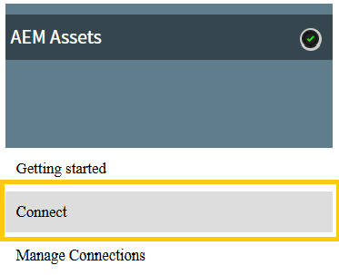
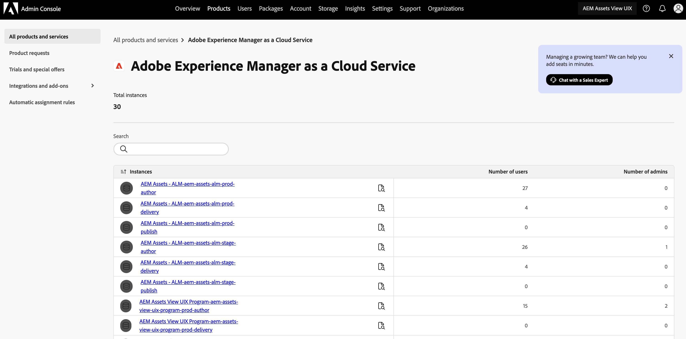

# Integration von AEM Assets

## Übersicht

Adobe Learning Manager ist jetzt as a Cloud Service mit Adobe Experience Manager Assets integriert. Teams können Lerninhalte und Bilder in Adobe Experience Manager Assets speichern, sie in Adobe Learning Manager importieren und Updates von einem zentralen Ort aus verwalten. Wenn sich ein Element ändert, können verknüpfte Inhalte in der Inhaltsbibliothek automatisch aktualisiert werden, sodass Autoren keine Dateien erneut hochladen müssen.

Da die Assets in Ihrem Unternehmen an zentraler Stelle verwaltet werden, verwenden Autoren aktuelle, markengenehmigte Dateien, anstatt Kopien herunterzuladen und erneut hochzuladen. Adobe Experience Manager Assets speichert auch den Versionsverlauf jeder Datei, sodass Sie festhalten können, welche Version live war und wann dies geschehen ist.

Setup ist eine einmalige Aufgabe, und es ist der Teil, der die meiste Sorgfalt benötigt. Nach der Einrichtung funktioniert der Import von Elementen wie jeder andere Upload.

>[!NOTE]
>
>Diese Integration ist für alle Adobe Learning Manager-Konten verfügbar, die über eine Adobe Experience Manager Assets-Lizenz verfügen, einschließlich Prime- und Ultimate -Konten. Die gleiche Dokumentation gilt für beide.

## Wer macht was?

| Rolle | Aktivitäten. |
|---|---|
| ALM-Integrationsadministrator | Verbindet das Konto und wählt die Integrationseinstellungen aus. |
| Adobe Admin Console-Administrator | Weist das generierte technische Konto den rechten AEM Assets-Produktprofilen zu. |
| ALM-Administrator | Importiert mithilfe der Integration Bilder von verschiedenen Orten. |
| ALM-Autor | Importiert Inhalte und Bilder und erstellt Kurse. |

Jede Rolle hat eine eigene Rolle bei der Einrichtung und Verwendung der Integration.

## Unterstützte Bereitstellungen

| Element | Unterstützt |
|---|---|
| Adobe Experience Manager Assets as a Cloud Service, Autoreninstanz | Ja |
| Adobe Experience Manager Assets as a Cloud Service, veröffentlichen oder bereitstellen | Nein |
| Adobe Experience Manager vor Ort | Nein |

>[!NOTE]
>
>Adobe Learning Manager stellt nur dann eine Verbindung zu Autoreninstanzen her, wenn Elemente dort erstellt und verwaltet werden. Publish und Bereitstellungsinstanzen sind nicht Teil der aktuellen Integration.

## Einrichten der Integration

Verbinden Sie Adobe Learning Manager mit Adobe Experience Manager Assets, weisen Sie das technische Konto zu und wählen Sie Ihre Aktualisierungseinstellungen aus.

Dieser Arbeitsablauf ist für Integrationsadministratoren vorgesehen. Führen Sie jeden Schritt aus, damit automatische Aktualisierungen für Ihre Autoren funktionieren. Das Setup besteht aus fünf Teilen: Stellen Sie eine Verbindung zu Ihrer IMS-Organisation her, suchen Sie das technische Konto, weisen Sie es in Adobe Admin Console zu, wählen Sie Ihre Einstellungen aus und gewähren Sie Autoren Zugriff.

### Voraussetzungen {#setup-prerequisites}

Sie müssen alle diese Anforderungen erfüllen. Sie fehlen am häufigsten, wenn eine Verbindung fehlschlägt.

* Sie haben die Rolle &quot;Integrationsadministrator&quot; in Adobe Learning Manager. Der Verbindungs-Workflow ist nur für diese Rolle verfügbar.
* Sie sind IMS-Organisationsadministrator für die Adobe Identity Management System (IMS)-Organisation, die Sie ausgewählt haben.
* Sie haben Zugriff auf mindestens eine Organisation, in der AEM Assets-Instanzen mit dem Lernmanager verknüpft werden können.

Wenn Sie kein IMS-Organisationsadministrator sind, bitten Sie Ihren IT-Administrator, Ihnen entweder Zugriff zu gewähren oder die Verbindung mit Ihnen auszuführen.

### Wie Adobe Learning Manager Ihre IMS-Organisation zuordnet

Jedes Adobe Learning Manager-Konto stellt eine Verbindung zu einer IMS-Organisation her (auch IMS-Profil genannt). Beachten Sie bei der Planung Ihrer Einrichtung Folgendes:

* Eine IMS-Organisation kann mehrere Programme und Umgebungen enthalten und jedes Programm kann Adobe Experience Manager Assets-Instanzen enthalten. Sie können jede dieser Instanzen mit dem verknüpften Konto verwenden.
* Instanzen in einer anderen IMS-Organisation können mit diesem Konto nicht verwendet werden.
* Eine IMS-Organisation, die mit einem Adobe Learning Manager-Konto verknüpft ist, kann nicht gleichzeitig mit einem anderen Konto verknüpft werden.

>[!NOTE]
>
>Wenn Ihr Unternehmen über mehr als eine IMS-Organisation verfügt, wählen Sie die Organisation aus, die Ihre Adobe Experience Manager Assets-Lizenz besitzt, und die Instanzen, die die Autoren verwenden sollen.

### Verbindung mit Ihrer IMS-Organisation herstellen

1. Melden Sie sich bei Adobe Learning Manager als **Integrationsadministrator** an.
1. Wählen Sie als Verbindung **Adobe Experience Manager Assets** aus.

   

1. Wählen Sie **Verbinden**.

   

1. Melden Sie sich auf Anforderung mit Ihrer Adobe ID an und wählen Sie die IMS-Organisation aus, die Ihre Adobe Experience Manager Assets-Instanzen enthält.

   

   

Adobe Learning Manager überprüft dann Ihre IMS-Organisationsadministratorrolle und Ihren Instanzzugriff. Wenn beide Prüfungen bestanden haben, wird Ihr Konto mit dem bereits erstellten IMS-Konto mit AEM Assets Author-API-Geltungsbereich mit der ausgewählten IMS-Organisation verknüpft und ein technisches Konto für Ihre Organisation erstellt. Daraufhin wird die Seite Verbindungsübersicht geöffnet, auf der die technischen Kontodetails angezeigt werden.

### Technisches Konto abrufen

Das technische Konto wird speziell für Ihr Unternehmen erstellt. Adobe Learning Manager verwendet sie zum Lesen oder Schreiben mit AEM Assets [Open API](https://developer.adobe.com/experience-cloud/experience-manager-apis/api/experimental/assets/author/) im Hintergrund.

1. Melden Sie sich als **Integrationsadministrator** an, und öffnen Sie die **Adobe Experience Manager Assets**-Verbindungsübersichtsseite.
1. Suchen Sie im Abschnitt **Anmeldeinformationen** die E-Mail-Adresse für das **technische Konto**.
1. Kopieren Sie die E-Mail des technischen Kontos. Sie verwenden sie, um das Konto in **Adobe Admin Console** zu finden.

### Technisches Konto in Adobe Admin Console zuweisen

Fügen Sie das technische Konto einem Produktprofil für jede Adobe Experience Manager Assets-Instanz hinzu, die Adobe Learning Manager verwenden soll. Wenn Sie beispielsweise 10 Instanzen haben und nur 6 davon mit Adobe Learning Manager arbeiten sollen, weisen Sie das Konto den Profilen dieser 6 Instanzen zu.

1. Melden Sie sich bei **Adobe Admin Console** als Administrator derselben IMS-Organisation an.
2. Wählen Sie **Produkte und Services** und anschließend **Adobe Experience Manager as a Cloud Service** aus.

   

3. Wählen Sie die Instanz aus, die Sie mit Adobe Learning Manager verwenden möchten.

   

4. Öffnen Sie das Produktprofil, das über den Zugriff verfügt, den Adobe Learning Manager benötigt. Beispiel: das Profil &quot;AEM Administratoren&quot;.

   

5. Wählen Sie **API-Zugangsberechtigungen hinzufügen**.

   

6. Suchen Sie nach dem technischen Konto. Weisen Sie die E-Mail mit dem technischen Konto zu, das Sie von Integration Administrator kopiert haben. Das Konto befindet sich in der Regel am Ende der Liste.

   

7. Wählen Sie das technische Konto aus, und wählen Sie dann **Speichern**.
8. Wiederholen Sie die Schritte 3 bis 7 für jede Instanz, die Sie verwenden möchten.

Wenn die API-Zugangsberechtigungsliste des Profils leer ist, wird das technische Konto noch nicht zugewiesen. Weitere Informationen zu Produktprofilen und API-Zugangsberechtigungen finden Sie in der Adobe Admin Console-Dokumentation.

>[!IMPORTANT]
>
>Überspringen Sie diesen Schritt nicht. Wenn Sie das technische Konto nicht zuweisen, können Autoren weiterhin Elemente aus Adobe Experience Manager Assets importieren, aber automatische Updates funktionieren nicht. Sie müssen den Inhalt dann manuell aktualisieren.

### Integrationseinstellungen auswählen

Nachdem Sie eine Verbindung hergestellt haben, aktivieren Sie die Verbindung und wählen Sie aus, wie Adobe Learning Manager mit Updates und Vorschauen umgeht.

| Einstellung | Zweck |
|---|---|
| Automatische Updates | Aktualisiert verknüpfte Inhaltsbibliothekselemente, wenn sich das Element in Adobe Experience Manager Assets ändert. |
| Aktualisieren auf Lernobjekte | Die Aktualisierung wird auch auf Lernobjekte angewendet, die das Inhaltsbibliothekselement verwenden. |
| Öffentlicher Vorschau-Link | Erstellt einen Vorschau-Link für unterstützten Inhalt und speichert ihn in den Metadaten des Assets in AEM Assets. |

Das Update auf das Lernobjekt ist eine untergeordnete Einstellung für automatische Updates. Sie kann nur aktiviert werden, wenn zuerst automatische Updates aktiviert werden. Wenn Sie die automatische Aktualisierung deaktivieren, aktualisieren Autoren den Inhalt manuell in der Inhaltsbibliothek.

>[!IMPORTANT]
>
>Änderungen an diesen Einstellungen, einschließlich ihrer Deaktivierung, können bis zu einer Stunde dauern, bis sie wirksam werden. Dasselbe gilt, nachdem Sie die Verbindung aktiviert haben. Die Verzögerung bedeutet nicht, dass etwas nicht stimmt. Warten Sie bis zu einer Stunde, bevor Sie testen.

### Autoren Zugriff auf Adobe Experience Manager Assets gewähren {#give-authors-access}

Durch das Einrichten der Integration erhalten Autoren keinen Zugriff auf Ihre Elemente. Jeder Adobe Learning Manager-Autor oder -Administrator, der Elemente importiert, muss auch Zugriff auf die entsprechende Adobe Experience Manager Assets-Autoreninstanz haben.

* Fügen Sie Autoren als Benutzer der Adobe Experience Manager Assets-Autoreninstanz in derselben IMS-Organisation hinzu.
* Erteilen Sie ihnen mindestens den Zugriff, den sie zum Durchsuchen und Auswählen von Elementen benötigen. Ihr Adobe Experience Manager-Administrator bestimmt, welche Rollen und Produktprofile verwendet werden.

>[!NOTE]
>
>Für die Gewährung dieses Zugriffs sind Sie als Adobe Experience Manager-Administrator verantwortlich. Adobe Learning Manager schreibt keine bestimmte Rolle vor. Hilfe zu Benutzern und Profilen finden Sie in der Adobe Experience Manager Assets-Dokumentation.

### Überprüfen Sie die Einrichtung

1. Warten Sie, bis die oben beschriebene Einstellungsverzögerung verstrichen ist.
1. Melden Sie sich als Autor mit Zugriff auf die Instanz an.
1. Wählen Sie in der **Inhaltsbibliothek** die Option **Durchsuchen** aus, und bestätigen Sie, dass **AEM Assets** neben **Gerät** angezeigt wird.
1. Importieren Sie ein Asset und bestätigen Sie dessen Import.
1. Wenn das Asset ersetzt wird, eine neue Version ist oder erneut verarbeitet wird, wird es in den meisten Fällen innerhalb weniger Minuten aktualisiert, in seltenen Fällen kann es bis zu einer Stunde dauern. Wenn es länger als eine Stunde dauert, können Sie das Asset in AEM Assets erneut verarbeiten.

## Inhalte aus Adobe Experience Manager Assets importieren

Importieren Sie Lerninhalte und Bilder aus Adobe Experience Manager Assets, und erstellen Sie Kurse zu Inhalten, die auf dem neuesten Stand bleiben.

Dieser Arbeitsablauf ist für Autoren. Ihr Integrationsadministrator muss die Integration zuerst einrichten.

### Voraussetzungen {#import-prerequisites}

* Ihr Integrationsadministrator hat die Verbindung zum Konto hergestellt und die Verbindung aktiviert.
* Sie haben Zugriff auf die Adobe Experience Manager Assets-Autoreninstanz, die Ihre Assets in der verbundenen IMS-Organisation enthält. Ihr Adobe Experience Manager-Administrator gewährt diesen Zugriff. Siehe [Autoren Zugriff auf Adobe Experience Manager Assets gewähren](#give-authors-access).

Nachdem die Integration aktiviert ist, werden bei jeder Upload-Option in Adobe Learning Manager, die sie unterstützt, zwei Quellen angezeigt: Gerät und AEM Assets. Dazu gehören die Inhaltsbibliothek und die Upload-Optionen für Kursbilder. Das Gerät bleibt verfügbar, sodass Sie weiterhin Dateien von Ihrem Computer hochladen können.

### Wo Sie aus

Die AEM Assets-Option wird an den Upload-Speicherorten angezeigt, die sie unterstützen. Das Hochladen vom Gerät bleibt erhalten. Sie können Folgendes importieren:

* Modulinhalt aus der Inhaltsbibliothek.
* Bilder, z. B. Titelbilder und Bannerbilder.
* Arbeitshilfen

Es werden nur die an diesem Upload-Speicherort unterstützten Dateitypen angezeigt. Beispielsweise werden bei der Option &quot;Titelbild&quot; nur Bilder angezeigt. Zu den unterstützten Typen zählen Bilder (JPEG, PNG, SVG), Videos (MP4) und Dokumente (PDF, SCORM-Pakete, PowerPoint und Word). Dateierweiterungen und Größenbeschränkungen sind dieselben wie für andere Uploads an diesem Speicherort.

### Inhalt und Bilder werden unterschiedlich behandelt

| Element | Und so funktioniert&#39;s |
|---|---|
| Inhalt in der Inhaltsbibliothek | Das Quellelement wurde kopiert und mit diesem verknüpft, sodass es automatisch aktualisiert werden kann. |
| Bilder, wie Titelbild und Bannerbild | Wird kopiert, wenn Sie sie auswählen. Sie sind nicht verknüpft und werden nicht automatisch aktualisiert. |

### Inhalte in die Inhaltsbibliothek importieren

1. Öffnen Sie die **Inhaltsbibliothek**, und fügen Sie Inhalt hinzu.
1. Wählen Sie **Durchsuchen** aus.
1. Wählen Sie **AEM Assets** aus.
1. Melden Sie sich bei Aufforderung mit Ihrer Adobe ID an.
1. Navigieren Sie im Fenster **Adobe Experience Manager Assets** zu dem Asset. Wenn Sie Zugriff auf mehr als ein Repository haben (AEM Instanz mit AEM Assets aktiviert), wechseln Sie nach Bedarf zwischen diesen Repositorys.
1. Wählen Sie das Element aus, schließen Sie den Upload ab und speichern Sie es.
1. Erstellen Sie Ihren Kurs mithilfe der Inhaltsgruppe.

Beachten Sie Folgendes:

* Elemente werden einzeln ausgewählt. Massenimport und Ordnerimport sind nicht verfügbar, und Sie können eine vorhandene Inhaltsbibliothek nicht nach Adobe Experience Manager Assets migrieren.
* Mit der Asset-Auswahl können Sie ein Asset in Adobe Experience Manager Assets öffnen.
* Adobe Learning Manager stellt keine Inhalte direkt aus Adobe Experience Manager Assets bereit. Es kopiert jedes importierte Asset und behält eine lokale Kopie bei.
* Importierte Inhalte werden wie alle anderen Inhalte in Adobe Learning Manager verarbeitet, einschließlich der Transkription für den Teilnehmer-Assistenten.

### Arbeitshilfen hinzufügen

Wählen Sie Arbeitshilfedateien wie PDF und Referenzdokumente aus AEM Assets auf die gleiche Weise aus, wie Sie Inhalte der Inhaltsbibliothek importieren.

### Autoren ohne Zugriff

Wenn ein Autor keinen Zugriff auf Adobe Experience Manager Assets für die verbundene IMS-Organisation hat, wird eine Meldung über seinen eingeschränkten Zugriff angezeigt, wenn er AEM Assets auswählt.

## Content auf dem neuesten Stand halten

Verknüpfte Inhaltsbibliothekselemente auf dem neuesten Stand halten, wenn sich Elemente in Adobe Experience Manager Assets ändern.

### Funktionsweise automatischer Aktualisierungen

Wenn automatische Updates im Bereich &quot;Integrationsadministrator&quot; aktiviert werden und das technische Konto zugewiesen ist, hält Adobe Learning Manager die Inhaltsbibliothek mit Adobe Experience Manager Assets synchron.

1. Laden Sie in **Adobe Experience Manager Assets** eine neue Version des Assets hoch oder stellen Sie eine frühere Version wieder her.
1. Adobe Experience Manager Assets verarbeitet das Element endgültig. Wenn das Asset ersetzt wird, wird es in den meisten Fällen innerhalb weniger Minuten aktualisiert oder in seltenen Fällen kann es bis zu einer Stunde dauern. Wenn es länger als eine Stunde dauert, können Sie das Asset in AEM Assets erneut verarbeiten.
1. Adobe Learning Manager aktualisiert die verknüpften **Inhaltsbibliothek**-Elemente und erhöht die Versionsnummer.
1. Wenn **Update auf Lernobjekte** aktiviert ist, werden Lernobjekte, die diese Elemente verwenden, ebenfalls aktualisiert. Sowohl derzeit eingeschriebene Teilnehmer als auch zukünftige Teilnehmer erhalten die neueste Version.
1. Teilnehmer erhalten die neueste Version, wenn sie den Inhalt das nächste Mal starten. Ein Teilnehmer, der den Inhalt bereits geöffnet hat, muss ihn schließen und neu starten.

Das Update erfolgt nicht sofort. Warten Sie kurz und aktualisieren Sie die Inhaltsbibliothek, um die Änderung anzuzeigen.

### Manuelles Aktualisieren von Inhalt

Wenn automatische Updates deaktiviert sind oder das technische Konto in Adobe Admin Console nicht zugewiesen ist, aktualisieren Sie den Inhalt manuell:

1. Öffnen Sie das Element in der **Inhaltsbibliothek**.
1. Wählen Sie die aktualisierte Datei aus **AEM Assets**.
1. Wählen Sie **Speichern**.

### Wie Updates für Gebietsschemas gelten

Wenn mehrere Gebietsschemas eines mehrsprachigen Inhaltsbibliothekselements dasselbe Asset verwenden, werden beim Aktualisieren dieses Elements alle diese Gebietsschemas aktualisiert. Gebietsschemas, die ein anderes Element verwenden, sind davon nicht betroffen.

### Wie viele Inhaltsgruppen ein Asset haben kann

Ein einzelnes Asset kann mit bis zu 10 Inhaltsgruppen verknüpft werden.

>[!NOTE]
>
>Berücksichtigen Sie dies bei der Planung Ihrer Content-Gruppen. Wenn Sie mehr als 10 Inhaltsgruppen aus derselben Quelle benötigen, verwenden Sie eine Kopie des Assets für die zusätzlichen Gruppen.

## Vorschau von Inhalten aus Adobe Experience Manager Assets

Verwenden Sie Vorschau-Links, um SCORM- und HTML-Inhalte zu überprüfen, ohne sie als Teilnehmer zu starten.

Wenn die Einstellung &quot;Öffentlicher Vorschau-Link&quot; aktiviert ist, erstellt Adobe Learning Manager einen Vorschau-Link für unterstützten Inhalt, den Sie in die Inhaltsbibliothek importieren, und speichert ihn in den Metadaten des Assets in Adobe Experience Manager Assets.

Der Vorschau-Link wird für die folgenden Inhaltstypen erstellt:

* SCORM 1.2
* SCORM 2004
* HTML

So suchen und verwenden Sie den Link:

1. Öffnen Sie die Eigenschaften des Assets in Adobe Experience Manager Assets.
1. Suchen Sie in den Metadaten nach dem Vorschaulink.

   <!-- TODO: The source document says "path to be mentioned here". Add the exact metadata location (confirm with Kranthi). -->

1. Kopieren Sie den Link und fügen Sie ihn in einen Browser ein, um eine Vorschau des Elements anzuzeigen.

Jeder, der die Metadaten des Assets öffnet, kann diesen Link sehen und verwenden.

>[!NOTE]
>
>Die Verwendung eines Vorschaulinks wird bei der Nutzung Ihrer ALM-Lizenz nicht berücksichtigt. Wenn Sie den öffentlichen Vorschaulink deaktivieren, werden die Vorschaudateien entfernt, die Adobe Learning Manager in Adobe Experience Manager Assets erstellt hat.

## Wenn sich Elemente, Zugriff oder Verbindungen ändern

Erfahren Sie, wie sich das Löschen eines Elements, das Verlieren des Zugriffs oder das Trennen der Verbindung auf Ihre Inhalte auswirkt.

### Was passiert, wenn Sie ein Element löschen? {#delete-asset}

Kurse, die den Inhalt bereits verwenden, funktionieren auch wenn Sie das Quellelement löschen. Wie sich der Löschvorgang auf die Inhaltsbibliothek auswirkt, hängt von den Gebietsschemas der Inhaltsgruppe ab.

| Szenario | Was passiert? |
|---|---|
| Das Asset wird von einem Gebietsschema einer mehrsprachigen Inhaltsgruppe verwendet. | Dieses Gebietsschema wird entfernt. Die anderen Gebietsschemas bleiben erhalten. |
| Das Asset ist das einzige Element hinter einer Inhaltsgruppe | Die Inhaltsgruppe wird eingestellt. |

Wenn eine Inhaltsgruppe eingestellt wird:

* In vorhandenen Kursen werden kopierte Inhalte abgespielt.
* Sie können die Inhaltsgruppe nicht verwenden, um neue Kurszuordnungen zu erstellen.
* Sie können die Inhaltsgruppe nicht bearbeiten.

### Was passiert, wenn ein Autor den Zugriff verliert?

Inhalte, die der Autor zuvor importiert hat, funktionieren weiterhin. Der Autor kann jedoch keine neuen Assets aus dieser Instanz importieren, keine Inhaltsgruppen erstellen oder vorhandene Inhaltsgruppen bearbeiten, die diese Instanz verwenden.

### Was passiert, wenn Sie die Verbindung trennen?

Importierte Inhalte und Bilder bleiben in Adobe Learning Manager, da es sich um Kopien handelt. Die Verknüpfungen zu den Quellelementen sind fehlerhaft, sodass verknüpfte Inhalte nicht mehr aktualisiert werden. Lernobjekte und Inhaltsgruppen funktionieren weiterhin.

## Fehlerbehebung

**Ich kann keine Verbindung herstellen oder die Verbindung nicht sehen**

Stellen Sie sicher, dass Sie die Rolle &quot;Integrationsadministrator&quot; in Adobe Learning Manager haben.

**Die Verbindung schlägt fehl, obwohl ich ein IMS-Organisationsadministrator bin**

Stellen Sie sicher, dass Sie auch Zugriff auf mindestens eine Adobe Experience Manager Assets-Instanz in der ausgewählten IMS-Organisation haben. Dies kann vorkommen, wenn Ihr IT-Supportteam das Unternehmen verwaltet, aber nicht den Adobe Experience Manager Assets-Produkten zugewiesen ist. Bitten Sie Ihren Adobe Experience Manager-Administrator, Sie einer Instanz hinzuzufügen, und stellen Sie dann erneut eine Verbindung her.

**Meine Adobe Experience Manager Assets-Instanz ist nicht aufgelistet**

Stellen Sie sicher, dass die Instanz zur IMS-Organisation gehört, die mit Ihrem Adobe Learning Manager-Konto verknüpft ist, und dass es sich um eine Autoreninstanz von Adobe Experience Manager Assets as a Cloud Service handelt.

**Ich sehe AEM Assets nicht als Upload-Option**

Bitten Sie Ihren Integrationsadministrator, zu bestätigen, dass die Verbindung aktiviert ist, und warten Sie bis zu eine Stunde nach der Aktivierung.

**Ein Autor kann Assets nicht sehen oder nicht importieren**

Bitten Sie Ihren Adobe Experience Manager-Administrator, dem Autor Zugriff auf die Adobe Experience Manager Assets-Autoreninstanz in der verbundenen IMS-Organisation zu gewähren.

**Inhalt wurde nicht aktualisiert, oder mein Kurs zeigt alten Inhalt an**

1. Vergewissern Sie sich, dass in den Einstellungen des Integrationsadministrators automatische Aktualisierungen aktiviert sind, und lassen Sie Zeit, bis die Änderung wirksam wird.
2. Vergewissern Sie sich, dass das technische Konto dem Produktprofil der Instanz in Adobe Admin Console zugewiesen ist.
3. Starten Sie den Inhalt neu. Wenn weiterhin alter Inhalt angezeigt wird, aktualisieren Sie ihn manuell.

**Eine Inhaltsgruppe wird eingestellt**

Das Quellelement wurde in Adobe Experience Manager Assets gelöscht. Siehe [Was passiert, wenn Sie ein Asset löschen](#delete-asset).

**Der Vorschaulink wird in den Asset-Metadaten nicht angezeigt**

Vergewissern Sie sich, dass der öffentliche Vorschaulink aktiviert ist, dass es sich bei dem Inhalt um SCORM 1.2, SCORM 2004 oder HTML handelt und dass Sie bis zu eine Stunde nach dem Aktivieren der Einstellung gewartet haben.

## AEM Assets-Integration - Häufig gestellte Fragen

**Q. Stellt ALM Schulungsinhalte direkt aus AEM Assets bereit?**

**A.** Nein. Wir kopieren den Inhalt aus AEM Assets in ALM und behalten eine lokale Kopie in ALM.

**Q. Was passiert, wenn ein Asset in AEM Assets aktualisiert wird?**

**A.** Wenn die Option &quot;Automatische Aktualisierung&quot; in ALM aktiviert ist, wird der mit AEM Assets verknüpfte Inhalt aktualisiert, ebenso wie die Version.

**Q. Können Administratoren steuern, ob AEM Updates automatisch Kurse erreichen können?**

**A.** Ja. Während der Integration sollte der Integrationsadministrator Automatische Aktualisierung auswählen und entscheiden, ob die Aktualisierung automatisch auch für die Lernobjekte gilt. Basierend auf den Kontoeinstellungen funktioniert die Aktualisierung der Lernobjekte.

**Q. Können Autoren weiterhin Dateien von ihrem Computer hochladen?**

**A.** Ja

**Q. Können Kunden ihre bestehende ALM-Inhaltsbibliothek zu AEM Assets migrieren?**

**A.** Nein. Eine solche Bestimmung gibt es heute nicht.

**Q. Kann ein ganzer AEM Assets-Ordner in die Inhaltsbibliothek importiert werden?**

**A.** Nein. Eine solche Bestimmung gibt es heute nicht.

**Q. Unterstützt die Integration den Massenimport von Assets?**

**A.** Nein, es gibt bis heute keine derartige Bereitstellung.

**Q. Welche ALM-Inhalte können aus AEM Assets ausgewählt werden?**

**A.** Wir unterstützen die gleichen Dateierweiterungen, die wir heute an jedem Upload-Speicherort unterstützen. Die Filter werden angewendet, wenn der AEM Content Advisor an diesem Upload-Touchpoint geöffnet wird.

**Q. Verhalten sich Content Assets und Bild Assets auf dieselbe Weise?**

**A.** Die Funktion zur automatischen Aktualisierung gilt nur für Inhaltsassets, nicht für andere Assets in ALM.

**Q. Kann ein Bild, das ursprünglich aus AEM Assets bezogen wurde, später durch eine lokale Datei ersetzt werden?**

**A.** Ja

**Q. Welche AEM Assets kann ein ALM-Autor sehen?**

**A.** Ein ALM-Autor kann alle Ordner und Dateien anzeigen, auf die er gemäß seinen Benutzerberechtigungen in AEM Assets Zugriff hat.

**Q. Was passiert, wenn der AEM eines Autors entfernt wird?**

**A.** Der Autor kann Inhaltsgruppen von AEM Assets nicht bearbeiten oder erstellen, da sie über den AEM Content Advisor keinen Zugriff mehr auf die Elementinstanzen dieses IMS-Profils haben.

**Q. Was passiert, wenn die AEM Assets-Integration deaktiviert oder getrennt ist?**

**A.** Lernobjekte und Inhaltsgruppen funktionieren weiterhin, aber die Funktion zur automatischen Aktualisierung dieser Elemente wird beendet und nicht fortgesetzt.

**Q. Unterstützt die Integration AEM On-Premises?**

**A.** Nein. Es werden nur Cloud-Instanzen unterstützt.

**Q. Kann ein ALM-Konto eine Verbindung mit mehreren AEM Assets-Konten herstellen?**

**A.** Das ALM-Konto ist dem IMS-Profil zugeordnet und alle AEM Assets-Instanzen in diesem IMS-Profil können verbunden und verwendet werden. Sobald das IMS-Profil mit einem ALM-Konto verknüpft ist, kann dieses IMS-Profil nicht mit einem anderen ALM-Konto verknüpft werden.

**Q. Kann der aus AEM Assets importierte Inhalt vom Teilnehmerassistenten verwendet werden?**

**A.** Wenn der aus AEM Assets importierte Inhalt zum Erstellen eines Kurses verwendet wird, kann der Teilnehmer-Assistent diesen Inhalt in entsprechenden Unterhaltungen referenzieren.

**Q. Können Autoren eine Vorschau eines AEM Assets anzeigen, bevor sie es auswählen?**

**A.** Nein. Die Vorschaufunktion ist vor der Auswahl des Assets nicht verfügbar, obwohl AEM Assets die Vorschau für einige Dateiformate unterstützt.

**Q. Generiert ALM einen öffentlichen Vorschaulink?**

**A.** Ja, nur für SCORM 1.2-, SCORM 2004- und HTML-Dateien Dies ist nur möglich, wenn die Funktion für die öffentliche Vorschau vom Integrationsadministrator aktiviert wurde.
