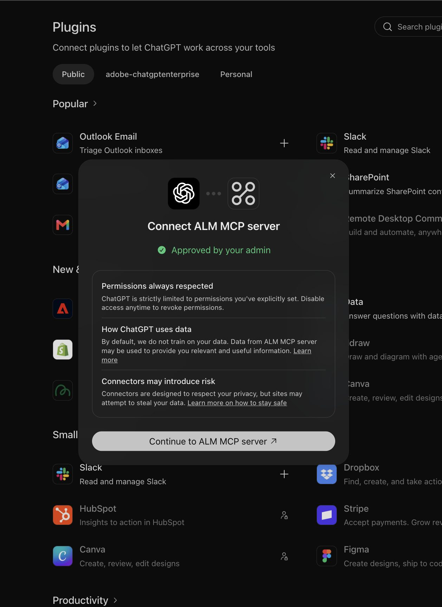

# Konfigurieren des Adobe Learning Manager MCP-Servers

## Übersicht

Die Konfiguration erfolgt in zwei Schritten. Erstellen Sie zunächst einen MCP-Server in Adobe Learning Manager. Zweitens, verbinden Sie den Server mit Ihrem KI-Assistenten. Anschließend authentifizieren sich die Teilnehmer über den AI-Assistenten bei Adobe Learning Manager und können dann die MCP-Tools verwenden.

## Voraussetzungen

* Der MCP-Server ist für Ihr Learning Manager-Konto aktiviert. Wenden Sie sich an Ihren Adobe Customer Success Manager oder den Adobe-Support, um ihn zu aktivieren. Bis dahin gibt jede Anforderung 403 Forbidden zurück.
* Der MCP-Server ist ein Backend-Flag-Feature, das nur für **Ultimate Tier**-Konten verfügbar ist.
* Der Administrator Ihres KI-Assistenten hat die Berechtigung, Verbindungen auf dieser Plattform hinzuzufügen und zu konfigurieren.

## Funktionsweise

Ein MCP-Client, z. B. Claude oder ChatGPT, sendet Anfragen zusammen mit dem OAuth-Zugriffstoken des Teilnehmers an die URL des MCP-Servers. Jedes Tool wird mit den Berechtigungen des Teilnehmers ausgeführt, für den das Token steht. Ein Teilnehmer kann daher über den MCP-Server nur das tun, was ihm in Adobe Learning Manager bereits gestattet ist.

Der Server verwendet den OAuth 2.0-Autorisierungscodefluss. Der AI-Assistent authentifiziert sich als vertraulicher Client über die Client-ID und das Client-Geheimnis einer Adobe Learning Manager-Anwendung. Der Server unterstützt keine dynamische OAuth-Clientregistrierung.

## Erstellen eines MCP-Servers im Learning Manager

Beim Erstellen eines MCP-Servers wird eine OAuth-Anwendung eingerichtet und die URL des MCP-Servers, die Client-ID und der geheime Schlüssel des Clients angegeben.

1. Melden Sie sich bei Learning Manager als Integrationsadministrator an.
2. Wählen Sie im Navigationsmenü **MCP-Server** aus.
3. Wählen Sie in der oberen rechten Ecke **Erstellen** aus.

   

4. Geben Sie auf der Seite **Anwendungsdetails** Folgendes ein, und wählen Sie dann **Weiter** aus:

   * **Anwendungsname:** Geben Sie bis zu 50 Zeichen ein, z. B. ALM für Claude. Teilnehmer sehen diesen Namen, wenn sie die Verbindung autorisieren. Wählen Sie daher einen Namen aus, den sie erkennen.
   * **Domänen umleiten:** Geben Sie die Rückrufdomäne jedes AI-Assistenten ein, eine Domäne pro Zeile. Beginnen Sie jeweils mit und schließen Sie keinen Pfad ein. Dieses Feld ist erforderlich.
   * **Beschreibung:** Geben Sie beispielsweise bis zu 150 Zeichen ein, damit Teilnehmer ALM von Claude verwenden können.

5. Überprüfen Sie auf der Seite **Tool-Konfiguration** die Tools und Beschreibungen, die AI-Assistenten verwenden, um zu entscheiden, wann sie jedes Tool aufrufen. Um eine Beschreibung zu ändern, wählen Sie **Aktionen** (**...**) > **Bearbeiten**. Wählen Sie &quot;**Zurücksetzen**&quot;, um den Standardwert wiederherzustellen. Wählen Sie dann **Weiter**.
6. Kopieren Sie auf der Seite **Clientanmeldeinformationen** die **MCP-Server-URL**, die **Client-ID** und den **Clientschlüssel**. Speichere Formulare sicher. Sie benötigen sie, um Ihren KI-Assistenten zu verbinden.

Der MCP-Server verfügt immer über den Teilnehmerbereich, sodass keine Bereiche ausgewählt werden können.

Registrieren Sie die Domäne für jeden KI-Assistenten, den Sie verbinden möchten.

| **KI-Assistent** | **Domäne in Registrierung umleiten** | **Vollständige Rückruf-URL (Referenz)** |
|----|----|----|
| Claude | [https://claude.ai](https://claude.ai/) und [https://claude.com](https://claude.com/) | <https://claude.ai/api/mcp/auth_callback> |
| ChatGPT | [https://chatgpt.com](https://chatgpt.com/) | <https://chatgpt.com/connector/oauth/&lt;id>\> (ChatGPT zeigt die ID während der Einrichtung an) |

>[!IMPORTANT]
>
>Registrieren Sie exakte Domänen, z. B. [https://chatgpt.com](https://chatgpt.com/). Verwenden Sie keine partiellen Platzhalter wie [https://*chatgpt.com*](https://chatgpt.com)*, da sie mit nicht verwandten Domänen übereinstimmen können. Verwenden Sie zum Zulassen von Unterdomänen einen Platzhalter für die gesamte Beschriftung, z. B.* [*https://*.example.com](https://encoded-592c9deb-987b-4562-aa3c-9fa3d37d83e9.uri/https%3a%2f%2f.example.com).

Ein MCP-Server kann mehrere AI-Assistenten bereitstellen, wenn Sie alle Umleitungsdomänen auflisten. Um einem Assistenten den Zugriff zu entziehen, ohne die anderen zu beeinträchtigen, erstellen Sie für jeden Assistenten einen separaten MCP-Server. Alle Server verwenden dieselbe MCP-Server-URL.

Sie benötigen nur die MCP-Server-URL. Claude und ChatGPT erkennen automatisch die Learning Manager OAuth-Endpunkte. Zeigen Sie für die manuelle Einrichtung [OAuth-Endpunkte für den Learning Manager-MCP-Server ](#oauth-endpoints-reference) an.

## MCP-Client anschließen

Der Administrator Ihres KI-Assistenten verbindet den MCP-Server. Clientschnittstellen ändern sich häufig. Wenn diese Schritte nicht mehr übereinstimmen, lesen Sie die Dokumentation des Clients.

>[!NOTE]
>
>Der AI-Client definiert die Antworten, die das Tool answer_learning_content_question zurückgibt, neu und formatiert sie, sodass die Ausführlichkeit der Antworten je nach Client variieren kann.

Vergewissern Sie sich vor dem Start, dass der MCP-Server für Ihr Konto aktiviert ist und dass Sie die URL des MCP-Servers, die Client-ID und den Client-Schlüssel aus dem vorherigen Abschnitt verwenden.

### Connect Claude Pro oder Max

**Hinweis:** Der Ausführlichkeitsgrad der Antworten auf gestellte Fragen ändert sich, wenn Antworten des Tools answer_learning_content_question von den Clients neu ausgerichtet und formatiert werden.

1. Wechseln Sie in Claude zu **Anpassen** \> **Verbindungen**.
2. Wählen Sie **Hinzufügen** (+) aus, und wählen Sie dann **Benutzerdefinierte Verbindung hinzufügen** aus.
3. Geben Sie die Details zur Verbindung ein und wählen Sie **Weiter**:

   1. **Name:** Geben Sie einen Namen ein, den Ihre Teilnehmer erkennen, z. B. Adobe Learning Manager.
   2. **URL des MCP-Remoteservers:** Geben Sie die URL des MCP-Servers von der Seite &quot;Clientanmeldeinformationen&quot; im Format [https://\[alm-host\]/v1/mcp](https://[alm-host]/v1/mcp) ein.

4. Halten Sie unter **Authentifizierung** **Jetzt anmelden**. Claude liest die OAuth-Einstellungen des Learning Manager und markiert entsprechende Optionen als *Erkannt*.
5. Wählen Sie unter **OAuth-Client** die Option **Einen eigenen OAuth-Client verwenden** aus. Fügen Sie die **Client-ID** und **Client-Geheimnis** ein.
6. Wählen Sie **Hinzufügen** aus. Claude öffnet die Anmeldeseite des Learning Manager. Nachdem Sie sich angemeldet haben, wird die Verbindung als verbunden angezeigt.

>[!NOTE]
>
>Claude bezeichnet das Feld &quot;Client-Geheimnis&quot; als optional, aber Learning Manager erfordert es. Wenn Sie das Feld leer lassen oder einen falschen Wert eingeben, schlägt die Anmeldung fehl und die Meldung &quot;Autorisierung fehlgeschlagen&quot; wird angezeigt.

### Connect Claude Team oder Enterprise

Die Verbindung kann nur von einem Organisationseigentümer oder einem Mitglied mit einer Rolle, die Verbindungen verwalten kann, hinzugefügt werden. Mitglieder sehen nie die Client-ID oder den geheimen Schlüssel des Clients.

>[!NOTE]
>
>Die Ausführlichkeit der Antworten auf gestellte Fragen ändert sich, wenn Antworten vom Werkzeug answer_learning_content_question von den Clients neu ausgerichtet und formatiert werden.

1. Melden Sie sich in Claude als Unternehmenseigentümer oder als Mitglied mit der Berechtigung zum Verwalten von Verbindungen an.
2. Wechseln Sie zu **Organisationseinstellungen** \> **Verbindungen**.
3. Wählen Sie **Hinzufügen** aus, bewegen Sie den Mauszeiger über **Benutzerdefiniert** und wählen Sie dann **Web** aus.
4. Geben Sie den Namen und die MCP-Server-URL ein und legen Sie dann **Authentication** und **OAuth-Client** fest, wie in den Schritten 4 und 5 der vorherigen Prozedur beschrieben.
5. Wählen Sie **Hinzufügen** aus.

Die Verbindung steht jetzt Ihrer Organisation zur Verfügung. Jedes Mitglied wählt **Connect** aus und meldet sich mit seinem eigenen Konto beim Learning Manager an.

### Connect ChatGPT Team oder Enterprise

>[!NOTE]
>
>Die Ausführlichkeit der Antworten auf gestellte Fragen ändert sich, wenn Antworten vom Werkzeug answer_learning_content_question von den Clients neu ausgerichtet und formatiert werden.

1. Melden Sie sich bei ChatGPT als Arbeitsbereichseigentümer oder Administrator an.
2. Klicken Sie in der linken Seitenleiste auf **Plug-Ins**.
3. Klicken Sie in der oberen rechten Ecke auf **Hinzufügen** und wählen Sie **MCP-App erstellen** aus.
4. Konfigurieren Sie im Fenster **Neues Plug-in** die Verbindung:

   * **Name:** Adobe Learning Manager oder der Name, mit dem Ihre Teilnehmer Ihre Lernplattform kennen, bis.
   * **Verbindung:**: **Server-URL** ausgewählt lassen und [https://\[alm-host\]/v1/mcp](https://[alm-host]/v1/mcp) eingeben
   * **Authentifizierung:** OAuth

   

5. Klicken Sie auf **Erweiterte OAuth-Einstellungen**. ChatGPT erkennt die ALM OAuth-Endpunkte automatisch.
6. Halten Sie unter **Clientregistrierung** die **Registrierungsmethode** auf **Benutzerdefinierter OAuth-Client** festgelegt, und geben Sie dann in Schritt 1 die **OAuth-Client-ID** und das **OAuth-Client-Geheimnis** ein.
7. Überprüfen Sie die **Rückruf-URL**, die in diesem Bereich angezeigt wird. Die Domäne (<https://chatgpt.com>) muss sich in den **Domänen umleiten** des MCP-Servers aus Schritt 1 befinden.

   

       **Endpunkte werden automatisch erkannt**
   
   Normalerweise müssen Sie die OAuth-Endpunkte nicht ändern. Wenn ChatGPT nach ihnen fragt, verwenden Sie: Auth-URL [https://\[alm-host\]/oauth/o/authorize](https://[alm-host]/oauth/o/authorize), Token-URL [https://\[alm-host\]/oauth/token](https://[alm-host]/oauth/token), Registrierungs-URL leer, Ressource [https://\[alm-host\]/v1/mcp](https://[alm-host]/v1/mcp), Bereichsteilnehmer:write.

8. Wählen Sie **Ich verstehe und möchte fortfahren**, und klicken Sie dann auf **Erstellen**.
9. Klicken Sie im Fenster **Connect** auf **Weiter** und melden Sie sich bei ALM an. Im Fenster sollte &quot;*Genehmigt von Ihrem Administrator*&quot; angezeigt werden.
10. Stellen Sie das Plug-in den Zielbenutzern in Ihrem Arbeitsbereich zur Verfügung.

    

## Endbenutzerauthentifizierung

Nachdem der Administrator die Konfiguration abgeschlossen hat, fügen die Teilnehmer die Adobe Learning Manager-Verbindung aus der Liste der Verbindungen ihres AI-Assistenten hinzu und wählen &quot;Verbinden&quot;. Dadurch wird die Adobe Learning Manager-Anmeldeseite geöffnet. Nachdem sich der Teilnehmer angemeldet hat (über SSO, falls das Konto dies verwendet) und den Zugriff genehmigt hat, wird der AI-Assistent mit dem Adobe Learning Manager-Konto des Teilnehmers verknüpft.

>[!NOTE]
>
>Wenn der Browser bereits über eine aktive Adobe Learning Manager-Sitzung verfügt, stellt der Assistent eine Verbindung zu diesem Benutzer her, ohne Anmeldeinformationen anzufordern. Um die Verbindung als anderer Benutzer herzustellen, melden Sie sich zuerst bei Adobe Learning Manager ab oder verwenden Sie ein privates Browserfenster.

Die Authentifizierung ist ein einmaliger Schritt. Wenn der Zugriff eines Teilnehmers widerrufen wird oder seine Sitzung abläuft, fordert der Assistent ihn auf, sich erneut anzumelden.

## Client-Geheimnis drehen oder Zugriff widerrufen

Sie können einen Client-Schlüssel nicht neu generieren. Drehen:

1. Erstellen Sie einen neuen MCP-Server, wie weiter oben in diesem Artikel beschrieben.
2. Aktualisieren Sie Ihren AI-Assistenten mit der neuen Client-ID und dem Client-Geheimnis.
3. Wählen Sie in **Integrations-Admin** > **MCP-Server** **Aktionen** (**...**) > **Löschen** für den alten Server aus.

Teilnehmer müssen sich nach dem Wechsel erneut anmelden.

Um einen AI-Assistenten für alle Teilnehmer zu trennen, löschen Sie seinen MCP-Server von derselben Seite.

## Verfügbare Tools

Der MCP-Server legt die folgenden Tools. Sie alle werden mit den Berechtigungen des angemeldeten Teilnehmers ausgeführt.

<table>
<colgroup>
<col style="width: 46%" />
<col style="width: 31%" />
<col style="width: 21%" />
</colgroup>
<thead>
<tr>
<th><strong>Werkzeug</strong></th>
<th><strong>Zweck</strong></th>
<th><strong>Beispielaufforderungen</strong></th>
</tr>
</thead>
<tbody>
<tr>
<td>search_learning_items</td>
<td>Durchsucht den Katalog nach Kursen, Lernpfaden, Zertifizierungen, Arbeitshilfen, Abzeichen, Kenntnissen, Katalogen und Tags. Filter: Typ, Teilnehmerstatus, Kenntnisse, Tag, Katalog, Bereitstellungsformat, Preis und Sprache. Gibt bis zu zehn Ergebnisse pro Seite zurück.</td>
<td>"Python-Anfängerkurse" 
"Kostenlose Schulungen im Klassenzimmer auf Französisch"</td>
</tr>
<tr>
<td>list_my_learning_enrollments</td>
<td>Listet die registrierten, laufenden und abgeschlossenen Lernergebnisse des Teilnehmers mit Status, Fortschritt und Termin auf. Zuletzt registriert zuerst standardmäßig.</td>
<td>"Wofür registriere ich mich?" 
"Was ist bald fällig?" 
"Meine abgeschlossenen Schulungen"</td>
</tr>
<tr>
<td>get_learning_object</td>
<td>Ruft alle Details eines Kurses, eines Lernpfads, einer Zertifizierung oder einer Arbeitshilfe nach ID ab, optional einschließlich Instanzen, Kenntnissen und Unterelementen.</td>
<td>"Erzählen Sie mir mehr über den zweiten Kurs"</td>
</tr>
<tr>
<td>get_my_learning_profile</td>
<td>Ruft das ALM-Profil des Teilnehmers ab, einschließlich Konto und Manager.</td>
<td>"Wer ist mein Manager in ALM?"</td>
</tr>
<tr>
<td>answer_learning_content_question</td>
<td>Beantwortet Fragen zum Kursthema mit dem ALM Learning Assistant, basierend auf Kursinhalten mit Zitaten. Gibt eine Konversations-ID zurück, die der Assistent für Anschlussfragen verwendet.</td>
<td>"Erläutern Sie TCP und UDP, wie in meinem Netzwerkkurs beschrieben."</td>
</tr>
<tr>
<td>personalized_learning_path</td>
<td>Bietet personalisierte Lernpfade in Adobe Learning Manager, die auf die Ziele, Themen und Lernanforderungen eines Teilnehmers zugeschnitten sind. Unterstützt das Generieren von Kursempfehlungen, das Speichern eines ausgewählten Lernpfads im Teilnehmerkonto, das Auflisten der gespeicherten Lernpfade des Teilnehmers (Aktionsliste) und das Abrufen der Details und Kurse eines gespeicherten Lernpfads anhand seiner ID (Aktionsdetails). Hilft Teilnehmern, relevante Lerninhalte zu identifizieren, um Kompetenzen zu entwickeln und Lernziele zu erreichen.</td>
<td>"Speichern Sie den ausgewählten Lernpfad in meinem Konto."</td>
</tr>
</tbody>
</table>

Konversationen, die durch answer_learning_content_question gestartet wurden, werden im Bericht &quot;Teilnehmer-AI-Konversation&quot; angezeigt, genau wie Konversationen im ALM-Lernassistenten.

## Einschränkungen

| **Limit** | **Wert** |
|----|----|
| Ergebnisse pro Seite (Suche und Registrierung) | Bis zu zehn. Verwenden Sie den zurückgegebenen Cursor für weitere Seiten. |
| answer_learning_content_question rate | 10 Anfragen pro Minute pro Teilnehmer (maximal 5 Anfragen), höchstens 2 Anfragen gleichzeitig |
| Unterstützte MCP-Protokollversionen | 2025-11-25, 2025-06-18, 2025-03-26 |
| Transport | Streamable HTTP, statuslos (nur POST; kein vom Server gesendeter Ereignisstream) |

## Referenz zu OAuth-Endpunkten {#oauth-endpoints-reference}

Claude und ChatGPT entdecken diese automatisch. Hier finden Sie eine Liste der Clients oder Proxys, die manuell eingegeben werden müssen. Ersetzen Sie `alm-host` durch den Host in Ihrer MCP-Server-URL (Ihr Regionshost oder die benutzerdefinierte ALM-Domäne).

| **Wert** | **URL** |
|----|----|
| MCP-Server-URL | [https://\[alm-host\]/v1/mcp](https://[alm-host]/v1/mcp) |
| Autorisierungs-URL | [https://\[alm-host\]/oauth/o/authorize](https://[alm-host]/oauth/o/authorize) |
| Token-URL | [https://\[alm-host\]/oauth/token](https://[alm-host]/oauth/token) |
| URL aktualisieren | [https://\[alm-host\]/oauth/token/refresh](https://[alm-host]/oauth/token/refresh) |
| Autorisierungsserver-Basis | [https://\[alm-host\]](https://[alm-host]) |
| Ressource | [https://\[alm-host\]/v1/mcp](https://[alm-host]/v1/mcp) |
| Umfang | Teilnehmer:write |

## Fehlerbehebung

| **Symptom** | **Ursache und Korrektur** |
|----|----|
| Nicht registrierte Umleitung während der Anmeldung | Die Rückrufdomäne des AI-Assistenten befindet sich nicht in den **Umleitungsdomänen** der Anwendung. Fügen Sie ihn hinzu (z. B. <https://claude.ai>), und versuchen Sie es erneut. |
| Die Anmeldung ist erfolgreich, dann meldet der Assistent, dass die Autorisierung fehlgeschlagen ist (ungültiger Client) | Der im Assistenten eingegebene Client-Schlüssel stimmt nicht mit der Anwendung überein. Kopieren Sie es erneut aus ALM, suchen Sie nach zusätzlichen Leerzeichen und stellen Sie die Verbindung wieder her. |
| Alle Anforderungen geben 403 Forbidden zurück | Der MCP-Server ist für Ihr Konto nicht aktiviert. Wenden Sie sich an den Adobe-Support. |
| Als falscher ALM-Benutzer verbunden | Der Browser hatte bereits eine ALM-Sitzung. Trennen Sie die Verbindung, melden Sie sich von ALM ab (oder verwenden Sie ein privates Fenster) und stellen Sie die Verbindung wieder her. |
| &quot;Ratenlimit überschritten&quot; aus dem Fragen-und-Antworten-Tool | Der Teilnehmer hat das F&amp;A-Ratenlimit überschritten. Warten Sie eine Minute und versuchen Sie es erneut. |
| Der Assistent bittet um erneute Anmeldung | Das Teilnehmertoken ist abgelaufen oder wurde widerrufen. Klicken Sie erneut auf **Verbinden**. |

## Häufig gestellte Fragen

**Können Teilnehmer den MCP-Server verwenden, ohne dass ein Administrator ihn eingerichtet hat?**
Anzahl Ein Integrationsadministrator muss in Adobe Learning Manager einen MCP-Server erstellen (Schritt 1), da der MCP-Server keine dynamische Clientregistrierung unterstützt.

**Können wir unsere eigene Domäne verwenden?**
Ja. Wenn Ihr Adobe Learning Manager-Konto über eine benutzerdefinierte Domäne verfügt, verwenden Sie diese anstelle von `alm-host` in allen URLs.

**Welche ALM-Rollen können den MCP-Server verwenden?**
Jeder Adobe Learning Manager-Benutzer kann eine Verbindung herstellen. Die Tools werden im Teilnehmerkontext eingesetzt, und die Berechtigungsprüfungen von ALM gelten für jede Anforderung.
