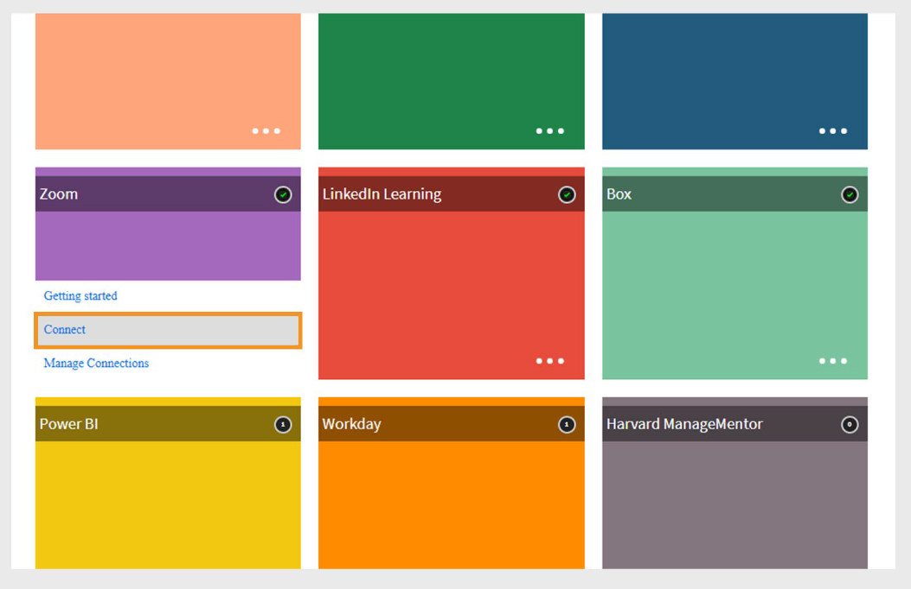

# Verbindung in Adobe Learning Manager zoomen

## Einführung

Mit der Zoom-Verbindung in Adobe Learning Manager können Unternehmen virtuelle Live-Sitzungen im Klassenzimmer bereitstellen, die Registrierung von Teilnehmern verwalten sowie die Anwesenheit und den Abschluss verfolgen. Es unterstützt auch mehrere Zoom-Verbindungen innerhalb eines einzigen Kontos, sodass Integrationsadministratoren den Zugriff basierend auf Rollen oder Benutzergruppen verwalten können und Autoren verfügbare Verbindungen für Kurssitzungen auswählen können. Nach der Sitzung werden die Anwesenheits- und Leistungsdaten wieder mit Adobe Learning Manager synchronisiert, um Berichte und Nachverfolgung zu erstellen.

## Einrichten der Zoom-Verbindung

So konfigurieren Sie die Zoom-Verbindung:

1. Melden Sie sich bei Adobe Learning Manager als Integrationsadministrator an.
2. Bewegen Sie den Mauszeiger über die Kachel **Zoom**.

   
   _Zoom-Verbindung in Adobe Learning Manager konfigurieren_

3. Wählen Sie **Verbinden**. Die Einrichtungsseite der Zoom-Verbindung wird geöffnet.
4. Geben Sie die folgenden Kontodetails in die entsprechenden Felder ein. Sie können diese Anmeldedaten von Ihrem Zoom-Kontoadministrator erhalten:

   * Name der Verbindung
   * Konto-ID zoomen
   * Client-ID
   * Client-Geheimnis
   * E-Mail-Adresse des Super-Administrators
   * Rollen oder Gruppen, die diese Verbindung verwenden können (optional)

   
   _Geben Sie die Konfigurationsdetails zum Einrichten der Zoom-Verbindung ein_

5. Wählen Sie **Verbinden**, um die Integration einzurichten.

>[!NOTE]
>
>Wenn Sie die Verbindung aktivieren, müssen **Teilnehmer die gleiche E-Mail-Adresse** für ihre Zoom- und Adobe Learning Manager-Konten verwenden, um sicherzustellen, dass die Benutzerdaten ordnungsgemäß synchronisiert werden.

## Mehrere Zoom-Verbindungen hinzufügen

Sie können Adobe Learning Manager mehrere Zoom-Verbindungen hinzufügen, wobei jede Verbindung mit einem anderen Zoom-Konto verknüpft ist. Beispielsweise können Sie separate Verbindungen für verschiedene Partner oder Teams erstellen und angeben, welche Rollen oder Benutzergruppen jede Verbindung verwenden können.

Die Anzahl der Verbindungen, die Sie hinzufügen können, hängt von Ihrer Adobe Learning Manager-Kontoebene ab:

| **Kontoebene** | **Maximale Zoomverbindungen** |
|---|---|
| Prime- | 6 |
| ultimativ | 50 |

## Zoom-Kurse erstellen

Sobald die Verbindung hergestellt ist:

1. Melden Sie sich als **Autor** an und erstellen Sie einen neuen Kurs für virtuelle Klassenzimmer.
2. Wählen Sie **Zoom** als Konferenzsystem aus und wählen Sie dann die zu verwendende Zoom-Verbindung aus der Liste aus.
   >[!NOTE]
   >
   >In der Liste werden nur die Verbindungen angezeigt, die für Ihre Rolle oder Benutzergruppe verfügbar sind, und in einer Sitzung wird jeweils eine Verbindung verwendet.
3. Weisen Sie dem Kurs Teilnehmer über Administratoren, Manager oder durch Selbsteinschreibung zu.
4. Nach der Registrierung erhalten die Teilnehmer eine E-Mail mit Kursdetails.
5. Teilnehmer können sich bei ihrem Adobe Learning Manager-Konto anmelden, um auf den Kurs zuzugreifen und an der Zoom-Sitzung teilzunehmen.

## Für Autoren verfügbare Zoom-Verbindungen

Wenn Sie eine Kurssitzung erstellen oder bearbeiten, können Sie aus den Zoom-Verbindungen auswählen, die für Ihre Rolle oder Benutzergruppe verfügbar sind. Der Integrations-Admin legt fest, welche Rollen oder Benutzergruppen auf die einzelnen Zoom-Verbindungen zugreifen können.

Beispiel: Ein Integrationsadministrator konfiguriert zwei Zoomverbindungen, **Partner A Zoom** und **Partner B Zoom**, und weist jede Verbindung einer anderen Benutzergruppe zu:

* Wenn Sie sowohl der Gruppe Partner A als auch der Gruppe Partner B angehören, können Sie eine der beiden Verbindungen auswählen.
* Wenn Sie nur der Gruppe &quot;Partner A&quot; angehören, können Sie **Partner A Zoom** auswählen.
* Wenn Sie keiner der Gruppen angehören, können diese Verbindungen nicht ausgewählt werden.

>[!NOTE]
>
>Sie können nur eine Zoom-Verbindung für eine Sitzung verwenden. Wenn mehrere Verbindungen verfügbar sind, wählen Sie die Verbindung aus, die Sie für die Sitzung verwenden möchten.

## Verwalten von Zoom-Verbindungen

Auf der Seite **Verbindungen verwalten** werden die für Ihr Konto konfigurierten Zoom-Verbindungen angezeigt. Die Spalte **Sichtbar für** zeigt die Rollen oder Benutzergruppen an, die jede Verbindung verwenden können. Auf dieser Seite können Sie vorhandene Zoom-Verbindungen bearbeiten, aktivieren oder deaktivieren und löschen.

### Bearbeiten einer Zoom-Verbindung

Bearbeiten einer vorhandenen Zoom-Verbindung

1. Wählen Sie auf der Seite **Verbindungen verwalten** die Verbindung aus, die Sie bearbeiten möchten.
1. Aktualisieren Sie auf der Registerkarte &quot;Konfigurieren&quot; eine der folgenden Optionen:

   1. Um die Anmeldeinformationen für das Zoom-Konto zu aktualisieren, wählen Sie **Bearbeiten** neben **Anmeldeinformationen** aus und aktualisieren Sie die erforderlichen Details.
   1. Um zu ändern, wer die Verbindung verwenden darf, aktualisieren Sie **Rollen oder Gruppen**, die diese Verbindung verwenden dürfen.

1. Wählen Sie **Speichern**.

### Zoom-Verbindung aktivieren oder deaktivieren

Neue Zoom-Verbindungen sind standardmäßig aktiviert. Sie können eine Verbindung deaktivieren, um zu verhindern, dass sie von Autoren verwendet wird, ohne die Verbindung zu löschen.

So deaktivieren Sie eine Verbindung

1. Wählen Sie auf der Seite **Verbindungen verwalten** die Verbindung aus, die Sie deaktivieren möchten.
1. Aktivieren Sie die **Verbindung aktivieren**.
1. Wählen Sie **Speichern**.

   Die deaktivierte Verbindung ist für Benutzer in den zugeordneten Rollen oder Gruppen nicht mehr verfügbar.

Um die Verbindung wieder zu aktivieren, wählen Sie **Verbindung aktivieren** und dann **Speichern**.

### Löschen einer Zoom-Verbindung

Löschen einer Zoom-Verbindung

1. Navigieren Sie auf der Seite **Verbindungen verwalten** zu der Verbindung, die Sie löschen möchten.
1. Wählen Sie das Symbol **Löschen** neben der Verbindung aus.
1. Wählen Sie **Löschen** aus.

## Anwesenheit und Abschluss verfolgen

Nach dem Ende der virtuellen Sitzung:

* Adobe Learning Manager erhält automatisch den Abschlussstatus von Zoom.
* Administratoren können Anwesenheits- und Bewertungsberichte in Adobe Learning Manager anzeigen, um die Teilnahme und Leistung der Teilnehmer zu verfolgen.

## Erstellen einer Zoom-OAuth-Anwendung von Server zu Server

Um die Zoom-Verbindung mit Adobe Learning Manager verwenden zu können, müssen Sie eine Zoom-Server-zu-Server-OAuth-App erstellen und die erforderlichen Geltungsbereiche konfigurieren.

### Erforderliche OAuth-Geltungsbereiche

Stellen Sie beim Erstellen der Anwendung in Zoom sicher, dass die folgenden Bereiche ausgewählt sind:

| Was du willst | Dieses Schlüsselwort suchen | Dann wählen |
|---|---|---|
| Alle Benutzermeetings anzeigen | Versammlung | `meeting:read:meeting:admin, meeting:read:list_meetings:admin` |
| Alle Benutzermeetings anzeigen/verwalten | Versammlung | `meeting:update:meeting:admin, meeting:delete:meeting:admin, meeting:write:meeting:admin` |
| Berichtsdaten anzeigen | Bericht | `report:read:meeting:admin, report:read:user:admin` (Wählen Sie den Punkt aus, der Ihrem Endpunkt entspricht.) |
| Alle Benutzerinformationen anzeigen | Benutzer | `user:read:user:admin, user:read:list_users:admin` |
| Verwalten von Benutzenden | Benutzer | `user:update:user:admin, user:write:user:admin` |
| Meetingregistrierten hinzufügen | Registrant | `meeting:write:registrant:admin` |
| Alle Meetingteilnehmer auflisten | Registrant | `meeting:read:list_registrants:admin` |
| Unterkontensitzungen | Meeting + nach :master suchen | `meeting:write:meeting:master` |
| Bericht über Meetingteilnehmer | Teilnehmerin | `report:read:list_meeting_participants:admin` |

