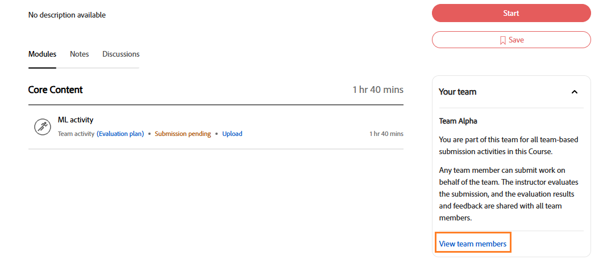

# Aufgabe als Team in Adobe Learning Manager einreichen

Zeigen Sie Ihr Team an, bearbeiten Sie die Aufgabe gemeinsam, laden Sie eine Datei für das gesamte Team hoch und überprüfen Sie das Testergebnis Ihres Teams.

Wenn Sie einem Team zugewiesen sind, erhalten Sie eine Benachrichtigung.

In einem Team-basierten Modul zur Dateiübermittlung kann jedes Team-Mitglied die Datei für alle Mitglieder desselben Teams hochladen. Ihr Kursleiter bewertet die Arbeit einmal und das Ergebnis gilt für das gesamte Team.

## Ihr Team und den Evaluierungsplan anzeigen

1. Öffnen Sie den Kurs in der Teilnehmer-App und rufen Sie dann die Seite &quot;Kursübersicht&quot; auf. Teamaktivitäten sind in der Kursübersicht als Teamaktivitäten gekennzeichnet.

   

1. Wählen Sie **Teammitglieder anzeigen** aus, um eine Liste anderer Teilnehmer anzuzeigen, die sich im selben Team wie Sie befinden.

   

1. Wenn Sie sich noch nicht in einem Team befinden, werden Sie in einer Meldung darüber informiert, dass die Aktivität beginnt, nachdem Sie einem Team zugewiesen wurden. Wenden Sie sich an Ihren Kursleiter oder Administrator.

1. Wenn der Autor es zulässt, sehen Sie sich an, worauf Sie bewertet werden. Sie können die Auswertungsplanbeschreibung und die Beschreibung der einzelnen Auswertungsparameter lesen. Sie können die Antwortoptionen, Punkte oder die Gewichtung nicht anzeigen.

Sie erhalten eine Benachrichtigung und eine E-Mail, wenn Sie einem Team hinzugefügt oder aus einem Team entfernt werden oder wenn ein Team-Mitglied hinzugefügt oder entfernt wird.

## Teamdatei senden

1. Öffnen Sie auf der Seite &quot;Kursübersicht&quot; die teambasierte Aktivität.

1. Stimmen Sie der Datei, die eingereicht werden soll, mit Ihrem Team zu. Wählen Sie **Hochladen**.

   

1. Lade die Datei hoch. Der Status ändert sich in **Auswertung ausstehend**. Sie können jedoch Ihre Einreichung überprüfen und eine andere Datei einreichen.

   

Ihr Kursleiter wird benachrichtigt. Jedes Team-Mitglied kann den Status und die gesendete Datei anzeigen und herunterladen. Alle Team-Mitglieder erhalten eine Benachrichtigung und eine E-Mail, wenn ein Mitglied sie erneut sendet oder sendet.

Um die Datei zu ersetzen, bevor sie genehmigt wurde, wählen Sie **Ansicht**/**Übermittlung ändern** aus, und laden Sie dann eine neue Datei hoch.

>[!NOTE]
>
>Wenn der Autor keine Genehmigung des Reviewers benötigt, wird die Aktivität für jedes Teammitglied abgeschlossen, sobald die Datei eingereicht wurde.

## Ergebnis anzeigen

1. Öffnen Sie die teambasierte Aktivität, nachdem sie von Ihrem Kursleiter ausgewertet wurde. Alle Team-Mitglieder erhalten eine Benachrichtigung.

1. Status anzeigen (z. B. genehmigt oder abgelehnt)

1. Lesen Sie die Kommentare des Kursleiters, wenn der Kursleiter sie angezeigt hat.

1. Wenn die Aktivität über einen Evaluierungsplan verfügt, können Sie den Namen des Reviewers, die ausgewählte Option für jeden Evaluierungsparameter, die schriftlichen Antworten sowie Anmerkungen anzeigen. Punkte für einzelne Optionen werden nicht angezeigt.

1. Wenn die Punktzahl aktiviert ist, sehen Sie sich die Gesamtpunktzahl Ihres Teams an.

Wenn für die Aktivität keine Genehmigung erforderlich ist, wird sie mit dem Ergebnis ausgewertet.

## Nach einer Ablehnung erneut senden

Wenn die Einreichung Ihres Teams abgelehnt wurde, lesen Sie die Kommentare und laden Sie dann eine neue Datei hoch. Ihre neue Datei ersetzt die vorherige.

## Fehlerbehebung

**In der Aktivität wird angegeben, dass Sie einem Team zugewiesen werden müssen.** Du bist noch nicht in einem Team. Wenden Sie sich an Ihren Kursleiter.

**Sie können nicht zu einer anderen Instanz wechseln.** Nach dem Senden Ihres Teams können Sie die Instanzen nicht mehr wechseln. Der Wechsel ist nur zulässig, wenn Ihr Team entsperrt ist.

**Die Übermittlung ist verschwunden, und der Status lautet &quot;Ausstehende Übermittlung&quot;.** Ihr Kursleiter hat die Einreichung aufgehoben und Sie haben eine Benachrichtigung und eine E-Mail erhalten. Laden Sie die Datei erneut hoch. Frühere Eingaben oder Kommentare werden nicht angezeigt.
