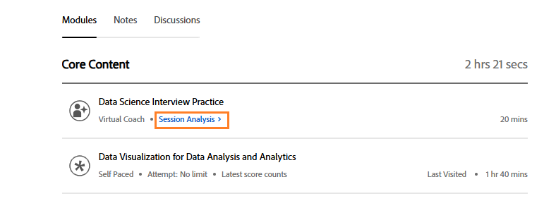
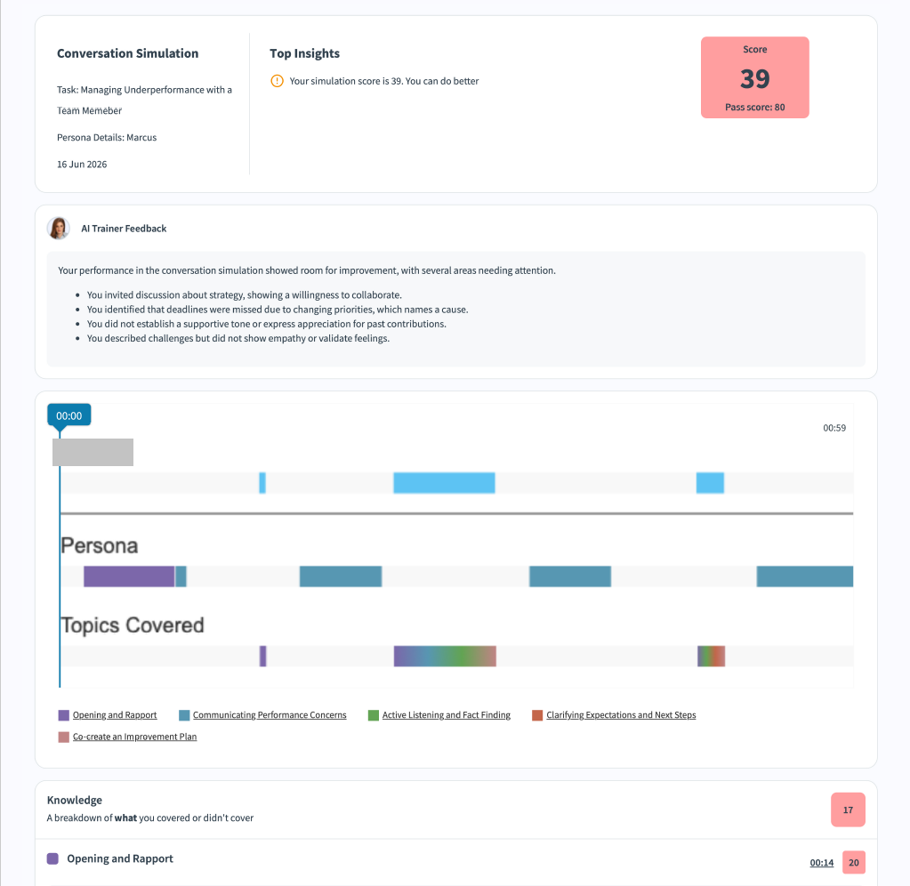

# Verstehen Ihres Virtual Coach-Leistungsberichts

Ihr Virtual Coach-Bericht zeigt, wie Sie in einem Rollenspiel aufgetreten sind, einschließlich der Themen, die Sie behandelt haben, wie Sie kommuniziert haben und bestimmter Bereiche, die vor Ihrem nächsten Versuch verbessert werden sollten.

Jede abgeschlossene Sitzung generiert automatisch einen Bericht. Greifen Sie sofort nach einer Sitzung darauf zu, indem Sie **Analyse anzeigen** auswählen oder jederzeit aus dem Sitzungsverlauf in **Meine Lernergebnisse** dorthin zurückkehren. Sie können den Bericht auch als PDF herunterladen, um ihn für Ihre eigenen Unterlagen aufzubewahren oder mit einem Manager zu teilen.

## Analyse Ihrer virtuellen Coach-Sitzung herunterladen

Laden Sie Ihre Sitzungsanalyse für Virtual Coach als signierte PDF in Adobe Learning Manager herunter und teilen Sie sie mit Ihrem Manager oder Kursleiter.

Nachdem Sie eine Virtual Coach-Sitzung abgeschlossen haben, generiert Adobe Learning Manager eine Leistungsanalyse. Sie können es erneut anzeigen, nachdem Sie den Player geschlossen haben, die Sitzung erneut durchführen und die Analyse als signierte PDF herunterladen.

1. Öffnen Sie den Kurs oder die Arbeitshilfe, der bzw. die Ihre virtuelle Coach-Sitzung enthält.

1. Wählen Sie **Sitzungsanalyse** aus.

   

1. Überprüfen Sie Ihre Analyse. Die Erstellung der Analyse kann einen Moment dauern.

1. Wählen Sie **Herunterladen** aus, um die signierte PDF der Analyse zu speichern.

Teilen Sie die PDF mit Ihrem Manager oder Kursleiter, um Ihre Leistung nachzuweisen. Die Datei enthält eine C2PA-Signatur. Weitere Informationen finden Sie unter [Informationen zu C2PA-Signaturen in Sitzungsanalyse-PDF](#c2pa-signatures).

### Informationen zu C2PA-Signaturen in PDF mit Sitzungsanalyse {#c2pa-signatures}

KI generiert die Sitzungsanalyse für den virtuellen Coach. Damit andere eine heruntergeladene Kopie als vertrauenswürdig einstufen, signiert der Lern-Manager die PDF mit einer [C2PA](https://c2pa.org/)-Signatur.

C2PA ist ein offener Industriestandard für Content-Authentizität. Adobe Learning Manager verwendet den gleichen Adobe-Signaturdienst wie andere Adobe-Produkte.

#### Was die Signatur enthält

Die Signatur ist ein kryptografisch signiertes Manifest, das in die PDF eingebettet ist. Er führt Folgendes aus:

* Die Analyse wurde von Adobe Learning Manager generiert.
* Die Analyse wurde zu einem bestimmten Datum erstellt.

#### Warum die Signatur wichtig ist

Wenn Sie die PDF für einen Manager oder Kursleiter freigeben, weist die Signatur darauf hin, dass die Datei authentisch ist und nach dem Herunterladen nicht bearbeitet wurde.

## Berechnung der Gesamtpunktzahl

Ihr Gesamtpunktzahl ist eine gewichtete Kombination aus zwei Komponenten: eine **Wissensbewertung** und eine **Stilbewertung**. Der Autor, der das Szenario erstellt hat, legt die Gewichtung der einzelnen Komponenten fest. Eine gängige Konfiguration ist 70 % Wissen und 30 % Stil, aber dies variiert je nach Szenario.

| Komponente | Was wird gemessen? | Typisches Gewicht |
|---|---|---|
| Wissen | Ob Sie die erforderlichen Themen behandelt und genaue Informationen bereitgestellt haben | 70% |
| Stil | Ihre Kommunikation - Bereitstellung, Geschwindigkeit, Klarheit und Zuverlässigkeit | 30% |

*Ihre Berichtskarte zeigt die genauen Gewichtungen an, die für Ihr Szenario konfiguriert wurden. Diese können sich von der hier angezeigten typischen Aufteilung unterscheiden.*

Ihre Gesamtpunktzahl wird auf einer Skala von 0 bis 100 angezeigt. Der Schwellenwert für das Bestehen wird vom Autor festgelegt und zusammen mit Ihrer Punktzahl angezeigt. Wenn Ihr Ergebnis den Schwellenwert erreicht oder überschreitet, bestehen Sie; Andernfalls können Sie die Sitzung erneut versuchen. Wenn ein erforderliches Thema als &quot;**Make or Break**&quot; konfiguriert wurde und Sie es während der Unterhaltung überhaupt nicht angesprochen haben, ist Ihr endgültiger Wert 0, unabhängig davon, wie gut Sie bei allem anderen gearbeitet haben.

## Wissensstand

Der Wissenswert spiegelt wider, was Sie während der Unterhaltung gesagt haben - ob Sie sich mit den Themen befasst haben, die der Autor für das Szenario konfiguriert hat.

### Themengliederung

Jedes Szenario verfügt über einen Satz erforderlicher Themen. Ihr Bericht enthält eine separate Punktzahl für jedes Thema und ein schriftliches Feedback, in dem erklärt wird, was Sie behandelt und was Sie verpasst haben. Themen sind in der Sitzungszeitleiste am unteren Rand des Berichts farbcodiert, sodass Sie genau sehen können, wann jedes Thema behandelt wurde.

**Beispielthemenergebnisse aus einem Discovery-Aufrufszenario:**

| Thema | Punktzahl | Zusammenfassung |
|---|---|---|
| Eröffnung und Berichterstattung | 40 | Die Verfügbarkeit wurde bestätigt, aber Sie haben sich nicht namentlich vorgestellt oder den Grund für die Kontaktaufnahme angegeben. |
| Klinische Glaubwürdigkeitsfeststellung | 60 | Identifizierter Prozess zur Erstellung und Überprüfung der Dokumente, aber die Bedenken der Person hinsichtlich ihrer Richtigkeit wurden nicht explizit anerkannt. |
| Implementierung und Ressourcenbewertung | 40 | Beschreibung der Personalausstattung und des Zeitplans, jedoch keine typischen Einrichtungsschritte und keine Bestätigung der Beteiligung der Stakeholder |
| Umgang mit Einwänden und Risiken | 0 | die Person nicht eingeladen hat, Risiken oder Zögerungen zu teilen, und keine Dokumentation oder Schritte zur Risikominderung angeboten hat, |
| Die nächsten Schritte vereinbaren | 20 | Einen Zeitplan für das Projekt vorgelegt, aber weder einen spezifischen Schritt mit geringem Engagement noch eine sichere mündliche Vereinbarung vorgeschlagen |

*Jede Topic-Bewertung zeigt genau an, auf welchen Teil der Konversation Sie sich vor Ihrem nächsten Versuch konzentrieren müssen.*

### So verbessern Sie Ihren Wissensstand

Jeder Themenabschnitt in Ihrem Bericht enthält spezifische, umsetzbare Anleitungen. Beispiel:

- **Wenn Sie bei Opening and Rapport:** einen niedrigen Wert erzielt haben, begrüßen Sie die Person nach Namen, geben Sie Ihren eigenen Namen an, verweisen Sie kurz auf den Grund für die Kontaktaufnahme und bestätigen Sie die Zeitbeschränkungen mit einem kurzen Öffner.
- **Wenn Sie bei der Behandlung von Einwänden und Risiken:** einen niedrigen Wert erzielt haben, laden Sie die Person explizit ein, Zögern zu teilen, bieten Sie an, eine Dokumentation bereitzustellen, wenn ein Problem aufgeworfen wird, und bestätigen Sie, dass das Problem behoben wurde, bevor Sie fortfahren.
- **Wenn Sie beim Zustimmen der nächsten Schritte zu wenig Punkte erzielt haben:** schlagen Sie einen klaren, unverbindlichen nächsten Schritt vor, bitten Sie darum, Materials per E-Mail zu teilen, bestätigen Sie das bevorzugte Timing und die Teilnehmer, und suchen Sie nach einer verbalen Vereinbarung oder einem eindeutigen Grund, nicht fortzufahren.

## Stil-Score

Die Punktzahl für &quot;Stil&quot; gibt an, wie Sie während der Unterhaltung kommuniziert haben, basierend auf fünf Zustellungsmetriken, die automatisch aus Ihrem Audio gemessen werden.

**Pace** misst Ihre Sprechgeschwindigkeit in Wörtern pro Minute (WPM). Der Zielbereich liegt zwischen 140 und 180 WPM - schnell genug, um sicher zu klingen, aber langsam genug, um klar verstanden zu werden. Unter 140 WPM war das Tempo etwas langsam; über 180 WPM war es zu schnell. Ihr Bericht zeigt Zeitstempel für die langsamsten und schnellsten Momente an, damit Sie sie in der Sitzungsaufzeichnung wiedergeben können.

**Die Klarheit** misst, wie verständlich Ihre Rede war. Ein Wert von 90 % oder mehr bedeutet, dass die Leute Sie gut verstehen können. Der Bericht kennzeichnet dies als Pass- oder Verbesserungsbereich.

**Füllwörter** sind Töne und Ausdrücke wie &quot;um&quot;, &quot;uh&quot;, &quot;like&quot;, &quot;you know&quot; und &quot;basic&quot;. Ihre Verwendung verringert häufig Ihre Glaubwürdigkeit und lenkt von Ihrer Botschaft ab. Ihr Bericht zeigt die Gesamtzahl und die Zeitstempel für jede Instanz an. Für eine dreiminütige Sitzung sind in der Regel vier oder weniger Füllwörter zulässig. Fünf oder mehr bedeuten, dass Sie die markierten Zeitstempel überprüfen und das Anhalten im Hintergrund üben sollten, anstatt die Lücke mit Ton zu füllen.

**Die Satzlänge** misst, ob Ihre Sätze prägnant und leicht zu befolgen sind. Der Zielbereich liegt zwischen 7 und 30 Wörtern pro Satz. Unter 7 Wörtern können Sätze gekürzt oder unvollständig klingen; Über 43 Wörter sind sie wahrscheinlich zu lang und verlieren möglicherweise die Aufmerksamkeit des Zuhörers. Ein Balkenindikator im Bericht zeigt an, wo Ihr Durchschnitt in dieses Spektrum fällt.

**Energie** misst Ihre stimmliche Begeisterung und Zuversicht während der gesamten Unterhaltung. Der Bericht zeigt eine Energiezeitleiste für die gesamte Sitzung an, farbcodiert von niedrig bis hoch. Konsistente Einschaltung von Signalen mit hoher Energie; In bestimmten Momenten lohnt es sich, Einblicke in die Session-Aufzeichnung zu nehmen, um zu verstehen, was sie verursacht hat.

## Sitzungsaufzeichnung und Timeline

Der Abschnitt **Sitzungsaufzeichnung** zeigt Ihre vollständige Unterhaltung als Videowiedergabe mit einer synchronisierten Zeitleiste an, die aus drei Spuren besteht: Ihre Redewendung, die Redewendung der Person und das benötigte Thema wurde an jedem Punkt angesprochen, farbcodiert, um der Tabelle mit den Themenaufschlüsselungen zu entsprechen. Mithilfe der Zeitleiste können Sie direkt zu bestimmten Momenten springen, z. B. zum Zeitstempel, wenn ein Thema versäumt wurde oder ein Füllwort markiert wurde.

## Best Practices

- **Überprüfen Sie zuerst Ihr Thema mit der niedrigsten Punktzahl.** Eine Verbesserung dort hat den größten Einfluss auf deine Gesamtpunktzahl.
- **Verwenden Sie die Themenzeitleiste, um das Timing zu überprüfen.** Wenn erforderliche Themen zu einem früheren Zeitpunkt in der Unterhaltung angesprochen werden, werden häufig sowohl das Wissen als auch die Punktzahl für den Stil verbessert.
- **Geben Sie die langsamsten WPM-Momente wieder.** Langsames Tempo wird oft durch die Suche nach dem richtigen Wort verursacht; Das Vorbereiten von Schlüsselsätzen kann hier hilfreich sein.
- **Behandeln Sie einen niedrigen Energiewert als Hinweis, um Ihre Öffnung zu überprüfen.** Die Energie ist tendenziell am höchsten zu Beginn und in der Mitte abzusinken. Wenn du deine Übergänge zwischen Themen übst, bleibt die Dynamik erhalten.
- **Wiederholen Sie das Rollenspiel.** Siehe [Rollenspiel mit virtuellem Coach üben](/help/migrated/learners/feature-summary/virtual-coach/practice-role-play-with-virtual-coach.md). Jeder Versuch erzeugt einen neuen, unabhängigen Bericht. So nutzt du das, was du von einer Sitzung zur nächsten gelernt hast.
